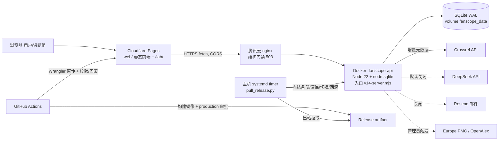

# FanScope V2.0 工程底座审计（Foundation Audit）

> 审计基线：`main` @ `12310c85229e5e8f99cb9249d449b6bb4d1481a8`（2026-10-29 fetch 后与 `origin/main` 一致，工作区干净）。
> 审计分支：`chore/v2-foundation-audit`。本轮只读审计 + 文档，没有修改业务代码、数据库、生产配置或云端设置，没有调用付费 API。
> 配套文档：[V2_TARGET_ARCHITECTURE.md](V2_TARGET_ARCHITECTURE.md) · [V2_INCREMENTAL_ROADMAP.md](V2_INCREMENTAL_ROADMAP.md)
>
> **2026-10-29 评审更新**：[V2_ARCHITECTURE_REVIEW.md](V2_ARCHITECTURE_REVIEW.md) 补充了本审计遗漏的 N1–N5，包括发布回滚丢失日志、启动期禁写约束和会议摘要混入；并按产品决定把 P1-2 从"金额上限"改为"失控防护"。发现编号保持不变，冲突时以评审文档为准。

## 0. 证据等级与阅读方式

| 标记 | 含义 |
| --- | --- |
| **代码核实** | 本轮直接阅读当前 `main` 源码得出，附文件与行号 |
| **测试核实** | 本轮在隔离环境实际运行得出（见 §9） |
| **远端核实** | 本轮通过 GitHub 公开 API 只读查询得出（未读取 Actions 日志正文） |
| **文档记载** | 仓库内既有文档或用户交接说明记录，本轮无法独立复现 |
| **Unverified** | 缺乏证据，不能当作已确认缺陷或已确认能力 |

风险等级：**P0** 有证据的生产数据丢失/严重安全/不可恢复故障；**P1** 新增大型 AI 功能前必须解决；**P2** 可边开发边改进；**P3** 可延后。

---

## 1. 结论摘要

**FanScope 当前底座适合继续扩展，但要先补一层"平台底座"，不能直接在现有结构上叠 AI 功能。**

值得肯定的是，安全与数据保护意识非常强：付费调用前预留账本、不确定请求不自动重放、模型引用必须是原文子串、中文导入前后对非中文表做全表指纹比对、后端发布前在冻结副本上演练并能自动回滚。这些机制应原样保留并推广。

主要短板集中在"为新功能预留扩展点"：

1. **没有显式、可审查的数据库迁移路径**，而后端 CD 会拒绝任何启动时的结构变化。因此第一个新增表的 V2 PR 无法经 CD 上线（P1-1）。
2. **AI 成本没有强制金额上限**，三处代码各自直接调用 DeepSeek，账本不统一（P1-2）。
3. **AI 结果原位覆盖写入 `articles` 行**，没有版本，也没有"来源事实 / 规则 / AI / 人工"的层级区分（P1-3）。
4. **日志不能支撑多步骤 AI 任务的诊断**：没有 request/job ID，异常只记 `message`，health 不含版本（P1-4）。
5. **生产运行时是"分阶段恢复"白名单模式**：新 POST 路由默认 503，发布控制器还会拒绝配置了 AI Key 的版本（P1-5）。
6. 数据层面：中文 349 条记录摘要为 0；英文 2026 年文章类型 98% 未确认；主题分类是 4 组关键词子串匹配。**现有数据只能支撑"摘要层面、部分样本"的研究设计分析**（P1-7）。

**本次没有发现有证据支持的 P0。** 异机备份未见证据，标为 Unverified 的 P1-6，建议尽快由管理员确认。

---

## 2. 现有系统架构（As-Is）

### 2.1 组件与部署

**运行入口**（代码核实）：

| 入口 | 用途 | 后台任务 |
| --- | --- | --- |
| [server.mjs](../../api/src/server.mjs#L184-L201) | 通用/本地开发入口 | 启动全部 worker：扫描、文档 AI、批次、回填、发现、摘要邮件 |
| [v14-server.mjs](../../api/src/v14-server.mjs) | **生产入口**（[production.yml](../../deploy/cicd/production.yml) 指定） | 仅英文增量监测 + 显式启用的英文 AI 队列；套用分阶段恢复白名单 |
| [staged-recovery-server.mjs](../../api/src/staged-recovery-server.mjs) | 恢复期入口 + 写入白名单包装器 | 英文监测 |
| [release-server.mjs](../../api/src/release-server.mjs) | 发布验收只读入口 | 无 |

### 2.2 模块地图

| 层 | 文件 | 职责 |
| --- | --- | --- |
| 配置 | `config.mjs`, `config/*.json` | 环境变量、44 本期刊、4 组主题词典 |
| 数据访问 + 迁移 | `db.mjs`（另有 `lab.mjs`、`project-workspace.mjs`、`manuscripts.mjs`、`metadata-enrichment.mjs`、`openalex.mjs`、`chinese-authorized-import.mjs` 在 import 时建表） | 39 张表，import 时执行加列/回填 |
| 采集 | `monitor.mjs`, `sources.mjs`, `rss-security.mjs`, `journal-*.mjs`, `chinese-*.mjs`, `metadata-enrichment.mjs`, `openalex.mjs` | Crossref/RSS 增量、回填、中文目录与授权导入、摘要补充 |
| 研究分析 | `research.mjs`, `publication-policy.mjs`, `brief.mjs` | 趋势统计、文章类型、相关性、AI 简报 |
| AI | `ai.mjs`, `analysis-batches.mjs`, `automatic-ai.mjs` | 摘要结构化提取、批次队列、英文持续队列 |
| Lab | `lab.mjs`, `project-workspace.mjs`, `manuscripts.mjs` | 登录会话、项目/论文/成员、会议文档 AI 建议与审批 |
| 通知 | `mail.mjs` | 订阅、即时与日/周摘要（生产关闭） |
| HTTP | `server.mjs` | 单函数 if 链路由（约 130 行），部分业务逻辑内联 |
| 发布 | `scripts/cicd/*`, `deploy/cicd/*`, `.github/workflows/*` | Pages 发布/回滚、后端拉取式发布、SQLite 备份恢复 |

### 2.3 关键数据流

1. **英文监测**：timer → `runEnglishMonitor` → `scanAll` → `crossrefPages`（增量按 index-date，回填按 pub-date，窗口游标持久化于 `scan_windows`）→ `insert`（DOI 规范化成 `doi:` 主键，URL 二次去重）→ `articles`。
2. **中文元数据**：离线 CLI [chinese-production-import.mjs](../../api/src/chinese-production-import.mjs)，要求包 SHA256、授权声明、目标期刊身份一致，在单事务中导入，并比对其他全部表的指纹。生产 HTTP 中文管理路由一律 404（[server.mjs:180](../../api/src/server.mjs#L180)）。
3. **摘要补充**：Europe PMC 按 DOI + ISSN 双重核验，只补空摘要，冲突类型降为 unknown（[metadata-enrichment.mjs:14-40](../../api/src/metadata-enrichment.mjs#L14-L40)）。
4. **AI 提取**：管理员创建/启动批次，或启用英文持续队列 → `analyzePending` 先在事务中领取并预留账本，再调用 DeepSeek → 校验每个字段的原文引用 → 写回 `articles`（[ai.mjs:58-106](../../api/src/ai.mjs#L58-L106)）。
5. **趋势/统计**：`/api/research`、`/api/stats` 每次请求都遍历时间窗内全部文章，并重新校验 AI 结果（[research.mjs:33-62](../../api/src/research.mjs#L33-L62)）。
6. **Lab 文档 AI**：上传 → `pdftotext`/`unzip` 提取 → DeepSeek 生成建议 → 原文引用校验 → 人工逐条审批 → `lab_events` 留痕（[lab.mjs:80-87](../../api/src/lab.mjs#L80-L87)、[lab.mjs:103-113](../../api/src/lab.mjs#L103-L113)）。
7. **发布**：见 §3.7。

### 2.4 数据资产清单（代码核实）

39 张表：

- **文献**：`articles`, `journals`, `journal_source_evidence`, `scan_windows`, `journal_backfill_jobs`, `journal_discovery_jobs`, `article_metadata_checks`, `provider_cache`
- **AI**：`analysis_batches`, `analysis_batch_items`, `analysis_usage_log`
- **Lab**：19 张 `lab_*` 表
- **通知**：`subscribers`, `deliveries`
- **运行**：`jobs`, `meta`, `schema_migrations`
- **仅本地**：`cn_import_*` 4 张（授权导入工作台）

`meta` 是通用 KV 表，承载 17 类以上命名空间，包括 `ai-auto:`, `cn-job:`, `cn-batch:`, `cn-source:`, `brief-budget:`, `document-ai-budget:`, `openalex-budget:`, `research-brief:`, `document-meta:`, `unsub:`, `cssci-review:`, `cn-production-import:`, `digest:`。

生产规模（文档记载，2026-10-28 准备时观察）：英文约 12,442 篇，已有 AI 分析 375 篇（[release-0d38926.md](../chinese-production-readiness/release-0d38926.md)）。中文 349 条是否已进入生产库：**Unverified**。仓库只有本地演练和导入工具记录，没有生产执行记录。

### 2.5 能力验证矩阵

| 能力 | 生产已验证 | 仅 CI/Mock/合成数据验证 | 未验证 |
| --- | --- | --- | --- |
| Pages 前端自动发布 | ✅ 远端核实：`12310c8` 的 checks 与 Pages deploy 运行均 success（runs 40820254534 / 40820794075 / 40822262177） | 回滚、失败自动回滚、预览画廊 | — |
| 后端拉取式 CD | — | Python 编排测试 17 项、CI Docker 演练（合成库） | ✅ 远端核实：`backend-release.yml` 运行次数 = 0；主机控制器安装、nginx 门禁、token 均未验证 |
| SQLite 在线备份 + 隔离恢复 | 文档记载：用户确认 2026-10-28 PASS | 合成库演练 | 异机副本、定期演练 |
| 英文增量监测 | 文档记载：生产 overlay 开启 | `monitor-scan`、`crossref-v12` 等 | 当前生产实际入口命令、启用期刊集合 |
| DeepSeek 文献 AI | 历史 375 条结果（文档记载） | `deepseek-json`、`automatic-ai-v14` 等（Mock） | 当前生产关闭，Key 被 overlay 置空 |
| Lab 登录/会话 | 白名单允许 | `lab*.test.mjs` | 实际使用情况 |
| Lab 写入、文档 AI | — | 测试覆盖 | 生产被 503 白名单阻断 |
| 邮件订阅 | — | `email-flow`（Mock） | 生产关闭 |
| 中文 349 条 | — | 本地两次导入演练、浏览器验收 | 生产执行 |

---

## 3. 八维审计

### 3.1 数据库与数据完整性

**现状（代码核实）**

- `PRAGMA journal_mode=WAL; busy_timeout=5000; foreign_keys=ON`（[db.mjs:23](../../api/src/db.mjs#L23)）。部分表有外键（`articles.journal_id`、批次条目、Lab 部分表）。状态字段基本没有 CHECK 约束（只有 `lab_users.role` 有）。
- 迁移在 `import db.mjs` 时执行（[db.mjs:16-150](../../api/src/db.mjs#L16-L150)）：
  - `addColumns` 幂等加列；
  - `schema_migrations` 只记录版本名；
  - 若干一次性全表重算（[db.mjs:108-129](../../api/src/db.mjs#L108-L129)，单个 `BEGIN IMMEDIATE`）；
  - 每次启动都扫描已分析行补指纹（[db.mjs:132-140](../../api/src/db.mjs#L132-L140)）；
  - 迁移前自动备份只针对 v1.2 之前的库（[db.mjs:19-21](../../api/src/db.mjs#L19-L21)）。
- 另外 6 个模块在 import 时 `CREATE TABLE IF NOT EXISTS`（例如 [lab.mjs:23-43](../../api/src/lab.mjs#L23-L43) 包含一次把私人备注移入归档表的数据迁移）。
- 事务：写操作普遍使用 `BEGIN IMMEDIATE`，而且**事务从不跨越网络 await**。例如 AI 领取在调用 DeepSeek 之前就提交了（[ai.mjs:76-82](../../api/src/ai.mjs#L76-L82)），这是正确做法，应作为 V2 规则保留。
- 备份/恢复：`sqlite_release.py` 用 SQLite Backup API 生成快照，然后做 integrity、外键、逐表有序指纹、隔离恢复比对（[sqlite_release.py:61-93](../../scripts/cicd/sqlite_release.py#L61-L93)）。质量很高。
- 兼容性：迁移只加列/加表，旧镜像通常能读新库。发布控制器会在冻结副本上演练候选镜像启动，**一旦发现结构或数据变化就拒绝**（[deploy_backend.py:112-121](../../scripts/cicd/deploy_backend.py#L112-L121)）。

**SQLite 能力评估（测试核实，合成数据）**：12,500 篇文章约 21 MB，100,000 篇约 216 MB。在这个量级上 SQLite 的存储与查询能力绰绰有余。真正的瓶颈是：

1. `node:sqlite` 是同步 API，长查询会阻塞整个事件循环（P2-1）；
2. 单写者（单进程时没有问题）；
3. `node:sqlite` 仍是实验 API（P2-9）。

本轮还验证了：FTS5 + trigram 分词在本机 Node 24（SQLite 3.53.4）上可用；对 2 字中文词，`MATCH` 返回 0 条，需要用 `LIKE` 兜底。**不需要因 V2 迁移 PostgreSQL。** 迁移触发条件见架构文档 §8。

**V2 如何不破坏论文、课题组与 Lab 数据**：

- V2 只新增表，对既有表只读；
- 复用 [chinese-production-import.mjs:19-25](../../api/src/chinese-production-import.mjs#L19-L25) 的"受保护表指纹"模式，作为迁移与 V2 写操作的回归测试；
- 迁移先在冻结副本演练；
- 静态测试禁止 V2 模块对 `articles`/`lab_*` 写入。

关联发现：P1-1、P1-3、P1-6、P2-1、P2-4、P2-9。

### 3.2 文献采集与科研数据质量

**现状**

- **来源**：配置 44 本期刊，其中 5 本英文 Crossref 启用；22 本中文中 RSS 3 本、manual 19 本，全部未启用自动监测；其余 17 本英文为 manual（[config/journals.json](../../api/config/journals.json)，代码核实）。生产实际启用集合：Unverified。
- **增量与去重**：Crossref 按 ISSN + index-date 窗口和 cursor 增量，失败不推进游标（[sources.mjs:55-98](../../api/src/sources.mjs#L55-L98)）。DOI 规范化为主键，同刊 URL 二次去重。中文用"题名+作者+卷期+日期"组合身份，相似题名不自动合并。
- **日期**：`publication_date` / `published_online_date` / `published_print_date` / `publication_date_partial` / `date_precision` 与 `discovered_at` / `indexed_at` / `metadata_fetched_at` 分列保存。**正式发表日期与系统首次发现日期已明确区分**，未来日期会被拒绝。这部分设计良好。
- **缺失字段**：`missing_fields_json`、`abstract_status` 如实记录，信息缺失时显示未知，不做推断。
- **授权**：中文导入要求授权声明或证据 URL，并保存在 `source_evidence_json`。中文来源策略文档已列出向各刊/数据库申请许可的模板（[chinese-source-strategy](../chinese-source-strategy/README.md)）。
- **失败检测**：每刊记录 `last_error` 与 `scan_windows.status`；`sourceSummary` 能计算出 `stale`，**但没有任何主动告警**（P2-10）。

**分类可信度**

| 字段 | 方法 | 可信度 |
| --- | --- | --- |
| 主题 `topics` | 4 组关键词子串匹配（[sources.mjs:4-7](../../api/src/sources.mjs#L4-L7)） | 低：`care` 组含 "养老"，会把"养老保险/养老金"判为长期照护；"公共政策"会命中大量无关论文；**没有社会保险/医保主题** |
| 文章类型 | 仅接受来源明确类型（[publication-policy.mjs:22-38](../../api/src/publication-policy.mjs#L22-L38)） | 准确但覆盖极低：2026 年确认原创研究 132、综述 39、社论 3，6,566 条未确认（[TRENDS-2026-ZH.md:39](../TRENDS-2026-ZH.md)，隔离审计库） |
| 设计/方法/样本/数据来源 | DeepSeek 仅读摘要，每字段要求原文子串引用，模型自报置信度 ≥0.7（[ai.mjs:16-26](../../api/src/ai.mjs#L16-L26)） | 有引用核验的部分可信，但只覆盖摘要层面和少量样本。置信度是模型自报，未经校准 |

**现有数据能否支持研究设计分析？只能部分支持。** 缺少的字段/证据/步骤：

1. 中文摘要（0/349，[chinese-bulk-backfill/README.md:26](../chinese-bulk-backfill/README.md)）；
2. 英文文章类型（约 98% 未确认）；
3. 全文或方法章节（没有授权全文渠道）；
4. 数据库名称（CHARLS/CFPS/CHFS/CGSS 等）作为结构化字段；
5. 识别策略（DID/RDD/IV/PSM）与因果声明强度；
6. 定性研究的访谈对象类型、样本规模、分析方法；
7. 变量与模型设定；
8. 社会保障领域的受控主题词表与中英对照；
9. 人工复核与抽样一致性评估（目前文献 AI 没有人工复核流程）。

关联发现：P1-7、P2-10、P2-14。

### 3.3 API 与模块边界

**现状**

- 路由是 [server.mjs:45-174](../../api/src/server.mjs#L45-L174) 中的单一 if 链。订阅、期刊排名审核等业务逻辑内联在路由中；各模块直接 `import {db}`，没有仓储层。以当前规模尚可接受，但 V2 不应继续往这个 if 链里追加。
- **耦合**：`db.mjs` 的迁移调用业务规则 `classifyArticleType`/`relevanceScore`，导致迁移结果依赖当时的代码版本；`chinese-ingestion` 依赖 `monitor.insertArticle` 与 `research.researchReport`。
- **认证**：公共只读接口不鉴权；管理接口使用单一共享 `X-Admin-Key`（[server.mjs:28](../../api/src/server.mjs#L28)），常数时间比较；Lab 使用 scrypt 密码 + 随机会话（哈希存储、7 天、`sessionStorage`）+ 角色（mentor/lab_admin/member）+ 实体级权限。
- **输入**：请求体大小限制（150 KB / 10 MB / 18 MB），数值钳制，JSON 解析错误返回 400；带 `status` 的异常把 message 返回客户端，其余返回"内部服务错误"。
- **超时与重试**：所有外部 `fetch` 都有 `AbortSignal.timeout`（Crossref 22 s、DeepSeek 55/95 s、Resend 25 s、RSS/OpenAlex 20 s）。Crossref 在 429/5xx 时按 Retry-After 退避；DeepSeek 对不确定请求不重试。
- **幂等**：订阅 upsert、`deliveries` 唯一键、AI 领取条件更新、Lab 建议重复审批返回 409。**没有通用请求幂等键。**
- **单请求阻塞**：同步 SQLite + 全量聚合（P2-1）；ExcelJS 解析在进程内（上限 1000 行）。PDF/DOCX 提取走子进程，有超时，不阻塞事件循环。

关联发现：P1-5、P2-1、P2-5、P2-6、P2-7。V2 模块边界见架构文档 §3。

### 3.4 AI 调用与后台任务

**现状（代码核实）**

| 调用点 | 账本 | 预算 | 重试/恢复 | 证据追溯 |
| --- | --- | --- | --- | --- |
| 文献摘要提取 [ai.mjs:43](../../api/src/ai.mjs#L43) | `analysis_usage_log`：调用前预留 `uncertain` 行，响应后更新 token/成本 | **无金额上限**；单 tick ≤5 篇不是预算（[ai.mjs:63-64](../../api/src/ai.mjs#L63-L64)） | 429/5xx 退避；不确定请求→failed，不自动重放；重启时 `analyzing`→`request_uncertain` | 每字段原文引用 + 输入指纹 |
| 英文持续队列 [automatic-ai.mjs](../../api/src/automatic-ai.mjs) | 同上 | `budgetEnforced:false`（[L40](../../api/src/automatic-ai.mjs#L40)） | DB 租约（120 s），连续 3 次 429/5xx → blocked；401/402/403 → blocked | 同上 |
| 研究简报 [brief.mjs:14](../../api/src/brief.mjs#L14) | **无**：只有 `meta` 日计数（3 次/天） | 次数 | 无 | 声明必须引用提供的论文 ID |
| Lab 会议文档 [lab.mjs:85](../../api/src/lab.mjs#L85) | **无**：`meta` 日计数（默认 10） | 次数 | 进程内最多 2 个任务，每 15 s 恢复 pending | 原文引用 + 人工审批 |

批次支持 start/pause/cancel/retry；预算接口是兼容空操作（[analysis-batches.mjs:77-81](../../api/src/analysis-batches.mjs#L77-L81)）；`.env.example` 明确写着"no daily or CNY spending limit is enforced"（[.env.example:33](../../api/.env.example#L33)）。重新分析会把结果重置为 pending 再覆盖写入（[analysis-batches.mjs:138](../../api/src/analysis-batches.mjs#L138)、[ai.mjs:91](../../api/src/ai.mjs#L91)）。提示词没有版本号。

**评估**：

- **可复用**：调用前预留账本、不确定即阻断、引用核验、DB 租约。
- **缺失**：统一网关、金额硬上限（全局/模块/用户/任务四级）、提示词版本、结果版本化、进行中请求的主动取消、按用户配额。

三个 V2 模块并行时的任务隔离、预算、防重复扣费设计，见架构文档 §5。

关联发现：P1-2、P1-3、P2-5。

### 3.5 日志、可观测性与错误诊断（重点）

**现状（代码核实）**

- 全部后端日志都是 `console.*`，分布在 13 个文件。只有 v14 入口的监测汇总是 JSON（[v14-server.mjs:18](../../api/src/v14-server.mjs#L18)）。
- HTTP 异常只记录 `e.message`，没有方法、路径、状态码、耗时、堆栈或请求 ID（[server.mjs:182](../../api/src/server.mjs#L182)）。没有访问日志。
- `/api/health` 只返回 status/time/监测期刊数/邮件与 AI 是否配置，**不含 commit、镜像、schema 版本、Node/SQLite 版本或 worker 状态**（[server.mjs:49](../../api/src/server.mjs#L49)）。
- 采集错误截断成 230 字符的自由文本，写入 `journals.last_error`（[monitor.mjs:42-43](../../api/src/monitor.mjs#L42-L43)）；`jobs.details` 是自由 JSON。
- AI 错误码体系做得好（`http_429`/`length`/`invalid_json`/`request_uncertain`…，[ai.mjs:95-101](../../api/src/ai.mjs#L95-L101)），而且明确不保存原始供应商正文与提示词。V2 应推广这一做法。
- 发布控制器的 `result.json` 只记录 `failureType`（异常类名），详细信息依赖 journald（[deploy_backend.py:212](../../scripts/cicd/deploy_backend.py#L212)）。

**系统性原因**：外部依赖的错误信息在第一层就被丢弃或泛化，没有贯穿全链路的关联 ID，因此每次只能看到"失败了"，看不到"哪一步、哪个上游、什么错误码"。Pages 400 事故文档直接印证了这一点："原 `cf()` 丢弃了 Cloudflare 的 `errors`，所以不能从这份旧日志恢复真实错误码"（[CICD_V1_6_PAGES_400_FIX_ZH.md](../CICD_V1_6_PAGES_400_FIX_ZH.md)）。该问题已在 `pages.mjs` 中修复，但后端还没有对应的统一规范。

**低成本方案**（详见架构文档 §6，路线图 PR-1）：

- 一个 `log.mjs`：JSON Lines + 固定字段 + 统一脱敏；
- `X-Request-Id` 透传/生成，并回显到响应头和错误体；
- job/llm_call ID 与 request ID 关联；
- health 返回 commit 和版本；
- Docker 日志轮转；
- 不引入 ELK/Prometheus。

关联发现：P1-4、P2-3、P2-13。

### 3.6 测试与 CI/CD

**现状**

- 后端：40 个测试文件，**216 项全部通过**（测试核实，Windows Node 24.21.0，§9）。外部调用全部 Mock，数据库为临时文件。
- 发布脚本：Python 17 项通过（测试核实）。
- 浏览器：Playwright Chromium/WebKit，在隔离 fixture 上做移动端、双语、深色、质量、中文验收（CI 执行，本轮未重跑）。
- CI 设计：Action 固定 SHA；`contents: read`；`required` 聚合作业（失败/取消/跳过一律失败）；Pages 发布只检出可信的 `main` 代码；后端发布要求 exact main SHA + main CI 成功 + production 审批，主机拉取时校验 receipt/digest/checksum。
- Mock 与真实服务的边界：`api/test/fixtures` 只有中文官网 HTML、DOCX/PDF 样例和 v12 schema。**Crossref、DeepSeek、Cloudflare、Europe PMC 的响应都是测试中手写的。**

**为什么出现"CI 绿色但真实 Cloudflare 调用失败"（基于事故文档与代码）**：

1. **Mock 编码的是开发者对 API 的假设，而不是真实响应**。`per_page=100` 和部署阶段语义（idle/active/skipped）都在 Mock 中"可用"，在真实 API 上却不同。
2. **预检与真实路径不对等**：旧 `inspect` 没有调用生产部署列表接口，所以 inspect 通过不能证明 deploy 路径可用。
3. **错误被吞掉**：`cf()` 丢弃 `errors` 正文，日志无法给出真实错误码。
4. **快速失败 + 单点修复**：每次只暴露第一个阻塞，修复后只经 Mock 验证。要验证，必须先合并 `main` 再跑可信工作流，反馈周期很长，于是出现"修一个暴露下一个"。
5. **环境差异**：Windows 与 Linux 在 Docker 文件属主、`NODE_ENV`、PATH 工具上的差异，导致本地通过、CI 失败（[CICD_V1_6_TESTS.md](../CICD_V1_6_TESTS.md)）。

**减少此类问题**（P2-3）：

- 用脱敏后的真实响应作为合约夹具（由只读 inspect 运行时采集）；
- 预检必须覆盖发布路径的每一个读调用，并"收集全部失败"后再退出；
- 外部 API 错误信封统一记录"状态码 + 供应商错误码 + 供应商请求 ID"；
- 测试报告标注"Mock / 合约夹具 / 真实只读"三类。

关联发现：P2-2、P2-3、P2-9、P3-6。

### 3.7 部署、备份与灾难恢复

**Pages**：Actions + Wrangler 直传，并强制唯一发布渠道（Git 自动构建必须关闭）。`release.json` 记录 SHA，正式域名与不可变部署地址逐字节比较；同 SHA 已验证则不重复发布；新版本失败时按归属自动回滚。分页、阶段状态分类和脱敏诊断已修复。**远端核实：`12310c8` 已成功发布。**

**后端（尚未在生产运行过）**：

流程：拉取 → 关入口并实测 503 → 原始 SQL 暂停 AI → 等待空闲 → 在线快照 → SIGTERM 180 s → 冻结快照 → 候选镜像在冻结副本上无网络启动演练 → 切换 → Docker/API/全表指纹/公网健康 → 开放。失败时恢复冻结快照与上一镜像；恢复失败则保持维护模式（[deploy_backend.py:124-246](../../scripts/cicd/deploy_backend.py#L124-L246)）。

**版本回退与数据库恢复的区别**已写入手册：入口开放并产生新数据后，不得用旧快照覆盖，应走 revert PR + 新发布。这个原则正确，V2 必须坚持。

**资源**：API 容器 `mem_limit: 420m`，基础 compose 没有 CPU 限制，没有日志轮转（[docker-compose.yml](../../deploy/docker-compose.yml)）。主机 RAM/磁盘/其他容器负载：**Unverified**。

关联发现：P1-1、P1-5、P1-6、P2-2、P2-13。

### 3.8 安全、维护与工程规范

- **AGENTS.md / CLAUDE.md**：分支、禁止强推/重置、测试诚实、密钥、付费 API 与生产操作需授权、交付格式等规则清楚合理，予以保留。缺少的是项目特定约束（迁移、AI 网关、日志、唯一基线），本次在 AGENTS.md 末尾小幅补充了 6 条，没有改动原有条款。
- **Secret**：Cloudflare token 放在 Environment Secret；主机 GitHub token 通过 systemd `LoadCredential` 注入。`check-sensitive.mjs` 在 CI 运行（本轮通过）；`.gitignore` 覆盖 `.env`、`*.sqlite*`、`work/`、`*.xlsx`。
- **依赖**：运行时只有 2 个直接依赖，版本精确锁定（exceljs 4.4.0、fast-xml-parser 5.11.2）；CI 运行 `npm audit`；Wrangler 独立 lockfile。
- **分支保护**：文档要求 `required` 必需检查与审批，实际 Ruleset 状态：**Unverified**（需要管理员在 Settings 查看）。
- **仓库可见性**：**公开**（远端核实）。没有发现密钥，但运维文档包含域名、主机路径、备份目录与部署 UUID（P3-7）。
- `.vscode/settings.json` 只有一项 R 语言提示设置，无风险。

---

## 4. 发现清单（Findings Register）

> 工作量单位为"人日"，按一名熟悉仓库的开发者或代理估算，不含管理员审批与主机操作的等待时间。

### P0

**本次未发现有证据支持的 P0。**

### P1：新增大型 AI 功能前必须解决

#### P1-1 缺少显式迁移机制，且后端 CD 拒绝任何结构变化

| 项 | 内容 |
| --- | --- |
| 问题 | 结构变更散落在 7 个模块的 import 副作用里，没有版本化迁移文件、校验和或计划/应用分离。后端发布控制器在冻结副本上演练候选镜像，**发现任何 schema 或数据变化就拒绝发布**，而仓库中不存在它所要求的"separate reviewed migration"。 |
| 证据 | [db.mjs:16-150](../../api/src/db.mjs#L16-L150)；[lab.mjs:23-43](../../api/src/lab.mjs#L23-L43)；[backend-release.yml:46-47](../../.github/workflows/backend-release.yml#L46-L47) 固定写 `migrationPolicy:'no-change'`；[deploy_backend.py:107](../../scripts/cicd/deploy_backend.py#L107) 只接受该值；[deploy_backend.py:112-121](../../scripts/cicd/deploy_backend.py#L112-L121) |
| 事实/推断 | 事实：以上行为（代码核实）。推断：第一个新增表的 V2 PR 无法经 CD 上线，只能走手工维护，而这正是此前产生大量 runbook 的模式。 |
| 影响与触发 | 任何 V2 新表/新列进入生产时触发；手工迁移有数据完整性风险。 |
| 等级理由 | 直接阻断全部 V2 生产发布，并涉及生产数据完整性。 |
| 最小整改 | ① `api/migrations/NNNN_*.sql` + `migrate.mjs --plan/--apply`（离线，不随 import 执行），记录版本、校验和、commit；② 冻结 import 期迁移，测试禁止在 migrations 目录之外出现新的 `CREATE TABLE`/`ALTER`；③ manifest 支持 `migrationPolicy:'reviewed'` + 迁移 ID 列表；④ 控制器在冻结副本上 apply，校验"受保护表指纹不变、仅白名单新表/列变化"，再在维护窗口应用到生产，失败时恢复冻结快照；⑤ 旧镜像在迁移后的副本上通过健康检查。 |
| 验收标准 | CI：旧库夹具 → apply → 受保护表指纹相等；Docker 演练包含一个示例迁移并能回滚；控制器拒绝未知迁移 ID；旧镜像兼容测试通过。 |
| 阻塞 Copilot | **是**（生产发布）；本地开发不阻塞。 |
| 工作量 | M，4–6 人日。控制器属于信任根，需要单独审查并由管理员重新安装主机，时间不确定性高。 |

#### P1-2 AI 成本没有强制金额上限，三处 DeepSeek 客户端账本不统一

| 项 | 内容 |
| --- | --- |
| 问题 | 没有任何金额硬上限；`brief.mjs` 和 `lab.mjs` 绕过账本直接调用；价格未配置时成本为 null，但调用照常进行。 |
| 证据 | [.env.example:33](../../api/.env.example#L33)；[automatic-ai.mjs:2](../../api/src/automatic-ai.mjs#L2)、[L40](../../api/src/automatic-ai.mjs#L40)；[analysis-batches.mjs:30-32](../../api/src/analysis-batches.mjs#L30-L32)、[L77-81](../../api/src/analysis-batches.mjs#L77-L81)；[ai.mjs:29-36](../../api/src/ai.mjs#L29-L36)；三个调用点 [ai.mjs:43](../../api/src/ai.mjs#L43)、[brief.mjs:14](../../api/src/brief.mjs#L14)、[lab.mjs:85](../../api/src/lab.mjs#L85) |
| 事实/推断 | 事实：代码核实。推断：Copilot 多轮对话每轮 1–2 万 token，在无上限的情况下，并发、重复点击或循环 bug 会导致成本失控。 |
| 影响与触发 | 启用任何 V2 AI 功能时触发。 |
| 等级理由 | 用户明确要求的成本控制目标，且有直接证据表明当前不具备。 |
| 最小整改 | 统一 LLM 网关：账本 `llm_calls` 采用"预留 → 完成/不确定"；四级硬预算（全局日/模块日/用户日/任务）在调用前检查；**未配置价格就拒绝调用**；幂等键唯一；超时与错误码；合约夹具测试。旧路径先在全局日预算中合并计入 `analysis_usage_log`，再逐步迁移。 |
| 验收标准 | 预算耗尽时在发出网络请求前失败；并发重复提交只产生一次调用；不确定请求被阻断且不重试；未配置价格时拒绝；日志中有 `llm_call_id` 而没有提示词正文。 |
| 阻塞 Copilot | **是** |
| 工作量 | M，3–5 人日 |

#### P1-3 AI 结果原位覆盖写入，缺少版本与来源层级

| 项 | 内容 |
| --- | --- |
| 问题 | AI 字段、规则字段和来源字段写在同一行 `articles`；重新分析会覆盖；不记录提示词版本；没有人工修订表；摘要补充时会重写 `topics`/`matched`。 |
| 证据 | [ai.mjs:91](../../api/src/ai.mjs#L91)；[analysis-batches.mjs:138](../../api/src/analysis-batches.mjs#L138)；[ai.mjs:25](../../api/src/ai.mjs#L25)（只有 `schema_version:2`）；[metadata-enrichment.mjs:37](../../api/src/metadata-enrichment.mjs#L37)；[db.mjs:108-129](../../api/src/db.mjs#L108-L129) |
| 事实/推断 | 事实：代码核实。推断：Copilot 引用的证据可能在之后被静默替换，无法复现当时的回答。 |
| 影响与触发 | 任何依赖 AI 提取结果并引用证据的 V2 功能。 |
| 等级理由 | 直接影响新功能的证据可追溯性与数据完整性。 |
| 最小整改 | 即路线图 Phase 2 的证据层（新表，只追加不覆盖，标注层级），`articles` 冻结为旧读模型；把旧 `analysis_json` 复制进新表（不发起新调用）。**不重构现有代码。** |
| 验收标准 | 每条提取都带 model/prompt_version/input_hash/llm_call_id/quote_verified；重新提取产生新行并标记旧行 superseded；回填前后受保护表指纹不变。 |
| 阻塞 Copilot | **是** |
| 工作量 | M–L，5–8 人日（计入 Phase 2） |

#### P1-4 可观测性基线不足以诊断多步骤任务

| 项 | 内容 |
| --- | --- |
| 问题 | 没有 request/job 关联 ID 和访问日志；异常只有 message；health 不含版本；错误为自由文本。 |
| 证据 | [server.mjs:182](../../api/src/server.mjs#L182)、[L49](../../api/src/server.mjs#L49)；[monitor.mjs:42-43](../../api/src/monitor.mjs#L42-L43)；§3.5；事故文档 [CICD_V1_6_PAGES_400_FIX_ZH.md](../CICD_V1_6_PAGES_400_FIX_ZH.md) |
| 事实/推断 | 事实：代码与文档核实。推断：Copilot 一次回答包含检索 → 聚合 → LLM → 校验 → 持久化多个阶段，没有关联 ID 就无法从日志还原。 |
| 影响与触发 | 任何生产异常；代理需要反复人工排查。 |
| 等级理由 | 用户列为重点，有反复发生的事故证据，修复成本低。 |
| 最小整改 | 新增 `log.mjs`（JSON Lines，固定字段 `ts, level, event, request_id, job_id, module, stage, error_code, upstream{provider,status,code,request_id}, duration_ms, attempt, commit`，统一脱敏）；HTTP 中间层生成/透传 `X-Request-Id` 并写访问日志；错误响应包含 `request_id`；health 增加 `commit/schema/node/sqlite/flags`；镜像构建注入 `FANSCOPE_COMMIT`。 |
| 验收标准 | 测试：错误路径日志含 request_id 与 error_code，且不匹配任何密钥模式；响应头有 `X-Request-Id`；health 中的 commit 等于镜像 label。 |
| 阻塞 Copilot | **是**（最小版） |
| 工作量 | S，1–2 人日 |

#### P1-5 生产运行时与发布控制器结构性禁止 AI 与新写入路由

| 项 | 内容 |
| --- | --- |
| 问题 | 生产入口固定为 v14 + 分阶段恢复白名单，除登录/登出/改密/退订/AI 控制外的 POST 一律 503；控制器要求入口命令必须是 v14；**健康检查发现 `aiConfigured=true` 就判定失败并回滚**。 |
| 证据 | [staged-recovery-server.mjs:16-18](../../api/src/staged-recovery-server.mjs#L16-L18)；[deploy_backend.py:133](../../scripts/cicd/deploy_backend.py#L133)、[L56](../../scripts/cicd/deploy_backend.py#L56)、[L68](../../scripts/cicd/deploy_backend.py#L68)；[production.yml](../../deploy/cicd/production.yml) 把 Key 置空 |
| 事实/推断 | 事实：代码核实。推断：Copilot 的对话 POST 与 DeepSeek Key 都无法经现有 CD 上线。 |
| 影响与触发 | V2 首次生产上线。 |
| 等级理由 | 阻断生产上线；控制器是信任根，修改需要审查并重装主机，前置时间长，必须提前规划。 |
| 最小整改 | 定义 V2 运行时策略：代码审查过的路由白名单模块 + 功能开关；manifest 增加 `aiPolicy`（启用模块、日预算），审批人在 production 审批时可见；控制器把"AI 必须关闭"改为"AI 配置必须与 manifest 一致"。 |
| 验收标准 | 控制器测试：`aiPolicy` 为关闭但存在 Key → 拒绝；启用且有预算 → 接受；未列入白名单的路由 → 503。 |
| 阻塞 Copilot | **是**（生产上线）；不阻塞开发与 CI。 |
| 工作量 | S–M，2–4 人日 + 管理员主机操作 |

#### P1-6 异机备份与定期恢复演练未见证据（Unverified）

| 项 | 内容 |
| --- | --- |
| 问题 | 已知备份都在同一台主机（`/var/lib/fanscope-cd/backups`、`/home/ubuntu/fanscope-backup-*`）。手册写明"同机备份不防磁盘损坏，应加密复制到已有独立位置"，但仓库中没有执行记录。 |
| 证据 | [CICD_V1_6_ZH.md](../CICD_V1_6_ZH.md)"后端发布与恢复"末段；[chinese-production-readiness/README.md](../chinese-production-readiness/README.md) 第 3 行 |
| 事实/推断 | 事实：仓库中没有异机备份记录。**是否存在：Unverified。** |
| 影响与触发 | 磁盘或云主机故障时，Lab 数据、375+ 条付费 AI 结果以及未来的对话与证据标注全部丢失。 |
| 等级理由 | 没有发生过丢失，所以不是 P0；但 V2 会快速积累不可再生的数据，而补救成本最低。 |
| 最小整改 | 主机每日 cron：`sqlite_release.backup` → 加密（age/gpg）→ 复制到已有异地存储（例如 COS 或另一台机器），保留 7 日/4 周/6 月；每月在隔离副本上做恢复演练并记录 JSON。 |
| 验收标准 | 存在 ≤24 h 的异机副本；最近一次恢复演练在 35 天内且 integrity 为 ok；RPO/RTO 写入手册。 |
| 阻塞 Copilot | 生产上线前应完成；不阻塞开发。 |
| 工作量 | S，约 1 人日（管理员） |

#### P1-7 现有数据不足以支撑研究设计分析

| 项 | 内容 |
| --- | --- |
| 问题 | 中文只有题录；英文文章类型大多未知；AI 只读摘要；主题是关键词子串匹配，并有误判；缺少数据库名称和识别策略字段。 |
| 证据 | §3.2 表格；[chinese-bulk-backfill/README.md:26](../chinese-bulk-backfill/README.md)；[TRENDS-2026-ZH.md:39](../TRENDS-2026-ZH.md)；[config/topics.json](../../api/config/topics.json)；[ai.mjs:25](../../api/src/ai.mjs#L25)（`extraction_scope:'abstract-only'`） |
| 事实/推断 | 事实：代码与文档核实（类型统计来自隔离审计库）。推断：没有粒度门禁的话，模型会用标题补全方法与样本。 |
| 影响与触发 | Copilot 回答方法、样本、识别策略类问题时。 |
| 等级理由 | 直接影响新功能的正确性。 |
| 最小整改 | ① Copilot 强制"证据粒度下限"：每个回答声明粒度，超出粒度的问题明确回答"证据不足"；② 扩展摘要层提取 schema（数据库名、识别策略、定性细节），每项带引用；③ 在证据层建立领域主题词表 v1（不改现有 `topics`）；④ 并行推进中文摘要授权（非工程）。 |
| 验收标准 | Copilot 评测集中，无引用的方法类断言为 0；每个回答显示粒度和覆盖数 n。 |
| 阻塞 Copilot | **部分**：阻塞方法/样本类问答，不阻塞主题探索类 MVP。 |
| 工作量 | L，分布在 Phase 2（见路线图） |

### P2：可边开发边改进

| ID | 问题 | 证据 | 影响/触发 | 最小整改与验收 | 阻塞 Copilot | 工作量 |
| --- | --- | --- | --- | --- | --- | --- |
| **P2-1** | 公开的 `/api/research`、`/api/stats` 每次请求同步全量遍历并重新校验 AI 结果，阻塞事件循环；首页一次调用两遍。 | [research.mjs:33-62](../../api/src/research.mjs#L33-L62)；[server.mjs:56-57](../../api/src/server.mjs#L56-L57)。**测试核实**（合成库，桌面 CPU）：12.5k 篇/375 分析，`period=all` 中位 147 ms、90d 43 ms；12.5k/5k 为 194/67 ms；100k/20k 为 **1485/519 ms**。 | 当前规模可接受；语料增长或 Copilot 同进程运行后会出现秒级停顿；匿名请求可放大负载。 | 按（规范化查询, data_version）做内存 LRU 缓存；为接口记录耗时；nginx 对重接口限流。验收：缓存命中 p95 < 50 ms；CI 合成 50k 基准有记录。 | 否（若同进程运行，建议先做） | S，1–2 |
| **P2-2** | 后端 CD 从未在生产执行；第一次真实运行若与第一次 V2 迁移重叠，会叠加风险。 | 远端核实：`backend-release.yml` 运行次数 = 0 | 首个 V2 后端发布 | PR-1 合并后，经批准做一次**不含结构变化**的代码发布来演练整条链路。验收：`result.json` success，health commit 一致。 | 生产上线前应完成 | S（管理员） |
| **P2-3** | 合约测试缺口：外部 API 响应是手写 Mock；预检与发布路径不对等（Pages 已修复，其余未推广）。 | `api/test/fixtures` 清单；§3.6 | 真实调用失败但 CI 绿色 | 脱敏真实响应夹具；预检收集全部失败；统一外部错误信封。验收：DeepSeek/Crossref 夹具来自脱敏真实样本，测试报告标注三类验证。 | 否（网关验收中包含 DeepSeek 夹具） | S–M，2–3 |
| **P2-4** | `meta` 承载 17 类以上命名空间：作业状态（`cn-job` 中 `visited` 最多 5000 项）、预算、租约、缓存、审计、文档元数据；缓存与日计数从不清理。 | §2.4；[chinese-ingestion.mjs](../../api/src/chinese-ingestion.mjs)；[brief.mjs:6-7](../../api/src/brief.mjs#L6-L7) | 难查询、难迁移，持续增长 | V2 状态一律使用专表；增加过期键清理任务。验收：静态测试保证 V2 模块不写 `meta`。 | 否 | S |
| **P2-5** | 进程内单例与限流假设单副本：`scanning`、`running`、`processing`、`loginCounters`、`rates`。 | [monitor.mjs:6](../../api/src/monitor.mjs#L6)；[ai.mjs:57](../../api/src/ai.mjs#L57)；[analysis-batches.mjs:11](../../api/src/analysis-batches.mjs#L11)；[lab.mjs:16-17](../../api/src/lab.mjs#L16-L17)；[server.mjs:21](../../api/src/server.mjs#L21) | 拆分 worker 后会重复执行；重启后限流归零 | V2 作业统一使用 DB 租约（沿用 [automatic-ai.mjs:67-73](../../api/src/automatic-ai.mjs#L67-L73)）；文档写明"只运行一个 API 副本"。 | 否（作业 PR 中包含） | S |
| **P2-6** | 公开诊断接口暴露运维细节：`/api/system-status`（最近作业与扫描错误）、`/api/chinese-diagnostics`（来源许可证据、种子 URL、作业队列）。 | [server.mjs:50-51](../../api/src/server.mjs#L50-L51)、[L60-66](../../api/src/server.mjs#L60-L66)；[chinese-ingestion.mjs:141-151](../../api/src/chinese-ingestion.mjs#L141-L151) | 信息泄露（不含密钥） | 拆分公开摘要与需鉴权的详情；V2 的用户/对话数据永不经公开接口返回。 | 否 | S |
| **P2-7** | 管理鉴权是单一共享 Key，管理操作不记录操作者；Lab 登录限流只按邮箱、在内存中；过期会话不清理。 | [server.mjs:28](../../api/src/server.mjs#L28)；[lab.mjs:56](../../api/src/lab.mjs#L56) | V2 需要按用户配额与审计 | V2 一律复用 Lab 会话 + 角色；V2 管理操作要求 mentor/lab_admin 并记录 actor；会话清理任务。 | 否（Copilot 复用 Lab 会话） | S–M |
| **P2-8** | 存在两套本地副本和两段历史：`FanScope-Dev` 的 origin 是 Downloads 下的 git bundle，停留在 844da25 且不在 GitHub 历史中；同步曾丢失 CI 修复。 | 提交 [ecd41f5](https://github.com/MartinZhong2026/FanScope/commit/ecd41f5)、[64157ef](https://github.com/MartinZhong2026/FanScope/commit/64157ef)；GitHub 历史始于 2026-10-28 `3042263` | 代理可能基于过时副本开发并覆盖成果 | 本次已在 AGENTS.md 声明唯一基线为本仓库 `main`；建议将 FanScope-Dev 设为只读归档（用户决定）。 | 否 | S |
| **P2-9** | 运行时未锁定：Docker `node:22-bookworm-slim` 是浮动标签；CI `node-version:'22'`；本地是 Node 24；`node:sqlite` 为实验 API；FTS5 trigram 只在本地 Node 24 验证过。 | [Dockerfile:1](../../api/Dockerfile#L1)；[test.yml:24](../../.github/workflows/test.yml#L24) | 镜像重建后 SQLite/Node 行为可能悄然变化 | 锁定 Node 22 补丁版本与镜像 digest；health 输出 node/sqlite 版本；CI 测试 FTS5 可用性。 | 否（检索 PR 前完成） | S |
| **P2-10** | 监测覆盖与告警不足：配置中只启用 5 本英文期刊，没有中文自动来源；`stale` 状态能计算但没有告警。 | [journal-onboarding.mjs:46-47](../../api/src/journal-onboarding.mjs#L46-L47)；§3.2 | 监测静默停止数天无人察觉 | 每日健康汇总日志 + 免费外部探测（health + 新鲜度端点）。 | 否 | S |
| **P2-11** | 生产前端没有 CSP（只有预览画廊有）；页面用 `innerHTML` 模板，依赖 `esc()` 转义。 | [web/_headers](../../web/_headers)；[build-pages.mjs:20](../../scripts/cicd/build-pages.mjs#L20) | 渲染 LLM 输出（不可信）后 XSS 风险上升 | 生产 CSP（`script-src 'self'`，`connect-src` 只允许 API 域名）；LLM 文本只经转义或安全的 Markdown 子集渲染。 | Copilot UI 上线前完成 | S |
| **P2-12** | 邮件"先发送后记录"，属至少一次投递，没有幂等键。 | [mail.mjs:27-42](../../api/src/mail.mjs#L27-L42)；[background-recovery-plan.md](../chinese-production-readiness/background-recovery-plan.md) | 重启或重试时重复发信（生产当前关闭） | 启用前：outbox 表 + Resend Idempotency-Key。 | 否 | S–M |
| **P2-13** | compose 没有日志轮转；主机 `daemon.json`：Unverified。 | [docker-compose.yml](../../deploy/docker-compose.yml) | 结构化日志会增加体积，低配主机磁盘可能写满 | `logging: json-file, max-size 10m, max-file 5`（生产配置变更，需管理员审查）。 | 否 | XS |
| **P2-14** | 摘要的再展示权与发送给第三方模型的许可边界没有字段级记录（Unverified）。 | Crossref/Europe PMC 摘要直接存储并在公开接口展示；[chinese-bulk-backfill/README.md:35](../chinese-bulk-backfill/README.md) 已指出 Crossref 摘要可能受版权限制 | Copilot 与诊断会把摘要/全文发给模型供应商 | 证据层增加来源许可矩阵（展示/AI 处理/保留），未知时按最保守处理。 | 部分（中文与全文相关功能） | S（工程）+ 许可调研 |

### P3：可延后

| ID | 问题 | 证据 | 建议 |
| --- | --- | --- | --- |
| P3-1 | 验收截图与报告入库导致仓库膨胀 | `docs/` 42 MB，239 张图片；`.git` 40 MB | 新的验收产物放到 Actions artifact 或 Release；历史文件保留不动 |
| P3-2 | README 与入口文档过时 | README 标题为 v1.2，写着"曼谷服务器""零 npm 依赖"；根目录有 4 个 `START_HERE_STAGE*.md` | 在 README 顶部指向 `docs/architecture/`，并标注历史段落 |
| P3-3 | 四个运行入口语义易混淆 | §2.1 | V2 运行时策略落地后，把 release/staged 合并为一个可配置入口 |
| P3-4 | 极长单行代码影响审查与 diff | `server.mjs` 23 KB / 201 行，最长 698 字符 | V2 新模块采用常规格式；旧文件只在触及时局部整理 |
| P3-5 | `lab-cli` 通过命令行参数传递密码，会留在 shell 历史 | [lab-cli.mjs:3](../../api/src/lab-cli.mjs#L3) | 改为从 stdin 或环境变量读取 |
| P3-6 | CI 的 api/mobile job 使用 `ubuntu-latest`，且没有 `timeout-minutes` | [test.yml:49](../../.github/workflows/test.yml#L49)、[L67](../../.github/workflows/test.yml#L67) | 固定 `ubuntu-24.04`，并设置 20–30 分钟超时 |
| P3-7 | 公开仓库包含详细运维信息（不含密钥） | 部署 UUID、主机与备份路径、API 域名 | 评估是否把运维 runbook 移到私有位置（用户决定） |

---

## 5. 应保留的机制（不要在 V2 中削弱）

1. AI 调用前在事务中领取并预留账本；不确定请求阻断、不自动重放（[ai.mjs:72-101](../../api/src/ai.mjs#L72-L101)）。
2. 模型输出逐字段要求"原文子串引用"（[ai.mjs:16-26](../../api/src/ai.mjs#L16-L26)、[lab.mjs:70-79](../../api/src/lab.mjs#L70-L79)、[brief.mjs:16](../../api/src/brief.mjs#L16)）。
3. 受保护表指纹比对（[chinese-production-import.mjs:19-41](../../api/src/chinese-production-import.mjs#L19-L41)、`sqlite_release.fingerprint`）。
4. 后端发布：维护门禁实测 → 在线 + 冻结快照 → 冻结副本无网络演练 → 切换 → 全表指纹 → 失败自动恢复。
5. Pages：唯一发布渠道、SHA 标记、逐字节比对、同 SHA 不重复发布、脱敏诊断。
6. CI：Action 固定 SHA、最小权限、`required` 聚合、可信 `main` 检出、敏感扫描、`npm audit`。
7. 日期精度与"发现日期/发表日期"分离、缺失字段如实记录、保守的文章类型规则。
8. RSS 抓取的 SSRF 防护（主机白名单、DNS 固定、禁重定向、禁 DTD，[rss-security.mjs](../../api/src/rss-security.mjs)）。
9. AGENTS.md 中关于测试诚实、禁止绕过、付费与生产操作需授权的规则。

## 6. 仍缺少真实环境证据的结论

- 生产当前实际运行的入口命令、镜像、启用期刊集合与英文监测是否在运行（需管理员只读核查）。
- 中文 349 条是否已导入生产（仓库内没有执行记录）。
- 主机 RAM/CPU/磁盘余量、同机其他容器负载、Docker `daemon.json` 日志策略。
- 异机备份是否存在；最近一次恢复演练日期。
- 后端拉取控制器是否已安装、nginx 门禁是否生效、主机 token 是否有效。
- GitHub Ruleset、Environment 审批人、`PAGES_CD_ENABLED`/`BACKEND_CD_ENABLED` 的当前值。
- 生产 Node 22 镜像的 SQLite 版本与 FTS5/trigram 可用性。
- 性能数据来自 Windows 桌面 CPU 上的合成库；腾讯云低配主机预计更慢。

## 7. 本轮执行的检查与测试

| 命令/操作 | 环境 | 结果 |
| --- | --- | --- |
| `git fetch`；`git status -sb`；比对 `main`/`origin/main` | Windows, Git Bash | 均为 `12310c8`，工作区干净 |
| `node --experimental-sqlite --test --test-concurrency=2 test/*.test.mjs`（`api/`，`NODE_ENV=test`，已清空 AI/邮件 Key 环境变量，`api/.env` 不存在） | Windows, **Node 24.21.0** | **216 passed / 0 failed / 0 skipped**，耗时 77.7 s |
| `python -m unittest discover -s scripts/cicd/tests -v` | Python 3.13.11 | **17 passed** |
| `node scripts/check-sensitive.mjs` | — | 通过 |
| `git diff --check main` | — | 通过 |
| 合成库基准 `researchReport`（临时库，fetch 禁用；脚本与临时库放在会话 scratchpad，不入仓库） | Windows, Node 24 | 见 P2-1 |
| FTS5 + trigram 可用性（内存库） | Node 24 / SQLite 3.53.4 | 可用；2 字中文 `MATCH` 返回 0，`LIKE` 可匹配 |
| GitHub 公开 API 只读查询（仓库可见性、`main` 最近运行、后端发布运行次数、开放 PR） | 未认证 GET | 公开仓库；`12310c8` checks/Pages 成功；后端发布 0 次；无开放 PR |

**未运行**：Linux CI、Docker 构建与演练（本轮未触发 CI，也没有使用本地 Docker；历史文档记录本机 Docker Desktop 存储异常）、Playwright 浏览器验收、`npm audit`、任何生产或 Cloudflare 操作。
**注意**：本地 Node 24 与 CI/生产的 Node 22 不同。216 项结果不能替代 Linux CI，本 PR 的 CI 结果以 GitHub Actions 为准。
