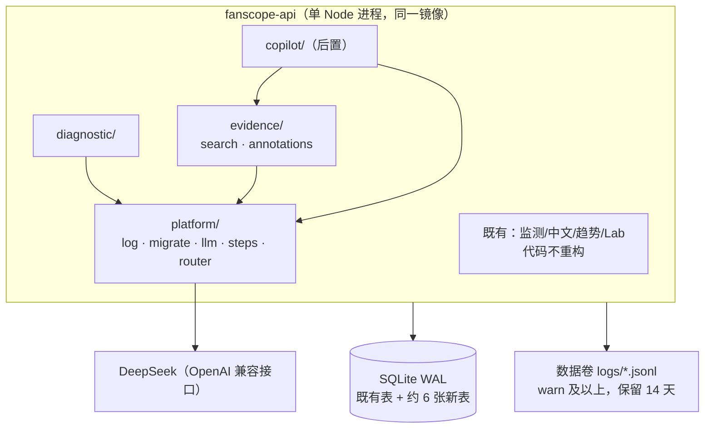
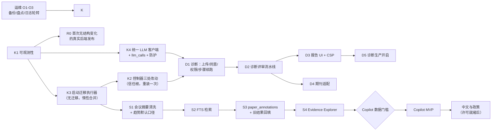

# FanScope V2.0 架构评审与修订方案

> 日期：2026-10-29。基线 `main` @ `12310c8`，评审对象为同分支上的 [FOUNDATION_AUDIT.md](FOUNDATION_AUDIT.md)、[V2_TARGET_ARCHITECTURE.md](V2_TARGET_ARCHITECTURE.md)、[V2_INCREMENTAL_ROADMAP.md](V2_INCREMENTAL_ROADMAP.md)。
> **与以上三份文档冲突时，以本文为准。** 本轮只做评审，不改代码、数据库或生产环境，不产生付费调用。
> 新输入：两项产品决定——① AI 不设应用内金额上限，接受余额耗尽后停止；② 允许第三方模型处理未发表稿件全文。
>
> **2026-10-29 更新**：八项正式产品决定与"无人值守文献更新"需求已记入 [V2_DELIVERY_PLAN.md](V2_DELIVERY_PLAN.md)。**本文 §5–§7 的顺序与待决事项由该文取代**；§0–§4 的架构原则继续有效。

## 0. 结论先行

原方案的**风险判断大体正确，但解决方案设计偏重，产品顺序也有误**。我会把它当成另一位工程师的提案来挑战，结论如下：

1. **底座方向不变**：继续使用单个 Node 进程 + SQLite + 现有发布链路，不拆服务，不换数据库。现有的安全机制全部保留。
2. **共享平台大幅收缩**：
   - 证据层从 7 张表减到 1 张版本化标注表；
   - 通用任务队列（租约、阶段机、并发槽、独立 worker）缩减为"持久记录 + 进程内执行 + 可续跑步骤"；
   - 四级金额预算按产品决定删除，改为"失控防护"（重试、并发、去重、熔断）。
3. **产品顺序改为 Paper Diagnostic 优先**。诊断的输入是用户提供的全文，不依赖目前质量很差的文献库；Copilot 则必须等数据底座达标后再做。
4. **迁移方式改为"启动时执行的版本化、仅追加迁移 + 发布控制器校验"**，不再给信任根增加一个独立的 apply 步骤。
5. **补上原审计的三处遗漏**（均已核实，见 §1.3）：
   - 发布回滚会丢失失败版本的容器日志；
   - 控制器禁止启动期任何数据库写入，这会约束 V2 的设计；
   - 英文文献库约 1/4 是会议摘要，现有趋势图默认把它们计入。
6. **最先要做的稳定性工作只有五件**：可观测性、发布诊断与迁移策略、第一次真实后端发布演练、异机备份、统一的 LLM 客户端。其余改进都随功能一起推进。

---

## 1. 对三份报告的独立评价

### 1.1 站得住的结论（保留）

| 结论 | 理由 |
| --- | --- |
| 继续用 SQLite，不迁 PostgreSQL | 数据量小（合成 12.5k 篇约 21 MB），备份、恢复和发布工具都围绕 SQLite；换库的风险远大于收益 |
| 后端 CD 拒绝结构变化，阻断任何新表上线（P1-1） | 代码核实，结论成立；本文只改变整改方式 |
| 生产运行时与控制器禁止 AI（P1-5） | 代码核实；按产品决定，整改更简单 |
| AI 结果原位覆盖、缺少版本（P1-3） | 成立；本文改用更轻的存储方式 |
| 日志无法支撑诊断（P1-4） | 成立，并且比原报告描述的更严重（§1.3 N1） |
| 异机备份未见证据（P1-6） | 仍是成本最低、价值最高的运维动作 |
| 中文无摘要、文章类型大多未知（P1-7） | 成立，并且比原报告描述的更严重（§1.3 N3） |
| FTS5 检索、暂不引入向量库 | 成立 |
| 应保留的机制清单（审计 §5） | 全部成立 |

### 1.2 过度设计或优先级错误（调整或删除）

| 原设计 | 问题 | 调整 |
| --- | --- | --- |
| 四级金额预算、预留成本、价格表缺失即拒绝调用（原 V2-04） | 与产品决定冲突；而且它解决的是"花多少钱"，真正的稳定性问题是"失控" | **删除金额预算**，改为 §3.4 的失控防护；调用记录保留，用于去重、诊断和用量可见 |
| 证据层 7 张表（`ev_documents/chunks/extractions/reviews/claims/claim_support/src_licenses`） | 在交付任何用户价值之前就建了 7 张表；按字段拆行使聚合与回填都更复杂；claim 不需要跨会话查询 | **一张 `paper_annotations`**，按论文、按标注类型存版本化 JSON；回答和报告里的 claim 存在各自记录的 JSON 中；许可矩阵推迟到中文阶段；分块只在出现全文来源时再加 |
| 通用 `task_runs`：租约、阶段机、取消、并发槽、熔断，外加独立 worker 入口（原 V2-05） | 为"多进程"做准备，但我们推荐单进程；交互式对话不需要队列 | 交互请求采用"持久记录 + 进程内异步 + 前端轮询"；多步骤任务用约百行的"步骤续跑器"（§3.3）；**不写 worker 入口**，等触发条件出现再做 |
| 迁移：应用侧 `migrate --apply` + 控制器另加 apply 步骤（原 V2-02/V2-03） | 信任根多一个状态机：冻结副本 apply、生产 apply、失败恢复；控制器本身尚未在生产运行过 | **启动时执行版本化、仅追加的迁移**，控制器在冻结副本上演练并校验"受保护列的指纹不变"（§3.2） |
| 产品顺序 Copilot → Diagnostic | Copilot 的质量上限取决于文献库，而文献库摘要覆盖率与类型都很差（§1.3 N3）；诊断由用户提供全文，数据粒度天然最高 | **Diagnostic 先做**；同时治理数据底座；Copilot 设置数据质量门槛后再做 |
| 不确定请求导致整个模块 blocked | 这原本是为了防止"花钱失控"。对交互功能来说，用户体验代价高 | 无人值守的批处理保留现有规则；交互功能对不确定请求只标记失败，由用户手动重试，不自动重放 |
| 目录 `api/src/v2/*` | 用版本号命名会在 V3 时变成负担 | 按功能命名：`platform/`、`diagnostic/`、`evidence/`、`copilot/` |
| Copilot 的滚动摘要、意图规则 + 便宜模型两段式 | MVP 不需要 | 先只用最近 N 轮上下文 + 本轮检索，测量后再优化 |
| Evidence Explorer 放在 Copilot 之前 | 方向正确 | 保留，但它属于数据底座阶段，与诊断并行 |

### 1.3 原审计的遗漏（本轮新核实）

**N1 发布失败后诊断信息会丢失**（代码核实）

- 控制器回滚时用旧镜像执行 `compose up`，候选容器会被重建，**它的日志随之消失**（[deploy_backend.py:238](../../scripts/cicd/deploy_backend.py#L238)）。
- 控制器从不保存 `docker logs`（全文检索 `logs`，无结果）；`result.json` 只记录异常类名（[L212](../../scripts/cicd/deploy_backend.py#L212)）。
- 平时的每次发布也会重建容器，旧日志一并丢失。
- **影响**：恰恰是最需要日志的场景（发布失败）留不下日志。
- **等级**：P1，修复成本很低。

**N2 启动期禁止写库，会约束所有 V2 设计**（代码核实）

- 新镜像启动、健康检查通过后，控制器会比对整库指纹，**任何变化都会触发回滚**（[deploy_backend.py:194-197](../../scripts/cicd/deploy_backend.py#L194-L197)）。
- 因此 V2 的启动恢复逻辑（例如"把中断的对话标为失败"）、启动日志写库、预热缓存写库都会导致发布失败。
- **约束**：除迁移外，启动路径不得写库；中断恢复必须"惰性"处理，即在读取时判定，下次写入时再落库。控制器的比对范围改为"受保护表的原有列"（§3.2）。

**N3 文献库构成会误导趋势分析**（隔离审计快照核实；生产构成：Unverified）

在 [journal-audit/articles.jsonl.gz](../journal-audit/articles.jsonl.gz)（22 刊、18,216 条）中：

- *Innovation in Aging* 有 4,681 条，其中 **4,422 条来自增刊（Supplement）**。这几乎可以确定是 GSA 年会摘要，类型全部未确认。它们约占整个英文快照的 **24%**，在"有摘要"的记录中占约 39%。
- 摘要覆盖率：总体 63%，2025 年 71%，**2026 年 50%**。*Social Science & Medicine*（1,904 条）、*Health & Place*、*SSM – Population Health*、*The Lancet Healthy Longevity*、*Aging & Mental Health*、*Disability & Society* 均为 **0%**，与出版社不向 Crossref 存放摘要的情况一致。
- 前端趋势筛选默认是 `articleType:'all'`（[web/app.js](../../web/app.js) 中的状态初值），**所以现有首页趋势会计入会议摘要**，年会增刊所在月份会出现虚假尖峰。只有同比比较默认使用 original_research。
- **影响**：这是**现有产品**的数据正确性问题。同时它说明，在不做清洗的情况下，"近期研究了什么"这类 Copilot 回答会被会议摘要主导。
- **等级**：P1（数据正确性），清洗规则成本低。

**N4 单人维护的治理现实**

- 生产审批人、开发者和产品负责人实际上是同一人，"Required reviewers"只能防止误触，起不到双人复核的作用。
- 因此治理的重点应放在**自动化门禁**和**小而可回滚的变更**上，而不是依赖流程审批（§4）。

**N5 稿件进入备份**

- 稿件文本如果存放在 SQLite 中，就会进入在线备份和异机备份。用户删除稿件后，备份中仍会保留到备份过期为止。
- 这必须在同意页中披露，或者为稿件选择单独的存储与保留策略（§3.5、§6）。

### 1.4 三类问题分开看

| 类别 | 内容 |
| --- | --- |
| **已证实的技术风险** | P1-1 迁移被阻断；P1-3 结果覆盖；P1-4 与 N1 日志缺失；P1-5 运行时禁止 AI；N2 启动禁写约束；N3 会议摘要混入（快照）；P2-1 聚合阻塞（基准测试）；外部模型调用分散在三处、规则不一 |
| **尚未验证的假设** | 生产实际入口与启用期刊；中文 349 条是否在生产库；生产库的文献构成是否与快照一致；异机备份；主机资源余量；后端 CD 能否在生产跑通；生产 Node 22 是否支持 FTS5 trigram；DeepSeek 当前的数据处理条款、上下文缓存与余额查询接口（均以供应商当前文档为准，需负责人核对） |
| **主动接受的产品取舍** | 不设 AI 金额上限，余额耗尽即停止全部 AI（含现有英文自动队列）；未发表稿件全文可发送给第三方模型；单进程意味着 AI 高负载可能拖慢 API（以并发上限缓解） |

---

## 2. 总体路径比较

| 维度 | **路径 A：原路线图** 重平台先行，Copilot 优先 | **路径 B（推荐）：薄内核 + 诊断优先的纵向切片** 数据底座并行，Copilot 设门槛 | 路径 C：另起 Python AI 服务 （FastAPI + 独立数据库），与现有 Node API 并存 |
| --- | --- | --- | --- |
| 首个用户价值 | 晚：先建约 20 张表的平台 | 早：内核完成后约 2–3 周即有诊断 MVP | 中：需要先搭新服务与发布链 |
| 新增运动部件 | 多（预算、租约、阶段机、证据 7 表、迁移双阶段） | 少（日志、迁移、LLM 客户端、步骤续跑器、标注表） | 最多（第二语言运行时、第二套发布/备份、跨服务鉴权与数据同步） |
| 稳定性风险 | 中：平台大，未经真实使用检验 | 低：每一步都很小，并由真实功能驱动 | 高：现有控制器只管理一个容器、一个 SQLite |
| 对弱数据的依赖 | 高（Copilot 先行） | 低（诊断使用用户全文） | 与 A 相同 |
| 维护负担 | 中高 | 低 | 高 |
| 小团队适配度 | 一般 | 好 | 差 |
| 何时值得重新考虑 | — | — | 需要重型 NLP（版面解析、向量模型本地推理）时，可考虑把**单一能力**做成无状态的旁路工具，而不是第二个应用 |

**推荐路径 B。** 判断依据：在小团队、单维护者、低配服务器的条件下，稳定性主要取决于每次变更的规模和可回滚性，而不是基础设施有多完备。先让一个真实功能（诊断）走通"日志 → 迁移 → LLM → 发布 → 回滚"的全链路，再把它沉淀下来的模式复制到 Copilot，比预先搭建通用平台更可靠。

---

## 3. 推荐架构

### 3.1 形态

- 仍是一个进程、一个容器、一个数据库。所有新模块通过 `platform/router` 挂载到新前缀 `/api/v2/` 之下，不再扩展 `server.mjs` 的 if 链。
- 新表总数约 6 张：`llm_calls`、`ai_jobs`、`ai_job_steps`、`paper_annotations`、`dx_submissions`、`dx_reports`；后期再加 `cp_conversations`、`cp_turns`。原方案约 20 张。
- 既有模块只做三处小改：把三处 DeepSeek 调用收敛到统一客户端；在 HTTP 包装层加入日志与 request_id；health 增加版本信息。

### 3.2 迁移与发布（替代原 V2-02/V2-03）

| 方案 | 做法 | 优点 | 缺点 |
| --- | --- | --- | --- |
| 显式 apply（原方案） | 控制器在冻结副本 apply，再到生产 apply | 结构变化与启动完全解耦 | 信任根新增状态机；在控制器尚未实战的情况下继续加复杂度 |
| **启动时版本化追加迁移（推荐）** | `api/migrations/<UTC 时间戳>_<名称>.sql`；启动时在 listen 之前、单事务内执行未应用的迁移，记录 ID、校验和与 commit；lint 只允许 `CREATE TABLE/INDEX`、`ALTER TABLE … ADD COLUMN` 以及对**新表**的 INSERT | 符合主流框架习惯，代码路径少；控制器现有的"冻结副本演练 + 失败恢复快照"恰好覆盖它 | 迁移在生产启动时执行，必须仅追加且足够快（lint + 演练保证） |
| 维持现状（import 时隐式迁移） | — | 零工作 | 无版本、无审计，控制器仍会阻断 |

**控制器只需要三处最小改动**，合并为一个信任根 PR，主机只重装一次：

1. 保存发布日志（N1）：候选容器的 `docker logs --timestamps`（截取最后 N 行）在回滚前写入备份目录；`result.json` 记录失败阶段与异常消息（脱敏）。
2. 迁移校验：manifest 的 `migrationPolicy` 增加 `'additive'`，并列出迁移 ID。对冻结副本演练后，比较"受保护表在**原有列**上的指纹"必须相等，新表与新列不限；启动后的比对使用同一规则（N2）。
3. AI 一致性：health 的断言从"`aiConfigured` 必须为 false"改为"`aiConfigured` 等于 manifest 中的 `aiEnabled`"。

**旧镜像兼容**：因为迁移只追加，旧代码可以在新库上运行，回退代码不需要回退数据库。这一点要作为每个迁移 PR 的测试项。

### 3.3 AI 执行模型

| 场景 | 方案 | 理由 |
| --- | --- | --- |
| 交互（未来的 Copilot 回合） | POST 写入持久记录（`pending`）→ 进程内异步执行 → 202 返回 → 前端轮询 GET | 同步等待会撞上 nginx 默认 60 s 超时，客户端断开也无法处理；队列和 worker 又过重。持久记录让断开连接、刷新页面都安全 |
| 多步骤（诊断、批量提取） | `ai_jobs` + `ai_job_steps`：每一步的结果落库后才进入下一步；已有结果的步骤直接跳过 | 进程重启后只需重跑未完成的步骤，避免对已付费的步骤重复付费 |
| 重启恢复 | 惰性处理：读取时发现 `running` 且早于本进程启动时间，就显示为"已中断，可继续"，由用户点击"继续"后重跑失败步骤 | 满足 N2，不在启动时写库 |
| 并发控制 | 单进程，使用内存信号量（§3.4）；步骤认领使用条件 UPDATE 防止同进程内重复执行 | 现阶段不需要租约；拆分进程时再加 |

**拆出独立 worker 的触发条件**（满足其一）：

- AI 负载导致 API p95 连续一周超过 300 ms；
- 容器内存峰值超过 350 MB；
- 出现需要独立扩容或独立重启 AI 的需求。

在那之前，不写 worker 入口，也不改控制器的多服务逻辑。

### 3.4 失控防护（替代金额预算）

| 风险 | 机制 | 建议默认值 |
| --- | --- | --- |
| 无限重试 | 只对 429、5xx、请求未发出的连接错误自动重试，指数退避 + 抖动 + 遵守 Retry-After，**最多 2 次**；超时或响应中途断开**不自动重试**（交互功能交给用户重试，批处理沿用"不重放"规则） | — |
| 失控并发 | 供应商级信号量；模块级并发；每用户同时最多 1 个诊断任务、1 个对话回合 | 供应商 4；诊断 2；对话 2；批处理 1 |
| 重复调用 | 用户动作幂等键（前端生成 UUID）；`(model, prompt_version, input_sha256)` 在 10 分钟内命中则复用结果；步骤已有结果即跳过 | — |
| 循环/异常速率 | 模块熔断：10 分钟内调用次数超阈值，或连续 5 次供应商失败 → 该模块暂停，记 `llm.circuit_open` 错误事件，管理员恢复 | 诊断 60 次/10 分钟；对话 120 次/10 分钟 |
| 余额耗尽 | 收到 402 → 全局 AI 暂停标记，返回用户可读提示，非 AI 功能不受影响；之后定时（如 30 分钟）以低频探测恢复，或由管理员恢复 | — |
| 优先级 | 交互和诊断优先于无人值守的批处理；全局暂停或熔断时先暂停批处理 | — |
| 单次规模 | 每种用途设置 `max_tokens`；稿件字符上限；上传 10 MB（沿用现有限制） | 稿件 ≤ 20 万字符 |
| 无自主循环 | MVP 采用固定步骤流水线，不做工具调用型 agent 循环 | — |
| 用量可见 | `llm_calls` 记录 token、延迟、状态与上游请求 ID；管理页按模块和日汇总；价格配置可选，**仅用于显示估算**；若供应商提供余额查询则显示余额（需核实接口） | — |
| 降低成本 | 提示词把**稳定的长前缀**放在前面（例如稿件全文），以利用供应商的上下文缓存（DeepSeek 的缓存规则需按当前文档核实） | — |

**统一 LLM 客户端的范围**：

- 新代码只经它调用模型；
- `brief.mjs` 与 `lab.mjs` 的两处直接调用迁移过来，属于小型重构；
- `ai.mjs` 的账本与"不重放"语义保持不变，只把 HTTP 传输换成客户端，现有 216 项测试是回归保护。

### 3.5 Paper Diagnostic 设计要点

**流水线**（固定步骤，每步结果落库）：

1. 文本提取：复用 `extractText`，生成字符数与哈希。
2. 结构识别：研究问题、假设、理论、数据、方法、主要结论，每项附稿件原文引用。
3. 维度评审：理论与设计匹配、方法与数据、变量与模型（定量）或抽样与分析（定性）、结论是否超出证据、贡献与文献定位、写作与结构。
4. 修改计划：按严重度排序。
5. 期刊适配（可选，§5 D4）：用户从 FanScope 期刊库中选择目标期刊；先用代码统计该刊近两年的文章类型、主题与方法分布，再由模型给出适配意见。**必须声明该刊的证据粒度**，例如 SSM 只有题录。

**每条意见必须标注依据类别**：

| 类别 | 要求 |
| --- | --- |
| `material_fact` | 必须附可校验的稿件原文引用（规范化空白后做子串匹配），校验失败自动降级为 `ai_judgment` |
| `rule_flag` | 来自确定性规则 |
| `ai_judgment` | 模型判断，必须给出理由 |
| `cannot_assess` | 必须说明缺少什么材料 |

报告分四栏展示，顶部声明"AI 辅助诊断，不构成审稿结论"。

**授权与透明度**：

- 每篇稿件单独确认。同意页说明：发送什么（全文）、发给谁（供应商、模型、条款链接及负责人核对日期）、FanScope 保存什么、保存多久、谁能看、如何删除，以及删除后备份中的保留期（N5）。
- 上传者需声明有权提交（含合作者）。
- 同意记录保存版本号和时间。供应商或条款变更时，新任务需要重新同意。
- 供应商信息由负责人维护在配置中，包括存储地、是否用于训练、保留期，**以供应商当前条款为准，不由代码臆测**。

**访问控制**：默认仅上传者可见；可显式分享给指定的 Lab 用户。是否默认对导师可见，由产品决定（§6）。

**日志**：只记录 submission_id、步骤、长度、哈希、llm_call_id、错误码。**禁止**记录提示词、稿件或回复正文；供应商错误消息截断并脱敏后才能记录。生产环境没有开启正文日志的开关。

### 3.6 数据底座（与诊断并行）

- **清洗**：用规则把增刊或会议记录识别为 `conference_abstract`（规则版本化，沿用现有 `trends-2026-types-v3` 迁移模式），首页趋势默认排除会议摘要。**这会改变现有趋势数字，需要产品确认。**
- **检索**：在 `articles(title, abstract)` 上建外部内容 FTS5 索引（英文常规分词、中文 trigram，2 字中文词用 LIKE 兜底），不建分块表。
- **标注**：`paper_annotations(id, paper_id, kind, version, payload_json, input_sha256, model, prompt_version, llm_call_id, status, created_at)`，`kind` 包括 `ai_design_v3`、`rule_topics_v1`、`human_review`；"当前值"通过视图取每种 kind 的最新有效行。旧 `analysis_json` 一次性复制进来，不发起新调用。
- **摘要覆盖**：先用生产只读查询测量各刊覆盖率，再决定补充来源（OpenAlex 等，见 §6）。
- **Evidence Explorer**：零 AI 费用的检索与分布页面，**同时用作数据质量的公开看板**。

### 3.7 Copilot（后置）的上线门槛

Copilot 只有在以下条件都满足后才进入开发：

- 会议摘要已从默认范围排除；
- 目标领域内"原创研究且有摘要"的论文达到负责人认可的数量和覆盖率（§6）；
- 检索评测集已建立基线。

设计沿用原架构文档 §7.1 的核心规则（数字由代码计算、claim 必须引用、粒度下限声明），但简化为：最近 N 轮上下文、claim 存放在回合记录 JSON 中、交互执行模型见 §3.3。

---

## 4. 工程治理

1. **变更规模**：一个 PR 只做一件事；有效代码变更目标在 400 行以内（不含测试和文档）。功能开关默认关闭；"合并"与"生产开启"分成两个动作。
2. **WIP 上限**：
   - 同时最多 1 个信任根 PR（`.github/workflows`、`scripts/cicd`、`deploy/cicd`）；
   - 同时最多 2 个产品 PR；
   - 并行的代理只能修改互不相交的目录。热点文件（`server.mjs`、`v14-server.mjs`、`staged-recovery-server.mjs`、`platform/router`、`api/migrations/`、`test.yml`、`AGENTS.md`）的修改必须串行。
3. **迁移**：文件名使用 UTC 时间戳以避免并行冲突。初期每次后端发布最多包含一个带迁移的 PR。每个迁移 PR 都附带旧库夹具、受保护列指纹和旧镜像兼容三项测试。
4. **发布节奏**：合并不等于发布。后端按需或每周发布一次；**先完成第一次无结构变化的真实发布演练**，再发布任何带迁移的版本。
5. **事故规则**：出现生产事故或数据错误时，暂停功能合并，先修复，再在 `docs/ops/incidents/` 写复盘。
6. **每个模块一页 runbook**：如何关闭、看哪些日志事件、错误码含义、如何恢复。代理排障时从这一页开始。
7. **测试分层**：
   - 单元/API 测试（Mock）；
   - 合约夹具（脱敏的真实响应）；
   - 离线 AI 评测（固定样例 + 录制输出，校验结构、引用与依据分类）；
   - 人工真实评测（有意识地付费并留档，每个模块上线前一次）。

   既有测试不删除、不跳过。
8. **单维护者现实**（N4）：自动门禁（`required` 检查、迁移 lint、受保护列指纹、发布演练）是主要防线，审批只是辅助。

---

## 5. 实施顺序

| 阶段 | 内容 | 并行性 |
| --- | --- | --- |
| 1. 稳定性内核（约 1.5–2 周） | K1 → R0；K3；K2；K4 | K1 必须最先；K3、K4 可并行；K2 等 K3 合并后再做 |
| 2. 诊断 MVP（约 2–3 周） | D1–D3、D5，D4 可延后 | 与阶段 3 并行（目录不相交） |
| 3. 数据底座（约 2–3 周） | S1–S4 | 与阶段 2 并行 |
| 4. Copilot MVP | 达到数据门槛后启动 | — |
| 5. 中文与政策 | 许可就绪后启动 | — |

**投入比例**：阶段 1 几乎全部是稳定性工作。之后约 75% 投入产品、25% 投入稳定性；出现事故时按事故规则调整。

### 原 PR 计划的处置

| 原 PR | 处置 |
| --- | --- |
| V2-01 日志 | **保留**，改为 K1，并加入数据卷日志文件与 health 版本信息 |
| V2-02 / V2-03 迁移与控制器 | **重做**为 K3 + K2（启动迁移 + 控制器三处改动） |
| V2-04 LLM 网关 + 预算 | **简化**为 K4：删除金额预算，加入失控防护，并收敛三处旧调用 |
| V2-05 任务执行器 | **简化**为 D1 中的步骤续跑器，不做 worker |
| V2-06 聚合缓存 | **推迟**到 Copilot 或首页实际出现性能问题时；S1 之后口径变化，届时再做 |
| V2-07 证据层 7 表 | **缩减**为 S3 的一张标注表 |
| V2-08 检索 | **保留**为 S2 |
| V2-09 领域主题 | **推迟**到 Copilot 前；先做 S1 会议摘要清洗 |
| V2-10 提取 v3 | **推迟**到 Copilot 前，复用 K4 |
| V2-11 许可矩阵 | **推迟**到中文阶段 |
| V2-12 Evidence Explorer | **保留**为 S4 |
| V2-13～15 Copilot | **后置**，设门槛 |
| V2-16～17 诊断 | **提前**为 D1–D5，并按产品决定改为全文由第三方模型评审 |
| V2-18 worker 拆分 | **删除**，改为触发条件 |
| V2-19～21 中文与政策 | 不变，许可前置 |
| O-1～O-4 运维 | 保留；O-4 即 R0 |

---

## 6. 第一批任务与验收标准

### O1 异机加密备份与月度恢复演练（管理员）

- 存在 24 小时以内的异机副本；
- 已完成一次恢复演练，`integrity_check` 为 ok，并记录全表计数；
- 手册写明 RPO 和 RTO。

### O2 生产只读盘点（管理员执行脚本，我提供只读查询）

需要获得以下数据：

- 实际入口命令与镜像 label；
- 启用的期刊；
- 中文记录数；
- 英文各刊的摘要覆盖率；
- 增刊记录数；
- 主机内存和磁盘余量。

结果脱敏后入库，并用它更正本文中所有标为 Unverified 的结论。

### O3 Docker 日志轮转（管理员）

- `docker inspect` 能看到轮转配置。

### K1 可观测性

- JSON 日志带 `request_id`，响应头返回 `X-Request-Id`，错误体包含 `request_id`；
- warn 及以上的日志写入数据卷 `logs/`，按天轮转，保留 14 天，**不写数据库**（N2）；
- health 增加 `commit/schema/node/sqlite/flags`；
- 测试：脱敏用例（Key、Bearer、邮箱、正文）不出现在日志中；启动过程中数据库零写入。

### R0 首次真实后端发布（K1 合并后，使用现有控制器，需你批准）

- `result.json` 为 success；
- health 中的 `commit` 等于发布 SHA；
- 若失败，则保持维护模式，按手册恢复，并把失败日志补入 K2 的需求。

### K3 启动迁移执行器

- 合并时迁移目录为空，镜像启动零变化，现有控制器可直接发布；
- 测试：时间戳排序、校验和不一致时拒绝、lint 拒绝非追加语句、旧库夹具上受保护列指纹不变、旧代码可在迁移后的库上启动；
- CI 在 Node 22 上检查 FTS5 与 trigram 可用；锁定 Node 补丁版本。

### K2 控制器三处改动（信任根）

- Python 编排测试新增：保存候选日志、`additive` 策略下新表通过而改动受保护列失败、`aiConfigured` 与 manifest 不一致时拒绝；
- CI Docker 演练包含一个示例迁移，并验证回滚；
- 管理员重装主机后，再完成一次 R0 式发布。

### K4 统一 LLM 客户端

- 新增 `llm_calls` 迁移；`brief.mjs` 与 `lab.mjs` 改为经客户端调用；`ai.mjs` 只替换传输层；
- 测试：只重试 429/5xx/未发出的请求且最多 2 次；超时不重试；幂等键并发提交只产生一次调用；10 分钟去重；熔断与恢复；402 触发全局暂停；日志不含正文；
- 现有 216 项测试全部通过。

### D1 诊断基础

- 新增 `dx_submissions/dx_reports` 与 `ai_jobs/ai_job_steps` 迁移；
- 上传、同意记录、默认私有访问、分享、删除（行与文件同时删除）；
- 步骤续跑器；
- 测试：越权访问返回 403；删除后数据不残留；中断后惰性显示"可继续"且启动时零写入；日志中没有正文。

### S1 会议摘要清洗（需你确认口径变化）

- 增刊和会议记录被识别为 `conference_abstract`，规则版本化；
- 首页趋势默认排除会议摘要；
- 提供变化前后的趋势数字对照表供你确认；
- 受保护数据（AI 结果、Lab）指纹不变。

---

## 7. 需要你作为产品负责人决定的问题

1. **稿件可见范围**：默认只有上传者可见，还是导师默认可见？
2. **稿件与报告的保留期**：在线保存多久？是否接受"删除后备份中保留至备份过期"（例如 30 天）？还是要求稿件单独存储并不进入异机备份？
3. **供应商**：诊断只用 DeepSeek，还是允许用户在已配置的供应商中选择？由谁、多久核对一次供应商条款？
4. **S1 口径变化**：首页趋势默认排除会议摘要会改变现有数字，是否接受？
5. **摘要补充来源**：是否启用 OpenAlex（或其他开放元数据源）补充英文摘要？是否在中文刊官网公开页面采集摘要？两者都涉及条款或许可判断。
6. **Copilot 数据门槛**：例如"目标领域近两年原创研究且有摘要的论文 ≥ 1,000 篇"，具体数值由你确认。
7. **R0 首次真实后端发布**：何时批准？谁来执行主机侧的操作？
8. **诊断用户范围**：仅限课题组 Lab 账户，还是需要开放给更多研究者？后者会引入注册、滥用防护等新需求，建议暂不开放。
9. 仍待决定的旧问题：`FanScope-Dev` 是否归档为只读，运维文档是否继续公开。
