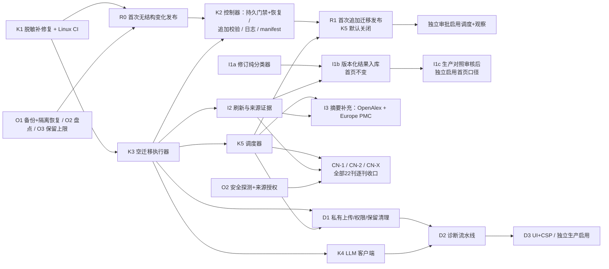

# FanScope V2 产品基线与交付计划

> 2026-10-29。本文记录 Product Owner 已确认的八项产品决定与新增需求"无人值守中英文文献持续更新"，并给出相应的技术方案与执行顺序。
> 架构原则沿用 [V2_ARCHITECTURE_REVIEW.md](V2_ARCHITECTURE_REVIEW.md) §0–§4；**评审文档 §5–§7 的顺序与待决事项由本文取代**。
> 证据等级沿用审计约定：**代码核实 / 测试核实 / 快照核实 / Unverified**。
>
> **2026-10-29 第二次更新**：纳入最终产品决定——22 本中文期刊同轮交付、统计口径细则、批准使用 OpenAlex。同时：调度方案改为"发布暂停标记"（§4.1）；补充 K1 验收记录（§12）；新增 [22 本中文期刊接入矩阵](CN_JOURNALS_22_MATRIX.md)；§10 改为新的第一批任务。
>
> **2026-10-29 工程交接修订**：以 fetch 后的三个分支为证据，修正分类器误排除/误纳入、暂停超时恢复、迁移发布依赖与验收表述。本文的产品决定、实施顺序及验收条件优先于旧审计/架构提案；旧审计证据与发现编号保留。本轮只改文档，以下新设计均未实现、未生产验证。

## 0. 接手基线与独立判断

开始修订时工作区干净，当前文档分支与远端一致；`origin/main` 为 `12310c8`。以下三个分支均基于该 main，互不包含另外两条开发分支的成果，不能把文档分支上的测试当作 K1 或分类器的测试。

| 分支 / fetch 后 HEAD | 实际改动与证据 | 工程状态 |
| --- | --- | --- |
| `chore/v2-foundation-audit` / `cc0af41`（本次修订前） | 4 个文档提交，包含审计、评审、计划、22 刊矩阵、工程规则与只读运维脚本 | 继续在本分支修订；不从旧 main 重建文档 |
| `feat/observability-request-logging` / `cfd70c0` | 两个提交，14 个文件；请求关联、health 版本、数据卷日志、JSON/供应商错误消息脱敏；详见 §12 | 本地验收为前轮记录；本轮发现短 ASCII 错误正文仍可原样记录，需补修复与回归；尚无 Linux CI 放行证据 |
| `feat/publication-classification` / `45902d4` | 一个提交，新增 5 个文件；纯函数 `api/src/ingest/classify.mjs`、8 个测试、期刊策略、只读报告脚本及快照报告 | 未接入 DB、API 或首页；`doc-v1` 是待修订规则基线，不能称为统计启用就绪 |

**远端核实（本轮开始时）**：GitHub 开放 PR 集合为空；三个分支的 Actions runs 均为 0。main 的历史 CI 成功不覆盖它们。GitHub 插件身份为仓库所有者且有 push 权限；本机没有 `gh`，可用插件创建本次文档 Draft PR。后续状态以各 PR 的准确 HEAD / 检查链接为准，不把本表当作实时仪表盘。

**独立评价**：保留单 Node + SQLite、诊断优先、数据治理可独立推进的轻量路线。需要收紧的是资格证据与分析粒度的分离、发布事务的恢复闭环，以及“可合并 / 可发布 / 可启用”三种门禁。K3 与 K5 不能因为本地实现完成就绕过 K2 发布；诊断也无需等待全部文献摘要补齐。未核实的生产状态继续标为 Unverified。

## 1. 产品决定对架构的影响

| # | 决定 | 架构影响 | 落点 |
| --- | --- | --- | --- |
| 1 | 稿件仅上传者与有权的导师可见，其他成员需显式共享；服务端强制 | 现有 Lab 中 mentor 对原始会议文档是**全局可见**（[lab.mjs:173-174](../../api/src/lab.mjs#L173-L174)），诊断必须更严格：用一个统一的服务端授权函数判断"上传者 / 显式共享 / 与该课题或学生有关系的导师"。关系来源有两种：稿件关联的项目（项目 manager 或 member），以及新增的导师-学生关联表 | D1 |
| 2 | 原稿 14 天、报告 90 天、可主动删除、披露备份期 | 读取时按 `expires_at` 强制过期，再由定时清理做物理删除。原稿删除后保留一条"墓碑"元数据作为授权锚点，报告不级联删除。**发布控制器的备份目录当前"不自动清理"**（[CICD_V1_6_ZH.md](../CICD_V1_6_ZH.md)），必须先设定上限，否则稿件会无限期留在备份中 | D1、O3 |
| 3 | 只用 DeepSeek，不设金额上限 | 评审 §3.4 的失控防护保持不变。现有英文自动 AI 队列与诊断共享同一账户余额，因此交互和诊断优先，批处理遇到全局暂停时先停 | K4 |
| 4 | 默认趋势包含可信的正式期刊研究论文及综述；**综述计入总量且分开统计**；正式 Online First 计入，后续卷期不重复；会议摘要与会议论文集单独统计；类型或状态无法确认的不视为已核实 | 资格分类与 AI 分析可用性分开（§5）。`doc-v1` 快照为 **18,216 → 6,975；2025-12 为 5,089 → 300**，但 6 本无摘要期刊全退出，不能作为正确结果。先修订规则/类型证据（I1a/I2），再分类入库（I1b），最后独立评审并启用首页口径（I1c）；摘要补充是独立质量轨道，不是正式论文资格门槛 | I1a–I1c、I2、I3 |
| 5 | 已有访问与使用权限，尽量补全中英文摘要；**批准使用 OpenAlex（免费 Key）** | 按来源登记授权范围，建立摘要补充队列并记录缺失原因；**禁止用 AI 生成摘要**（§6）。OpenAlex Key 只放在服务器 `.env` 中，由 `OPENALEX_API_KEY` 读取，绝不入库；日志与健康检查只显示"是否已配置" | I3、I4 |
| 6 | Copilot 不设固定论文数门槛 | 多维准入评分卡：按问题动态判定可提供的辅助等级（§8） | C0 |
| 7 | 原则同意 R0，但需先盘点、异机备份、恢复演练与 CI | R0 前置清单（§11）；已有只读盘点脚本待审查、由管理员执行 | O1–O3、R0 |
| 8 | 诊断只对 Lab 登录成员开放 | 复用现有 Lab 会话与角色；不新增注册或匿名入口 | D1 |
| 新 | 无人值守持续采集 | **新增一个共享内核组件：持久化调度器**。采集、摘要补充、稿件过期清理三类任务共用它（§4） | K5、I1–I5 |
| 新 | **22 本中文期刊同轮交付**，按真实状态报告 | 按平台写适配器（官网 `/CN/` 平台、ajcass、Crossref、CSSN、授权导出），而不是每刊一个。逐刊状态见 [CN_JOURNALS_22_MATRIX.md](CN_JOURNALS_22_MATRIX.md)：目前 E 4 本、E- 2 本、C 5 本、D 11 本，**A/B 均为 0**。是否能从生产主机连通中文站点，决定了全部 22 本的接入路径 | I4、O2 |

---

## 2. 无人值守采集：已有基础与缺口（代码核实）

**已经具备，可以继续使用的部分**

- **调度与关闭**：后台采集已经运行在服务器进程中，与浏览器无关。V1.4 入口按 `SCAN_INTERVAL_MINUTES`（≥30）定时扫描英文期刊，收到 SIGTERM 时会等待进行中的扫描完成（[v14-server.mjs](../../api/src/v14-server.mjs)）。
- **Crossref 增量**：按 index-date 窗口和 cursor 分页；游标只在页面提交后才推进；下一轮从"检查点减 2 天"处继续（[sources.mjs:55-98](../../api/src/sources.mjs#L55-L98)）。这支持中断后续采；“无缺口”仍需 §9 故障/更新夹具验证，并依赖来源保留与补采窗口，不能承诺任意故障均不会遗漏。
- **去重**：DOI 规范化后作为主键，同刊 URL 二次去重；中文使用组合身份键。
- **RSS**：抓取具备 SSRF 防护（主机白名单、DNS 固定、禁止重定向、禁止 DTD）。
- **中文采集引擎**：已实现官网目录解析与 `citation_*` 元数据解析（[chinese-ingestion.mjs:21-31](../../api/src/chinese-ingestion.mjs#L21-L31)），并读取 `Description`。官网页面同时提供中英文摘要（测试夹具核实），只是此前因为授权未确认而没有保存。
- **摘要补充**：Europe PMC 补充已实现，按 DOI 与 ISSN 双重核验。
- **状态展示**：每刊的 `last_checked/last_success/last_error` 与 `stale` 计算已有。
- **日志**：K1 分支新增的结构化日志覆盖每刊检查成功与失败；尚未合并/生产验证，残余风险见 §12。

**缺口**

| 缺口 | 证据 | 影响 |
| --- | --- | --- |
| 调度时间不持久：计时器从进程启动时开始计 | [v14-server.mjs](../../api/src/v14-server.mjs) 中的 `setInterval` | 频繁重启时扫描会被推迟甚至持续饿死；重启后无法得知"是否已经逾期" |
| **已有记录从不刷新** | [monitor.mjs:7-16](../../api/src/monitor.mjs#L7-L16) 使用 `INSERT OR IGNORE`，只有新插入时才写附加字段 | Online First 转为正式期次、后补的摘要、更正后的元数据都不会进入库内 |
| 中文没有无人值守路径 | 中文任务要由管理员逐步推进，而生产环境中文管理路由一律 404 | 中文论文只能依赖人工导入 |
| 摘要补充需要手动触发；OpenAlex 关闭 | `server.mjs` 中的 admin 路由 | 摘要覆盖率停滞（快照：2026 年为 50%） |
| 只扫描已有检查点的期刊 | [staged-recovery-server.mjs](../../api/src/staged-recovery-server.mjs) 的 `runEnglishMonitor` | 新增期刊不会自动进入监测 |
| 没有新鲜度告警 | `sourceSummary` 只在被查询时计算 | 监测静默停止时无人知晓 |
| 类型证据为空 | 快照中 18,216 条记录的来源类型标签全部为空 | 文章类型几乎无法确认（§5） |

---

## 3. 开源组件与外部接口评估

本节保留前轮调研判断；除 §5 本次核对的类型文档外，来源限额、条款与外部能力本轮未重新验证，更未在生产网络验证。上线前须按官方当前文档/合约夹具核对，不能把下表当作生产连通或授权成功记录。

| 候选 | 结论 | 理由 |
| --- | --- | --- |
| **RSSHub** | **不部署**，可参考其路由写法 | 它是一个完整服务（Node，可选 Redis/浏览器），部分路由被标为反爬或测试失败；搜索中**未找到可确认的 CNKI 路由**（[RSSHub 期刊路由](https://docs.rsshub.app/routes/journal)）。我们的中文目标期刊多数自建官网并带有标准元数据标签，直接解析更稳定，也不涉及数据库抓取条款 |
| **changedetection.io** | **不部署**，借鉴"页面内容指纹 → 变化检测" | 它是 Python 服务并带浏览器，用于页面差异比较；我们需要的是结构化解析。借鉴点：对目录页模板计算指纹，结构变化时把来源标为降级 |
| Crossref 工具（habanero、crossref-commons 等，Python） | **不引入**；保留现有 Node 实现 | 现有窗口与游标实现已经更健壮。借鉴礼仪：带 `mailto` 进入 polite pool；**限额以响应头 `X-Rate-Limit-*` 为准，不在代码中写死**（2025–2026 年已多次调整，[Crossref 公告](https://crossref.org/blog/announcing-changes-to-rest-api-rate-limits/)、[社区更新](https://community.crossref.org/t/refining-rest-api-limits-for-improved-stability-and-reliability/16137)）；增量改用 `from-update-date` 以捕获元数据更新 |
| **OpenAlex API** | **采用**，直接调用 REST，不引入 pyalex | 需要免费 API Key，有每日用量额度，可通过 `/rate-limit` 查询（[官方认证文档](https://developers.openalex.org/guides/authentication.md)）。数据为 CC0；摘要以倒排索引形式提供，需要重建（现有代码已实现）。用途：补摘要、`type`/`is_paratext` 类型证据。**上线前先抽样测量各刊覆盖率** |
| **Europe PMC** | **已实现，改为自动运行** | 对 MEDLINE 收录的期刊有效。快照中摘要为 0% 的 *Social Science & Medicine*、*Health & Place*、*Aging & Mental Health* 等是否被覆盖，需要在 I3 中实测（Unverified） |
| OAI-PMH / Sickle（Python） | **借鉴语义，自写约 100 行的客户端** | 已有 fast-xml-parser；Sickle 的 resumptionToken 处理与 503 Retry-After 处理值得照搬。只有在某个来源确认支持 OAI-PMH 时才启用（此前调研未确认 19 本中文刊有统一的 OAI，见 [chinese-source-strategy](../chinese-source-strategy/README.md)） |
| RSS 解析库（rss-parser、feedparser） | **不引入** | 现有 `parseFeed` + `secureFeed` 已包含安全防护，更适合本项目 |
| 调度库（node-cron、croner、bree、agenda；BullMQ 需要 Redis） | **不引入** | 我们需要"持久化到期时间 + 租约 + 发布门禁"，60 秒一次的 tick 加 SQLite 调度表与 §4.1 的主机状态即可；cron 表达式解决不了重启补跑与发布协调 |
| systemd timer / 主机 cron 执行 `docker exec` | **不用于采集**，继续用于发布拉取 | 需要容器在运行；与应用的优雅停机、发布控制器的空闲检查各自为政；增加主机侧配置漂移 |
| Zotero translators | **只借鉴选择器思路**（AGPL，不复制代码） | 积累了大量站点级元数据抽取经验，可作为中文平台解析规则的参考 |
| Highwire `citation_*` / Dublin Core 元数据 | **采用为中文通用适配器的基础** | Google Scholar 收录规范要求这些标签，覆盖面广；现有解析器已实现 |
| DeepSeek 上下文缓存 | **在诊断提示词中利用** | 官方为自动磁盘缓存，按命中计费、尽力而为（[官方说明](https://api-docs.deepseek.com/news/news0802)）。把稿件全文作为稳定前缀放在最前，多维度评审可以复用缓存。并发上限与价格以官方当前页面为准（Unverified） |

---

## 4. 推荐的自动更新方案

### 4.1 进程与调度（交接修订：持久发布门禁，超时只告警）

**为什么放弃固定 15 分钟宽限**：它有两个缺陷。第一，重启间隔短于宽限期时，任务会被持续推迟；第二，它只是"希望"发布控制器在 15 分钟内完成校验，并没有真正的协调。

**新方案**：

- **继续在 API 进程内运行**。用持久化的到期时间 + 租约，并与发布控制器显式协调。
- **调度表**：`scheduled_jobs`，字段包括 `name, next_due_at, last_started_at, last_finished_at, last_status, last_error_code, consecutive_failures, lease_owner, lease_expires_at`。
- **tick**：HTTP listen 就绪后立即安排首个独立调度 tick，之后每 60 秒一次，不再设置固定 30 秒或 15 分钟重启宽限。初始化/迁移路径本身不认领任务；发布校验期间由持久门禁保证首 tick 也只读、无业务写入。
- **认领与续租**：到期任务用条件 UPDATE 认领租约（120 秒），执行中续租；完成后 `next_due_at = 完成时间 + 间隔 + 抖动`；失败时指数退避，上限 24 小时。
- **发布门禁**：不用会过期失效的 DB 单行 hold 作为安全依据。复用现有主机控制器的 `maintenance`、`transaction.json`、`host.lock`，由 K2 维护一个仅含 `state, release_id, generation, blocked_at, alert_after, reason_code` 的持久状态文件。建议放在独立 `runtime/` 子目录，以目录只读 bind mount 提供给应用（原子替换文件不会留在旧 inode）；不挂载整个控制器状态目录，不暴露备份、token 或 Docker socket。
  - 生产调度要求有效的 `open` 状态。缺文件、读失败、格式未知、状态不明一律停止后台认领与写入，写脱敏文件日志；不在启动或暂停时写 DB 状态。安装时仅由管理员在确认无未完成事务后初始化 `open`，应用不得自行创建。
  - **两小时改为告警期限**：到期记录 `scheduler.hold_overdue` 并持续暴露 degraded 状态；门禁保持 blocked。管理员或主机 watchdog 从服务器侧监控门禁年龄/事务状态并向已配置渠道告警；即使 API 容器停止也能发现。此监控仅告警，不能自动删除标记或开放门禁。
- **频繁重启不会重置等待时间**：普通重启不创建发布 hold，也不重置 `next_due_at`；HTTP 就绪后的首 tick 补跑一次逾期任务（不是 N 次），不反复等待固定宽限。若有旧租约，仅等其剩余有效期；不因重启续期。若进程连就绪都无法达到，则属运行故障，须告警，不能承诺仍可采集；真正未完成的发布也保持暂停并需处置。
- **不重复写入**：
  - 同一任务同一时刻只有一个有效租约持有者；管理员手动补采与定时任务共用租约；每次写入校验租约 owner/token，过期或失去所有权的旧执行者不得落库；
  - 入库按身份解析做幂等 upsert；
  - 复用 DOI 主键；I2 如需新增 `(journal_id, chinese_identity_key)` 部分唯一索引，走后续独立迁移，先只读检查历史冲突，不删除数据凑约束；K3 本身保持空迁移目录。
- **三类任务安全共享**：
  - 每类任务有独立的行和租约：`ingest:<source>`、`enrich:abstracts`、`lifecycle:dx-purge`、`housekeeping:prune`；
  - 全局最多同时运行 2 个，每个任务有超时；
  - 稿件清理在暂停期间顺延；D1 必须让过期内容读取返回 410，但访问拒绝不等于完成物理删除。清理逾期须独立告警、列入恢复优先级并记录实际删除时间；不能靠解除安全门禁抢删，也不能宣称仅靠 410 已满足14天/90天物理保留要求。异常保留及备份恢复后的清理必须纳入生命周期验收/披露。
- **失败不影响 API**：
  - 每个任务都在 try/catch 中执行，异常只更新该任务的状态并记录日志；
  - 单次事务最多 100 行，页与页之间让出事件循环；
  - 同一来源连续失败时熔断并退避；
  - 调度循环自身的异常会被捕获并记录，不会让进程退出。
- **部署顺序约束**：调度器默认关闭（`FANSCOPE_SCHEDULER=false`）。只有 K2 控制器上线后才在生产开启，所以 R0 不受影响。

**K2/K5 的发布握手（均为待实现设计）**：

1. 控制器取得现有主机锁，先把门禁原子写为 `blocked`（同步文件及父目录，验证持久化），再建立发布事务、关闭并验证入口。此后才可暂停 AI、备份或改库。门禁写失败直接终止发布，不能继续接触 DB。
2. K5 在认领、每页/步骤及写事务前重读门禁；blocked 时停止新任务、取消可取消的网络请求，未提交结果留待幂等重试；暂停期间租约续期、状态收尾也不得继续写库。已开始的短事务可能在门禁切换时结束，因此**先 drain、SIGTERM 停止所有写者并核验空闲，再取冻结快照**；不能把“写了标记”当作“已经无写入”。旧 timer、自动 AI、手动采集及清理也必须纳入协调，不能只停新调度器。
3. 冻结演练、候选镜像启动、迁移外的指纹校验、数据库 integrity/外键、镜像/commit/schema/manifest、内网与公网 health 均在 blocked 下完成。`/api/health` 按现有 nginx 例外仍可访问；调度暂停不应让基础健康检查自相矛盾，运维状态单独报告 hold。
4. 成功后持久保存终态与验证证据、解除维护并归档事务，**最后**用匹配的 `release_id/generation` 开放门禁；安全回滚时，先验证快照、旧镜像、恢复库指纹和 health，再走同一收尾。只恢复本次发布前获准运行的任务；AI 的余额/人工/uncertain 暂停不能被 scheduler 开放覆盖。
5. 崩溃发生在任一阶段，或回滚/解除维护/归档失败，门禁仍 blocked。SQLite 快照恢复不得改变主机门禁。旧镜像若不识别门禁，K2 必须在恢复校验期间强制关闭其全部后台写者，验证安全后才恢复原获准配置；无法证明无写入就停止并保留维护。此兼容性是 K5 生产启用前置条件。
6. 管理员恢复沿用 `deploy_backend.py recover --confirm-sha <事务完整 SHA>` 的入口（K2 扩展），同一 `host.lock` 下核对 release/generation。若事务已归档而门禁仍 blocked，或 blocked 后尚未来得及建事务，也要走显式核验当前镜像/数据库/终态的恢复分支；不能靠手工删文件。再次崩溃仍保持 blocked，重复恢复幂等。恢复成功后按持久到期时间补跑，保留告警与恢复记录。

**方案比较**：

| 方案 | 故障行为 | 判断 |
| --- | --- | --- |
| DB hold 两小时 TTL 后恢复 | 控制器崩溃、回滚失败或维护未解除时也会写；快照恢复可能抹掉 hold；新表尚未建立时无法提前写 hold | 不采用 |
| DB hold 永不自动过期 | 比 TTL 安全，但仍需处理建表引导、回滚覆盖与容器停止后的告警 | 可实现，但比复用主机事务增加 DB 协调 |
| **持久主机门禁 + 明确终态开放 + 超时告警/管理员恢复** | 正常完成/安全回滚自动恢复；未证明安全则暂停且可告警处置 | 采用；一份脱敏状态文件、现有锁与恢复入口，不新增服务 |
| 超时后自动重新执行回滚 | 在快照不完整、镜像未知等状态下可能扩大损坏 | 不作为 MVP；超时只通知，恢复必须显式核验 |

**考虑过的替代方案**：

- **独立 worker 容器**：可以彻底隔离，但当前控制器只管理一个服务，需要较大改动。等评审 §3.3 的拆分触发条件出现时再做。
- **主机 systemd timer + `docker exec`**：与应用的优雅停机、租约、暂停标记各自为政，不采用。
- **"启动后 N 分钟"宽限**：已放弃，原因见上。

### 4.2 来源登记与适配器

- **来源登记**：每本期刊一个 `config/sources/<journal_id>.json`，经 PR 审查后生效。内容包括：
  - 适配器链（主来源与降级来源）；
  - 授权依据（谁、何时确认，范围，见 §6）；
  - 字段许可：`store / display / send_to_llm`；
  - 期刊政策，例如 `supplement_policy: meeting_abstracts | regular`；
  - 检查频率与新鲜度 SLA（例如英文 1 天检查、3 天告警；中文 7 天检查、21 天告警）。
- **适配器统一接口**：`discover(since, cursor) → {items, nextCursor, warnings}`，以及可选的 `details(item)`。规范化输出包含来源证据：URL、获取时间、原始字段哈希。
- **适配器类型**：
  - `crossref`：已有，改为基于更新日期的增量；
  - `rss`：已有；
  - `official-site`：已有解析器，改为每刊配置；
  - `oai-pmh`：新增，按需启用；
  - `openalex` 与 `europepmc`：只用于补充；
  - `authorized-export`：授权方定期投递 CSV/RIS/JATS 文件到服务器收件目录，自动导入，用来替代人工上传。

### 4.3 处理流水线

1. 发现
2. 规范化
3. **身份解析**：依次按 DOI、规范化 URL、（期刊, 规范化题名, 第一作者, 年份）匹配；
4. **增量写入（upsert）**：只在来源更新时间更晚，或优先级相同或更高时才更新字段；每次字段变化写入一条精简的修订记录，供解释与回溯；
5. **分类**：按 §5 的规则，规则版本化；
6. **摘要补充入队**：按 §6 的来源优先级；
7. **更新来源健康状态**：写入 `ingest_sources` 与 `ingest_runs`，后者保留 90 天后清理。

### 4.4 中文来源降级顺序

1. 授权 API 或数据接口（数据库机构接口、万方签名 API 等），以合同为准；
2. OAI-PMH（如有）；
3. 期刊平台 RSS；
4. **官网目录 + 文章页 `citation_*`/`Description` 元数据**（主力方案）；
5. Crossref（按 ISSN 查询，仅题录）；
6. 授权方定期文件投递（`authorized-export`）；
7. 人工 CSV（只作最后手段，不作为常规路径）。

**不采用**：对 CNKI 等数据库页面做 HTML 抓取（条款与反爬风险），以及依赖第三方 RSSHub 实例。

### 4.5 结构变化、限流与字段不全

- **结构变化**：每次运行统计解析成功率与必填字段（题名、期刊身份、日期、URL）的完整率。如果解析失败率超过 20%，或者在"期刊正常出版周期的 3 倍时间"内没有任何新条目，就把来源标为 `degraded` 并发出告警。**身份校验（ISSN 或刊名）不通过的记录一律不写入**；只写入通过校验的字段，绝不写入半截数据。目录页模板指纹发生变化时记录事件，供人工核对适配器。
- **限流**：以响应头和 Retry-After 为准；按主机的令牌桶；连续 429 时整个来源退避。
- **字段不全**：缺失字段保留为空，并记录缺失原因（`not_provided_by_source / not_authorized / source_unavailable / not_found / pending`）。日期精度如实记录。

### 4.6 资源与长期运行

- **数据库增长**：44 本期刊约每年 2–3 万条，含摘要约每年 40–80 MB，SQLite 无压力。
- **控制增长的手段**：`ingest_runs` 保留 90 天；日志文件保留 14 天，每日上限 50 MB（K1 已实现）；`meta` 表不再承载新状态。
- **内存**：分页流式处理，单页 ≤100 条，不在内存中累积整轮结果。
- **对外请求量**：44 本期刊每天检查一次，再加摘要补充（每轮 ≤200 条），远低于各来源的限额。

### 4.7 状态与告警

- **状态 API 与页面**：英文和中文分开展示每本期刊的
  - 最近成功检查时间、最新论文日期；
  - 近 30 天新增数；
  - 摘要覆盖率、类型置信率、日期精度率；
  - 最近失败原因（错误码与上游状态），来源状态（健康 / 降级 / 失败 / 停用）。
  
  公开接口只返回摘要信息，详情需要鉴权。
- **新鲜度端点**：`GET /api/ingest/freshness`。任何已启用来源超过 SLA 时返回 503。用免费的外部 uptime 服务轮询这个端点，**关闭电脑后也能收到告警**。

### 4.8 主要风险

| 风险 | 缓解 |
| --- | --- |
| 中文官网改版导致解析失效 | 每刊独立适配器、按 §4.5 判定降级、真实页面夹具做契约测试、降级到其他来源 |
| 来源限额收紧 | 以响应头为准，令牌桶，退避，每天只检查一次 |
| 单进程负载叠加（采集 + AI + API） | 采集并发 2，页间等待；如触发评审 §3.3 的条件再拆分进程 |
| 分类口径变化引起数字变动 | 规则版本化；提供修订前后对照；默认口径受测试保护 |
| 授权范围理解有误 | 授权依据逐来源登记并经 PR 审查；未登记一律按最保守处理 |
| 发布期间或失败恢复后后台写库 | 持久主机门禁 + drain/冻结 + 终态校验后开放；两小时只告警，不因时间恢复写入 |

---

## 5. 文献类型与发表状态分类规范

### 5.1 已有规则的具体风险（代码/快照核实）

`45902d4` 的 `classify.mjs` 不能直接作为首页口径：

- `H-substantive-abstract-*` 仅凭摘要 ≥150 字符、题名 ≥12 字符及增刊策略即可判为研究论文；没有实现旧计划所写的参考文献数/页数组合。缺少摘要走 `U-no-substantive-abstract`，把“分析材料不足”当成“类型未确认”的主要入口。
- `providerLabels` 抹掉来源差异，过滤泛型 `journal-article/article`；并未完整承接 PubMed 的 Observational Study、Clinical Trial 等研究类型。`LEGACY_TYPE && labels.length` 甚至可用一个无关/不支持的标签把旧推断升级为 high。不能信任旧 `article_type`，必须重新解析其对应来源证据。
- 题名规则或增刊策略先于来源冲突处理；`Review of …` 等题名也可能是研究题名。明确、已核验的类型冲突必须可见，不能被优先级静默掩盖；通用父标签与细分标签共存则不算冲突。
- 只有一个类型置信度；`publicationStatus` 凭在线日期直接推断正式 Online First，凭卷+期/纸本日期推断见刊，不能独立表达发表状态证据不足。它也不支持连续出版的卷+文章号等情况。

已提交的 [doc-v1 快照报告](https://github.com/MartinZhong2026/FanScope/blob/45902d4/docs/journal-audit/classification-report-doc-v1.json) 总数 18,216、默认 6,975；2025-12 为 5,089 → 300（其中会议类 4,414）。这证明规则大幅改变数字，**不证明分类正确率**。6 本默认为零的期刊为 Social Science & Medicine、Health & Place、SSM – Population Health、The Lancet Healthy Longevity、Aging & Mental Health、Disability & Society；需优先复核被排除的正式论文。以上是隔离快照，非生产库，不能把所有下降都解释成去除了会议摘要，也不能要求修订后凑回旧总量。

### 5.2 资格分类与分析可用性分离（修订目标）

保留两个独立的资格维度，**分别**携带置信度、证据来源、规则及版本；另加独立的分析可用性描述，不用单一 `confidence` 代替所有判断。下列是目标契约，现有 `doc-v1` 尚未实现：

| 维度 | 取值 |
| --- | --- |
| `doc_type` | research_article、review、short_communication、conference_abstract、conference_paper、editorial、news、letter_comment、book_review、correction_retraction、protocol、preprint、other、unknown |
| `pub_status` | issue_published、online_first、preprint、unknown；增刊另存 `is_supplement` 及其依据（在新版本契约中调整，保留旧结果可读） |
| `analysis_availability` | metadata_only / abstract_available / authorized_full_text_available，另记录可核验的方法信息覆盖、许可及缺失原因；有摘要不代表有足够方法信息 |

**核心不变量**：类型、期刊身份、发表状态证据相同时，移除/补入摘要、方法或全文，不改变统计资格。已确认的研究论文可计入趋势而只有题录分析能力；一篇有长摘要的会议摘要仍不能计入默认趋势。材料质量仅决定 Copilot 等功能能分析到哪一层。

### 5.3 来源明确的类型证据与冲突处理

1. 每条证据保留 provider、原始字段名/值、记录 ID/DOI、URL、获取时间、源更新时间、身份匹配结果和映射版本。ISSN/eISSN、刊名别名与出版者按既有核验链匹配；其他记录或预印本的标签不得混到正式版本。聚合源转引同一个上游不算两份独立佐证。
2. 出版者/期刊官方的文章类型、栏目、JATS 标签，Europe PMC/PubMed 明确的研究/综述/会议等类型，是主要依据。PubMed `Journal Article` 是泛型，Review + Systematic Review 属于兼容细分，不应误判冲突；研究类型组合需区分完成研究与 protocol。官方说明允许一条记录多种类型，且尚未完成索引的记录可能缺类型，见 [PubMed 类型说明](https://pubmed.ncbi.nlm.nih.gov/help/#publication-type-pt)。
3. Crossref `journal-article` 只能支持期刊载体证据，不能单独确认研究/综述；`proceedings-article` 支持会议论文，`posted-content` 需结合 subtype/版本/宿主判定，不能一律当作预印本。Crossref 的 DOI 还可用于期刊/卷/期，并允许没有期号的文章，见 [官方登记规范](https://www.crossref.org/documentation/schema-library/markup-guide-record-types/journals-and-articles/)。
4. OpenAlex 类型为补充证据，保留 `type`、可用的原始类型字段及 primary location/source/version；泛型 article、缺少 is_paratext 或其值为 false 均不证明是原创研究。官方 [类型词表](https://help.openalex.org/data/work-types/) 正在扩展会议/书评等类型，实际字段和覆盖必须用合约夹具锁定，不能假设历史 `type_crossref/is_paratext` 总是存在。
5. 缺少明确细分类时，可使用**经逐刊核实且有出处的栏目/期次政策**与记录级载体、发表证据组合确认，例如官方栏目明确定义为原创研究且该条目确属该栏目；规则置信度必须经分层抽样校准。单凭“知名期刊 + DOI + 有卷期 + 无负面标签”仍不足以把 unknown 改成研究论文。参考文献数、页数、摘要长度和题名词只用于候选复核，不独立授予统计资格。
6. 会议增刊政策必须限定到有证据的期次/系列和有效时间。保留 Innovation in Aging 的 4,422 条增刊风险证据，但不能把所有增刊或该刊全部未来增刊一概当会议摘要；The Gerontologist（10）、JGSB（37）、Health Policy and Planning（16）的增刊不套用该规则。正式专题增刊研究/综述可按记录证据纳入。
7. 明确的 correction/retraction、editorial、news、book review、conference 等不进入默认范围；撤稿通知与被撤稿论文关系分别保留，被撤稿研究不得因仍有 research 标签默认纳入。题名启发式与可靠来源证据矛盾、或可靠来源之间真正冲突时，返回 unknown/unconfirmed 并记录全部依据，进入复核；不能靠顺序覆盖。无法确认就是未知，不能为提高覆盖编造类别。

### 5.4 发表状态与默认趋势

- `issue_published` 要有可信来源的正式出版证据，支持卷期、连续出版的卷+页码/文章号等形式；只有页码、期刊名或一个日期不自动授予资格。
- `online_first` 要核实为正式发布版本（Version of Record），不能仅凭 `published_online_date`，也不能把 accepted manuscript 或仓储上线当正式发表。没有足够版本证据时保持 unknown。[PubMed 日期说明](https://pubmed.ncbi.nlm.nih.gov/help/#publication-date-dp) 也指出需结合期刊判断 Online First 的版本属性。
- 增刊是附加属性，不证明会议类型，也不取代正式出版状态。预印本、future/不合法日期及身份冲突单独处理；创建、deposit、index、discovery 时间都不能代替发表时间。
- 同一 DOI/已核实身份从 Online First 转卷期时更新同一论文，保留来源修订；按最早可信正式发表日期计数，后续补卷期不新增一篇或移动到另一个月份。发现日期不参与发表趋势；年月精度如实保留，禁止补造日。

**默认趋势口径（已决定）**：期刊身份已核验，`doc_type ∈ {research_article, review, short_communication}`（短文须有正式研究证据），`pub_status ∈ {issue_published, online_first}`，两者均达到经评测校准的至少 medium，且无未解决的排除/冲突证据。研究与综述分开统计并可合计；会议摘要和会议论文独立分类。unknown/unconfirmed 显示数量与原因，不纳入默认范围。**不以摘要、方法、全文覆盖率为资格条件，也不再把综述是否计入列为待决问题。**

### 5.5 代码合并、分类入库、统计启用分别验收

| 阶段 | 必须满足 | 保持的边界 |
| --- | --- | --- |
| I1a 纯分类器修订与合并 | 在现有分支修订、升级规则版本；Mock/合约夹具与快照分层评测通过，Linux CI 通过 | 不导入 DB 模块、不请求网络、不改正式数据/API/首页默认口径；允许先合并离线工具 |
| I1b 来源证据持久化与分类结果入库 | 依赖 I1a、I2、K3；实际发布须 K2/R1 门禁；新增版本化结果/证据，不改旧字段语义、不写 AI 结果回 articles；旧读模型兼容 | 首页仍用旧口径；回填可暂停、幂等、审计，不放在启动迁移里全量重算 |
| I1c 首页口径启用 | 基于获准生产只读快照重做按月/刊/类别/原因对照，负责人审核差异；新 API/UI 对同一版本一致，Linux/浏览器验证、回退开关与发布审批齐备 | 独立 PR/启用动作；不能因 I1a 合并或 I3 摘要覆盖提高就自动切换 |

验收至少包含：

- **确定性回归**：相同资格证据移除/补入摘要不改变 default scope；无摘要的已确认研究/综述可纳入；有长摘要的社论/会议摘要/预印本不纳入；泛型、无关标签不能提升 legacy 置信度；来源缺字段、兼容父子类型、真冲突及题名误命中均有夹具。
- **状态/身份**：正式 Online First、连续出版文章号、accepted manuscript、预印本、未知状态、身份不符、正式专题增刊、会议增刊、撤稿与更正关系；Online First → 卷期只计一次且月份不漂移。
- **分层评测**：至少 200 条人工标注（标注含依据链接与不确定项），覆盖全部 22 本英文刊、上述 6 本无摘要刊、研究/综述/会议/非研究/unknown，以及按月下降最大的样本。逐类给 precision/recall、分母、误纳入/误排除清单，标签不足时如实报告，不预设准确率已达标；固定已确认错例全部通过，未解释的整刊归零阻塞 I1c。
- **差异报告**：同一快照及其哈希、规则/配置版本下比较旧首页、doc-v1、新规则，按刊/月/类别/摘要有无/排除原因列数并可追溯样例；报告 unknown 数及未解决风险。生产结果与开发机快照分别标识；本轮只读查看既有报告，未重跑分类器或标注评测。

---

## 6. 摘要来源：授权与获取矩阵

授权依据：PO 于 2026-10-29 确认拥有相应的文献访问与使用权限。下表把这一确认落实到逐个来源；"需核对"表示上线前由负责人核对供应商当前条款，并在来源登记中写明版本与日期。

| 来源 | 自动访问 | 存储 | 站内检索/展示 | 发送给 DeepSeek | 说明 |
| --- | --- | --- | --- | --- | --- |
| Crossref REST | 是（polite pool，按响应头限速） | 是 | 是 | 是 | 题录为 CC0；摘要版权归出版社，依据 PO 授权使用；很多出版社（如 Elsevier）不提交摘要 |
| OpenAlex | 是（免费 Key，有每日额度） | 是 | 是 | 是 | CC0；倒排索引需重建；先抽样测量覆盖率 |
| Europe PMC | 是 | 是 | 是 | 是（需核对 PubMed/出版社摘要条款） | 对 MEDLINE 期刊有效 |
| 出版社官网 HTML（ScienceDirect、T&F 等） | **否** | — | — | — | 条款通常禁止自动抓取；只能通过机构授权的 API（例如出版社 TDM 接口）访问，并单独登记 |
| 中文期刊官网（目录页、文章页 `citation_*`/`Description`） | 是（逐刊登记授权，限速，遵守 robots） | 是 | 是 | 是（按登记） | 主力方案；中英文摘要都可获取 |
| CNKI、万方、维普等数据库 | 仅通过合同约定的 API 或导出 | 按合同 | 按合同 | 按合同 | **不做页面抓取** |
| AI 生成的摘要 | **禁止** | — | — | — | 缺失就如实标注 |

每条摘要都记录来源、获取时间、原始链接与内容哈希。没有摘要时记录缺失原因，并安排重试（1 天、7 天、30 天，之后停止）。

---

## 7. Paper Diagnostic：权限与生命周期设计

**授权函数**：`canAccess(user, submission)`，满足以下任一条件即可访问：

- 上传者本人；
- 被上传者显式共享的用户；
- 角色为 mentor，且满足以下之一：稿件关联项目的 manager 或 member；或在 `lab_advisor_links(mentor_id, student_id)` 中与上传者有关联。

关联表由 mentor 或 lab_admin 维护，变更写入 `lab_events`。列表、详情、下载、报告、删除等所有接口都调用同一个函数，前端不参与授权判断。测试需要覆盖：上传者、被共享者、有关系的导师、无关系的导师、普通成员、未登录用户。

> 注意：在建立导师-学生关联之前，导师默认看不到学生稿件。这符合"有权访问"的定义，但上线前需要由管理员配置关联。

**生命周期**：

- 创建时写入 `original_expires_at = 上传时间 + 14 天` 与 `report_expires_at = 上传时间 + 90 天`；
- **读取时强制**：过期内容一律返回 410，即使清理任务滞后也不会被读到；
- **定时清理**：调度器每小时运行一次。先把行标为 `purging`，再删除文件，再清空文本并写入 `purged_at`。每一步都幂等，重启后会继续执行；
- 原稿删除后保留墓碑行（所有者、共享关系、项目关联、同意记录），报告继续受同一授权函数保护，直到 90 天到期；
- 用户主动删除走同一条清理路径，并立即生效；
- 报告中的原文摘录和报告本身一起删除。

**备份披露**：

- 删除后，数据仍可能存在于加密异机备份中，最长不超过 O1 设定的保留期（建议 35 天：7 个每日 + 4 个每周）；
- 发布控制器的备份建议保留最近 3 次发布，且不超过 35 天（O3）；
- 同意页显示这个实际数值。

**验证**：用模拟时钟测试到期；进程重启后清理仍会执行（子进程测试）；文件与行都被删除；报告在原稿删除后仍可访问；越权访问返回 403；日志中没有正文。

---

## 8. Copilot 多维准入标准（不设固定论文数）

每个问题在运行时计算一张评分卡，决定可提供的辅助等级，并把评分卡展示给用户：

| 维度 | 指标 |
| --- | --- |
| 相关性 | 检索结果的相关性分数分布；离线评测集（每个领域 ≥30 条人工标注查询）的 nDCG@10 与 recall@20 |
| 来源可靠性 | 证据集中期刊身份已核验、文献类型置信 ≥ medium 的比例 |
| 摘要覆盖率 | 证据集中有摘要的比例 |
| 方法信息完整度 | 证据集中有经引用核验的设计、方法、数据库提取的比例 |
| 时效 | 相关来源是否在新鲜度 SLA 内 |
| 市场构成 | 中文与英文证据的占比，单一市场不足时显式标注 |

| 等级 | 能力 | 初始门槛（上线后用评测校准） |
| --- | --- | --- |
| L0 检索与清单 | 返回论文列表与分布 | 来源新鲜 |
| L1 描述性综述 | 带引用的主题概述 | 摘要覆盖 ≥40%，可靠性 ≥80% |
| L2 方法与数据分析 | 方法、数据库、样本的分布与比较 | 摘要覆盖 ≥70%，方法信息 ≥50% |
| L3 选题建议 | 候选方向与可行性 | 满足 L2，且该领域评测集经人工评分达标 |

**启动 Copilot 开发的项目级条件**：四个优先领域（社会保障/养老保险、老龄与长期照护、社会救助、数字养老）中，至少在英文上能稳定达到 L1，并且检索评测基线已经建立。数据不完整时仍可提供 L0/L1 辅助，但回答顶部必须说明覆盖限制。

---

## 9. 无人值守采集验收流程

### A. CI 自动化（模拟时钟 + Mock 来源，每个采集 PR 必须通过）

1. **无人值守**：测试期间没有任何对 API 的 HTTP 访问，调度器仍按到期时间运行，新论文入库。
2. **重启**：在采集中途杀掉子进程，普通重启在 HTTP 就绪后的首 tick（至多等待旧租约剩余有效期）从游标继续；多次重启不重置到期时间或固定宽限，没有重复行，旧执行者失去租约后不能落库。
3. **来源故障**：连续若干轮返回 503 或 429 时按规则退避；恢复后补采覆盖空档，入库数与 Mock 来源总数一致。
4. **重复出现**：同一 DOI 先后经 Crossref、RSS、OpenAlex 出现，最终只有 1 行，并有修订记录。
5. **分类**：按 §5 的来源证据确认会议摘要，不能把全部增刊排除；验证无摘要的已确认正式论文资格不变。I1a/I1b 检查候选分类输出，I1c 才验收默认趋势接口和会议筛选，不能提前修改首页。
6. **缺失摘要**：记录了缺失原因，按计划重试，全程没有任何 AI 调用。
7. **日志**：失败时产生 `ingest.source_failed`，带 journal_id、上游状态和 job_id。
8. **长期增长**：模拟 60 天运行，`ingest_runs` 与日志文件被清理，堆内存在多轮之后保持稳定（阈值写入测试）。
9. **市场分离**：状态接口分别返回英文与中文的同步状态。
10. **发布 hold**：模拟时钟越过 2 小时仍零后台写入，仅告警；缺失/损坏/不可读的门禁同样阻断，且不在启动/hold 期间更新租约或状态表。
11. **崩溃矩阵**：在 blocked 写入后、事务建立、drain、冻结、迁移、切换、回滚恢复、解除维护、事务归档、开放门禁前后分别杀进程。成功发布与已验证回滚自动恢复；回滚失败/快照不完整/维护未解除持续暂停；数据库恢复或新发布不得绕过旧 release/generation。
12. **管理员恢复**：精确 SHA/代次、同一主机锁、重复 recover 幂等；错误身份不能解锁；事务归档后残留 hold、只有 hold 没事务均有恢复路径。API 停止时主机告警仍可触发。Linux Docker 演练验证目录只读挂载、原子替换可见、旧镜像后台禁写及开放后的到期补跑；Mock 通过不替代此演练。

### B. 生产观察期（需审批的发布之后，由管理员执行）

1. 配置外部 uptime 服务监控 `/api/health` 与 `/api/ingest/freshness`，然后**关闭所有浏览器和本地工具**。
2. 连续 7 天，每天查看状态页与告警，确认每个已启用来源都在 SLA 内。
3. 在维护窗口内受控重启一次，在日志中看到补采发生。
4. 英文至少 2 刊直接对账；中文按矩阵对**每一本准备升为 A 的期刊**抽样 20 条（观察期不足 20 条则全量核验并保留样本量限制），逐刊确认来源与日期、类型、摘要。不能用 1 本代表全部 22 本。
5. 记录第 1 天与第 7 天的数据库体积、日志目录体积和容器内存。

---

## 10. 最小可执行 PR 顺序与依赖（交接修订）

图中的开发依赖不等于生产许可：**所有新表发布均额外依赖 K2 已安装验证及 R1 门禁；所有后台启用额外依赖发布握手与恢复演练。** R0 使用现有控制器、仅发布 K1 等无结构变化内容；后端工作流只接受 exact current main，故若要保持该范围，K3 可提前开 Draft 开发，但排在 R0 后合并，避免先合并带表功能再试图部署旧 SHA。

| 顺序 | 最小交付单元 | 依赖与验收 |
| --- | --- | --- |
| 0 | 本文档交接 Draft PR | 保留历史审计与两个功能分支；本轮在可审查提交阶段停止 |
| 1 | K1 在原分支补短 ASCII 正文脱敏，再开 PR | §12 补回归并重跑本地、Linux required 与 Docker 发布/回滚；代码合并仍需用户指令 |
| 2 | O1–O3 + R0（管理员运维动作，不是业务 PR） | §11；中文生产网络探测是来源验收前置，安全探测工具未就绪不阻塞无关的 K1 发布，但不能据此启用中文采集 |
| 3 | ★ K3 空迁移执行器 PR | K1 日志；R0 后合并。目录为空时不得创建记账表或改 schema/data；迁移排序/校验和/lint/旧库/旧代码兼容、Node 22 FTS5 验证；示例迁移仅在隔离测试夹具中 |
| 4 | ★ K2 控制器 PR（信任根） | K3 契约 + R0 记录；实现 §4.1、追加迁移白名单/校验和/原有列指纹、候选日志与 manifest 一致性；兼容无 scheduled_jobs 的旧库。主机门禁不依赖 K5 新表，消除 K2↔K5 引导循环；Python + Linux Docker 故障演练后，管理员审查安装，再验证无结构变化发布 |
| 5 | ★ K5 调度器 PR（默认关闭） | K3；按 K2 门禁契约实现并联合验证 §9-A。新增 scheduled_jobs；替代而非叠加旧 timer；任务认领/续租/游标/手动任务共用规则。代码可先审查，生产等待 K2 就绪 |
| 6 | R1 首个带迁移的发布，再独立开启调度 | 4、5 和 §11 后续门禁；初期一次后端发布最多一个带迁移 PR，可先用 K5 的调度表。schema 发布成功不等于任务已开启 |
| 7 | I1a 修订纯分类器 PR（复用原分支） | §5.1–5.5；可提前与运维/K3 开发并行，无 DB/首页副作用，不必等 I3 摘要补充 |
| 8 | I2 记录刷新/来源证据 PR → I1b 分类存储/回填 PR | K3；I1b 再依赖 I1a。upsert 不重计 Online First；保存字段出处/变更记录；保留旧接口语义；新表上线均走 K2/R1 后续门禁 |
| 9 | I1c 首页口径 PR / 独立启用 | 7、8；§5.5 的生产对照及负责人审核，含回退。I3 若提供类型证据可供使用，但摘要补齐不再是统计资格的硬依赖 |
| 10 | I3 自动摘要补充 PR | K5、I2；OpenAlex/Europe PMC 使用合约夹具、不调 AI、按刊报告覆盖及缺失原因；生产 OpenAlex flag/Key 与 K2 manifest/health/overlay 必须一致，现有入口会清空 Key，不能只设置 .env 就宣称启用 |
| 11 | CN-1、CN-2、CN-X 各按平台拆小 PR | K5、I2、安全生产网络探测、逐来源授权；共享内核后各适配器互不构成硬依赖，授权聚合渠道可提前推进。全部 **22 本**逐刊登记/路径/阻塞/复测条件，不能用 E 类 4 本代表完成 |
| 12 | K4 统一 LLM 客户端 PR | K1、K3；不依赖 K5 或 I1/I3。测试只用 Mock/合约，llm_calls 新表发布走 K2/R1；保留旧 uncertain 不重放，无金额硬预算 |
| 13 | D1 权限/上传/生命周期 PR → D2 流水线 PR → D3 UI/CSP PR | D1 依赖 K3 和 K5 清理契约，生产前清理/备份策略必须验证；D2 再依赖 K4。步骤结果先落库再下一步、启动惰性恢复、Lab 服务端权限/14天/90天；不等待文献治理或全部22刊完成。各 PR 保持单一目的，独立审批启用诊断 |

编号表示最短关键路径及可审查单元，不要求单线程做完全部文献工作才开始 K4/D1。K3/K5/I2/K4/D1 的迁移与入口接线须串行；隔离目录的规则、夹具、诊断业务可独立推进。Evidence Explorer/检索/版本化标注仍复用评审的 S2–S4，满足 §8 评分与检索评测后才开展 Copilot；不把中文采集排到 Copilot 之后。

**多代理并行规则**：

- 同一时刻只允许一个代理修改以下任一热点：`db.mjs`/`api/migrations/`、`server.mjs`、`v14-server.mjs`、`staged-recovery-server.mjs`、`scripts/cicd/`、`deploy/cicd/`、`.github/workflows/`、`AGENTS.md`；
- 迁移文件使用 UTC 时间戳命名；
- 信任根 PR 同时最多 1 个；
- 产品 PR 同时最多 2 个，且目录不相交。可以并行的典型组合：诊断（`api/src/diagnostic/`）与采集（`api/src/ingest/`）。

## 11. R0 前置条件（全部满足后才申请执行）

1. **O2 只读盘点**：先审查 [scripts/ops/readonly-inventory.mjs](../../scripts/ops/readonly-inventory.mjs)，再由管理员执行，结果脱敏后入库。核对入口命令（`docker inspect` 中的 `.Config.Cmd`）、镜像 label、启用期刊、各刊摘要覆盖、增刊数量和主机余量。脚本的 `last_error`/AI reason 是既有自由文本，截断不等于脱敏，输出须复查后才能提交；不导入会写库的应用模块。中文探测另见矩阵的安全前置，不在本轮运行。
2. **O1 异机备份与恢复演练**：存在 24 小时以内的加密异机副本；完成一次隔离恢复，`integrity_check=ok`、无新增外键异常、表计数与同一 pinned 快照的指纹一致。O2 在线计数可能随采集变化，不能拿不同时点的计数当作恢复损坏；保留时间/快照标识、RPO/RTO 和差异解释。
3. **O3**：日志轮转已生效；发布备份目录的保留上限已设定。
4. **CI**：K1 的待修复项关闭，准确 HEAD 的 Linux `required` 全绿，包括 Docker 发布与回滚；获准合并后的 exact current main SHA 也须通过 main CI，不能用文档 PR 或旧 main 的绿色代替。
5. **发布手册**：后端拉取控制器已按 [CICD_V1_6_ENABLE_ZH.md](../CICD_V1_6_ENABLE_ZH.md) 安装，nginx 维护门禁已验证，`BACKEND_CD_ENABLED` 由管理员开启。
6. **执行**：在维护窗口内按手册执行，GitHub 审批与主机结果分别核对；失败时保持维护模式，按手册恢复。

**R0 的原则同意不是本轮操作授权**：生产只读盘点/网络探测由管理员按已审查命令执行；主机配置、控制器安装、迁移、部署和付费评测仍须对应的明确批准。本轮不执行这些动作，也不合并任何 PR。

**R1 及后续生产门禁**：

- K2 已经审查并由管理员安装正确版本，状态挂载/主机告警/恢复入口验证；每次发布核对 exact main SHA、通过的 main CI、manifest、不可变镜像及迁移 ID+校验和。配置中的 scheduler、OpenAlex、AI 与 health 必须一致，不能沿用旧控制器对 Key 一律为空的断言却声称功能已启用。
- 每个迁移在同一冻结副本演练，仅允许列出的追加 schema；保护**所有既有表原有列**（包括 Lab、调用账本、文章），新表/新列也必须在白名单，不能一概不校验。旧镜像读取兼容；除经审核的迁移外，启动/健康检查/调度器全部零 DB 写入。历史 import 副作用也须通过指纹验证，不得广泛豁免。
- hold、drain、备份恢复、旧镜像禁写及 §9-A 崩溃矩阵全部在 Linux Docker 通过；旧代码在已追加库上的代码回退与维护期间恢复冻结快照分别验收。解除维护并产生新数据后，禁止用旧快照覆盖；走新的 revert PR + CI + 审批，或单独审核的数据恢复方案。
- 初期每次发布最多一个带迁移 PR；功能默认关闭合并，schema 上线、调度开启、首页口径切换、诊断开放分别留证据和审批。R1 不自动开启全部功能。
- 无人值守功能逐来源完成 §9-B；全部22刊保留生产网络探测时间/地点、来源授权、路径、失败码与下次处理条件，A/B/E/E-/C/D 汇总不得混淆。诊断启用前验证权限、到期读取拒绝、清理/恢复后的删除策略和备份保留上限；真实 DeepSeek 评测需单独批准样本与调用范围。

---

## 12. K1 可观测性验收记录（2026-10-29）

以下 226/226、Python 与浏览器结果为**前轮交接记录，本轮未重跑**。本轮只读审查 `cfd70c0` 的 logger、测试与接线，并做一个无网络/无数据库的合成错误探针；GitHub 查询未发现该分支 CI run，不能将 K1 整体标为已通过发布验收。

| 检查 | 结果 |
| --- | --- |
| 已修复的泄露路径 | 提交 `cfd70c0`：JSON 解析错误中的中文/引号输入及邮件供应商 JSON 正文改为长度+哈希；upstream 6 字段白名单与正文字段摘要。保留该风险发现与修复证据，不能表述为所有正文泄露已消除 |
| **本轮新增待修复项** | `SAFE_MESSAGE` 是字符/长度模式，允许括号和任意短 ASCII（与旧文字“不含括号”不符），并不判断是否为诊断。用合成 `Error('Private draft finding: pension effect is negative')` 调用该分支 `errorFields`，结果 **rawMessageRetained=true / hasHash=false**。后续 K1 PR 必须改为可信诊断模板/错误码等真正允许列表，默认任意异常消息只留哈希；审查 safeMessage 调用点与其他自由文本入口，并补短英文、括号、供应商纯文本等回归。本轮不改代码，此项未修复 |
| 结构化元数据与错误码 | 自动派生 `http_<状态码>`、`timeout`、`aborted`；监测自身的暂停错误带 `scan_budget_paused` 代码 |
| 发布失败后日志是否可查 | 服务启停（notice 级）与 warn/error 写入数据卷 `logs/`，容器重建后仍保留。**候选容器的完整 stdout 仍会随容器重建丢失**，由 K2 在回滚前保存到备份目录 |
| API 测试 | Windows Node 24.21.0：**226/226**；Linux（WSL2）Node 22.23.4：**226/226** |
| 浏览器关键流程（Linux，Playwright Chromium） | quality：16 项检查，无错误、无外部请求、无写入；中文：4/4 屏宽通过，8/8 次权限拒绝；fixture 服务器日志为结构化 JSON。移动端、深色、双语三套验收未在本地运行，由 CI 执行 |
| Python 发布测试 | 17/17 |
| Docker 构建与发布/回滚演练 | **本地无法完成**：Docker Desktop 的 containerd 元数据库为只读（与 [CICD_V1_6_TESTS.md](../CICD_V1_6_TESTS.md) 记录的故障一致），为避免影响本机其他容器，没有修复或重启 Docker。**必须以 PR 的 Linux CI 结果为准** |
