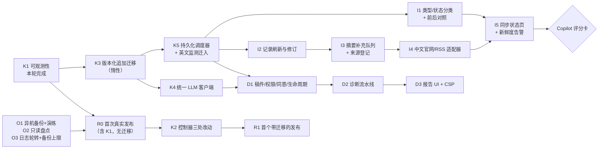

# FanScope V2 产品基线与交付计划

> 2026-10-29。本文记录 Product Owner 已确认的八项产品决定与新增需求"无人值守中英文文献持续更新"，并给出相应的技术方案与执行顺序。
> 架构原则沿用 [V2_ARCHITECTURE_REVIEW.md](V2_ARCHITECTURE_REVIEW.md) §0–§4；**评审文档 §5–§7 的顺序与待决事项由本文取代**。
> 证据等级沿用审计约定：**代码核实 / 测试核实 / 快照核实 / Unverified**。

## 1. 产品决定对架构的影响

| # | 决定 | 架构影响 | 落点 |
| --- | --- | --- | --- |
| 1 | 稿件仅上传者与有权的导师可见，其他成员需显式共享；服务端强制 | 现有 Lab 中 mentor 对原始会议文档是**全局可见**（[lab.mjs:173-174](../../api/src/lab.mjs#L173-L174)），诊断必须更严格：用一个统一的服务端授权函数判断"上传者 / 显式共享 / 与该课题或学生有关系的导师"。关系来源有两种：稿件关联的项目（项目 manager 或 member），以及新增的导师-学生关联表 | D1 |
| 2 | 原稿 14 天、报告 90 天、可主动删除、披露备份期 | 读取时按 `expires_at` 强制过期，再由定时清理做物理删除。原稿删除后保留一条"墓碑"元数据作为授权锚点，报告不级联删除。**发布控制器的备份目录当前"不自动清理"**（[CICD_V1_6_ZH.md](../CICD_V1_6_ZH.md)），必须先设定上限，否则稿件会无限期留在备份中 | D1、O3 |
| 3 | 只用 DeepSeek，不设金额上限 | 评审 §3.4 的失控防护保持不变。现有英文自动 AI 队列与诊断共享同一账户余额，因此交互和诊断优先，批处理遇到全局暂停时先停 | K4 |
| 4 | 默认趋势只统计已正式见刊、经核实的期刊论文；会议摘要单独成类；不删原始记录 | 新增两个维度的分类：**文献类型**与**发表状态**，每条附置信度和证据（§5）。首页默认口径改用新字段，并提供修订前后对照 | I1 |
| 5 | 已有访问与使用权限，尽量补全中英文摘要 | 按来源登记授权范围（自动访问 / 存储 / 检索展示 / 发送给第三方 AI），建立摘要补充队列并记录缺失原因；**禁止用 AI 生成摘要**（§6） | I3、I4 |
| 6 | Copilot 不设固定论文数门槛 | 多维准入评分卡：按问题动态判定可提供的辅助等级（§8） | C0 |
| 7 | 原则同意 R0，但需先盘点、异机备份、恢复演练与 CI | R0 前置清单（§10）；本轮已提供只读盘点脚本 | O1–O3、R0 |
| 8 | 诊断只对 Lab 登录成员开放 | 复用现有 Lab 会话与角色；不新增注册或匿名入口 | D1 |
| 新 | 无人值守持续采集 | **新增一个共享内核组件：持久化调度器**。采集、摘要补充、稿件过期清理三类任务共用它（§4） | K5、I1–I5 |

---

## 2. 无人值守采集：已有基础与缺口（代码核实）

**已经具备，可以继续使用的部分**

- **调度与关闭**：后台采集已经运行在服务器进程中，与浏览器无关。V1.4 入口按 `SCAN_INTERVAL_MINUTES`（≥30）定时扫描英文期刊，收到 SIGTERM 时会等待进行中的扫描完成（[v14-server.mjs](../../api/src/v14-server.mjs)）。
- **Crossref 增量**：按 index-date 窗口和 cursor 分页；游标只在页面提交后才推进；下一轮从"检查点减 2 天"处继续（[sources.mjs:55-98](../../api/src/sources.mjs#L55-L98)）。所以**中断、重启、来源故障都不会造成数据缺口，只会造成延迟**。
- **去重**：DOI 规范化后作为主键，同刊 URL 二次去重；中文使用组合身份键。
- **RSS**：抓取具备 SSRF 防护（主机白名单、DNS 固定、禁止重定向、禁止 DTD）。
- **中文采集引擎**：已实现官网目录解析与 `citation_*` 元数据解析（[chinese-ingestion.mjs:21-31](../../api/src/chinese-ingestion.mjs#L21-L31)），并读取 `Description`。官网页面同时提供中英文摘要（测试夹具核实），只是此前因为授权未确认而没有保存。
- **摘要补充**：Europe PMC 补充已实现，按 DOI 与 ISSN 双重核验。
- **状态展示**：每刊的 `last_checked/last_success/last_error` 与 `stale` 计算已有。
- **日志**：本轮新增的结构化日志已覆盖每刊检查的成功与失败。

**缺口**

| 缺口 | 证据 | 影响 |
| --- | --- | --- |
| 调度时间不持久：计时器从进程启动时开始计 | [v14-server.mjs](../../api/src/v14-server.mjs) 中的 `setInterval` | 频繁重启时扫描会被推迟甚至持续饿死；重启后无法得知"是否已经逾期" |
| **已有记录从不刷新** | [monitor.mjs:7-16](../../api/src/monitor.mjs#L7-L16) 使用 `INSERT OR IGNORE`，只有新插入时才写附加字段 | Online First 转为正式期次、后补的摘要、更正后的元数据都不会进入库内 |
| 中文没有无人值守路径 | 中文任务要由管理员逐步推进，而生产环境中文管理路由一律 404 | 中文论文只能依赖人工导入 |
| 摘要补充需要手动触发；OpenAlex 关闭 | `server.mjs` 中的 admin 路由 | 摘要覆盖率停滞（快照：2026 年为 50%） |
| 只扫描已有检查点的期刊 | [staged-recovery-server.mjs](../../api/src/staged-recovery-server.mjs) 的 `runEnglishMonitor` | 新增期刊不会自动进入监测 |
| 没有新鲜度告警 | `sourceSummary` 只在被查询时计算 | 监测静默停止时无人知晓 |
| 类型证据为空 | 快照中 18,216 条记录的来源类型标签全部为空 | 文章类型几乎无法确认（§5） |

---

## 3. 开源组件与外部接口评估

| 候选 | 结论 | 理由 |
| --- | --- | --- |
| **RSSHub** | **不部署**，可参考其路由写法 | 它是一个完整服务（Node，可选 Redis/浏览器），部分路由被标为反爬或测试失败；搜索中**未找到可确认的 CNKI 路由**（[RSSHub 期刊路由](https://docs.rsshub.app/routes/journal)）。我们的中文目标期刊多数自建官网并带有标准元数据标签，直接解析更稳定，也不涉及数据库抓取条款 |
| **changedetection.io** | **不部署**，借鉴"页面内容指纹 → 变化检测" | 它是 Python 服务并带浏览器，用于页面差异比较；我们需要的是结构化解析。借鉴点：对目录页模板计算指纹，结构变化时把来源标为降级 |
| Crossref 工具（habanero、crossref-commons 等，Python） | **不引入**；保留现有 Node 实现 | 现有窗口与游标实现已经更健壮。借鉴礼仪：带 `mailto` 进入 polite pool；**限额以响应头 `X-Rate-Limit-*` 为准，不在代码中写死**（2025–2026 年已多次调整，[Crossref 公告](https://crossref.org/blog/announcing-changes-to-rest-api-rate-limits/)、[社区更新](https://community.crossref.org/t/refining-rest-api-limits-for-improved-stability-and-reliability/16137)）；增量改用 `from-update-date` 以捕获元数据更新 |
| **OpenAlex API** | **采用**，直接调用 REST，不引入 pyalex | 需要免费 API Key，有每日用量额度，可通过 `/rate-limit` 查询（[官方认证文档](https://developers.openalex.org/guides/authentication.md)）。数据为 CC0；摘要以倒排索引形式提供，需要重建（现有代码已实现）。用途：补摘要、`type`/`is_paratext` 类型证据。**上线前先抽样测量各刊覆盖率** |
| **Europe PMC** | **已实现，改为自动运行** | 对 MEDLINE 收录的期刊有效。快照中摘要为 0% 的 *Social Science & Medicine*、*Health & Place*、*Aging & Mental Health* 等是否被覆盖，需要在 I3 中实测（Unverified） |
| OAI-PMH / Sickle（Python） | **借鉴语义，自写约 100 行的客户端** | 已有 fast-xml-parser；Sickle 的 resumptionToken 处理与 503 Retry-After 处理值得照搬。只有在某个来源确认支持 OAI-PMH 时才启用（此前调研未确认 19 本中文刊有统一的 OAI，见 [chinese-source-strategy](../chinese-source-strategy/README.md)） |
| RSS 解析库（rss-parser、feedparser） | **不引入** | 现有 `parseFeed` + `secureFeed` 已包含安全防护，更适合本项目 |
| 调度库（node-cron、croner、bree、agenda；BullMQ 需要 Redis） | **不引入** | 我们需要"持久化到期时间 + 租约 + 启动宽限"，60 秒一次的 tick 加 SQLite 一张表即可实现；cron 表达式解决不了重启补跑的问题 |
| systemd timer / 主机 cron 执行 `docker exec` | **不用于采集**，继续用于发布拉取 | 需要容器在运行；与应用的优雅停机、发布控制器的空闲检查各自为政；增加主机侧配置漂移 |
| Zotero translators | **只借鉴选择器思路**（AGPL，不复制代码） | 积累了大量站点级元数据抽取经验，可作为中文平台解析规则的参考 |
| Highwire `citation_*` / Dublin Core 元数据 | **采用为中文通用适配器的基础** | Google Scholar 收录规范要求这些标签，覆盖面广；现有解析器已实现 |
| DeepSeek 上下文缓存 | **在诊断提示词中利用** | 官方为自动磁盘缓存，按命中计费、尽力而为（[官方说明](https://api-docs.deepseek.com/news/news0802)）。把稿件全文作为稳定前缀放在最前，多维度评审可以复用缓存。并发上限与价格以官方当前页面为准（Unverified） |

---

## 4. 推荐的自动更新方案

### 4.1 进程与调度

- **仍在 API 进程内运行**。新增 `platform/scheduler.mjs` 与一张 `scheduled_jobs` 表，字段包括 `name, next_due_at, last_started_at, last_finished_at, last_status, last_error_code, consecutive_failures, lease_owner, lease_expires_at`。
- **每 60 秒 tick 一次**。到期任务先用条件 UPDATE 认领租约（120 s），执行期间续租；完成后写入 `next_due_at = 本次完成时间 + 间隔 + 抖动`。失败时按指数退避（上限 24 h）。
- **为什么不会漏采**：到期时间存在数据库里，与进程启动时间无关。重启后逾期的任务会**补跑一次**（不是补跑 N 次）；Crossref 的窗口从检查点开始，覆盖停机期间的空档。
- **启动宽限**：默认 15 分钟内不运行任何会写库的任务，避开发布控制器的"启动后整库指纹"检查（评审 N2）。
- **不会并发采集**：同一来源同时只能有一个租约持有者。管理员手动补采（CLI 或管理接口）与日常任务走同一套租约，所以不会重叠。全局最多同时采集 2 个来源；每个上游主机有令牌桶，并遵守 Retry-After。
- **优雅停机**：SIGTERM 时停止认领新任务，等待进行中的页面提交完成。沿用 v14 现有逻辑。

### 4.2 来源登记与适配器

- **来源登记**：每本期刊一个 `config/sources/<journal_id>.json`，经 PR 审查后生效。内容包括：
  - 适配器链（主来源与降级来源）；
  - 授权依据（谁、何时确认，范围，见 §6）；
  - 字段许可：`store / display / send_to_llm`；
  - 期刊政策，例如 `supplement_policy: meeting_abstracts | regular`；
  - 检查频率与新鲜度 SLA（例如英文 1 天检查、3 天告警；中文 7 天检查、21 天告警）。
- **适配器统一接口**：`discover(since, cursor) → {items, nextCursor, warnings}`，以及可选的 `details(item)`。规范化输出包含来源证据：URL、获取时间、原始字段哈希。
- **适配器类型**：
  - `crossref`：已有，改为基于更新日期的增量；
  - `rss`：已有；
  - `official-site`：已有解析器，改为每刊配置；
  - `oai-pmh`：新增，按需启用；
  - `openalex` 与 `europepmc`：只用于补充；
  - `authorized-export`：授权方定期投递 CSV/RIS/JATS 文件到服务器收件目录，自动导入，用来替代人工上传。

### 4.3 处理流水线

1. 发现
2. 规范化
3. **身份解析**：依次按 DOI、规范化 URL、（期刊, 规范化题名, 第一作者, 年份）匹配；
4. **增量写入（upsert）**：只在来源更新时间更晚，或优先级相同或更高时才更新字段；每次字段变化写入一条精简的修订记录，供解释与回溯；
5. **分类**：按 §5 的规则，规则版本化；
6. **摘要补充入队**：按 §6 的来源优先级；
7. **更新来源健康状态**：写入 `ingest_sources` 与 `ingest_runs`，后者保留 90 天后清理。

### 4.4 中文来源降级顺序

1. 授权 API 或数据接口（数据库机构接口、万方签名 API 等），以合同为准；
2. OAI-PMH（如有）；
3. 期刊平台 RSS；
4. **官网目录 + 文章页 `citation_*`/`Description` 元数据**（主力方案）；
5. Crossref（按 ISSN 查询，仅题录）；
6. 授权方定期文件投递（`authorized-export`）；
7. 人工 CSV（只作最后手段，不作为常规路径）。

**不采用**：对 CNKI 等数据库页面做 HTML 抓取（条款与反爬风险），以及依赖第三方 RSSHub 实例。

### 4.5 结构变化、限流与字段不全

- **结构变化**：每次运行统计解析成功率与必填字段（题名、期刊身份、日期、URL）的完整率。如果解析失败率超过 20%，或者在"期刊正常出版周期的 3 倍时间"内没有任何新条目，就把来源标为 `degraded` 并发出告警。**身份校验（ISSN 或刊名）不通过的记录一律不写入**；只写入通过校验的字段，绝不写入半截数据。目录页模板指纹发生变化时记录事件，供人工核对适配器。
- **限流**：以响应头和 Retry-After 为准；按主机的令牌桶；连续 429 时整个来源退避。
- **字段不全**：缺失字段保留为空，并记录缺失原因（`not_provided_by_source / not_authorized / source_unavailable / not_found / pending`）。日期精度如实记录。

### 4.6 资源与长期运行

- **数据库增长**：44 本期刊约每年 2–3 万条，含摘要约每年 40–80 MB，SQLite 无压力。
- **控制增长的手段**：`ingest_runs` 保留 90 天；日志文件保留 14 天，每日上限 50 MB（K1 已实现）；`meta` 表不再承载新状态。
- **内存**：分页流式处理，单页 ≤100 条，不在内存中累积整轮结果。
- **对外请求量**：44 本期刊每天检查一次，再加摘要补充（每轮 ≤200 条），远低于各来源的限额。

### 4.7 状态与告警

- **状态 API 与页面**：英文和中文分开展示每本期刊的
  - 最近成功检查时间、最新论文日期；
  - 近 30 天新增数；
  - 摘要覆盖率、类型置信率、日期精度率；
  - 最近失败原因（错误码与上游状态），来源状态（健康 / 降级 / 失败 / 停用）。
  
  公开接口只返回摘要信息，详情需要鉴权。
- **新鲜度端点**：`GET /api/ingest/freshness`。任何已启用来源超过 SLA 时返回 503。用免费的外部 uptime 服务轮询这个端点，**关闭电脑后也能收到告警**。

### 4.8 主要风险

| 风险 | 缓解 |
| --- | --- |
| 中文官网改版导致解析失效 | 每刊独立适配器、按 §4.5 判定降级、真实页面夹具做契约测试、降级到其他来源 |
| 来源限额收紧 | 以响应头为准，令牌桶，退避，每天只检查一次 |
| 单进程负载叠加（采集 + AI + API） | 采集并发 2，页间等待；如触发评审 §3.3 的条件再拆分进程 |
| 分类口径变化引起数字变动 | 规则版本化；提供修订前后对照；默认口径受测试保护 |
| 授权范围理解有误 | 授权依据逐来源登记并经 PR 审查；未登记一律按最保守处理 |
| 发布期间写库导致回滚 | 启动宽限 + 发布控制器暂停 |

---

## 5. 文献类型与发表状态分类规范

**两个独立维度，每条记录都附带 `confidence`（high/medium/low）与命中规则列表：**

| 维度 | 取值 |
| --- | --- |
| `doc_type` | research_article、review、short_communication、conference_abstract、conference_paper、editorial、news、letter_comment、book_review、correction_retraction、protocol、preprint、other、unknown |
| `pub_status` | issue_published（有卷期或页码、或有纸本日期）、online_first（有在线正式版日期、无卷期）、supplement（增刊）、preprint、unknown |

**信号与优先级**（从高到低；同一层内多个信号一致才提高置信度）：

1. **明确的负面类型**：题名或来源标签为 Erratum、Correction、Retraction、Editorial、Book review、In memoriam、News → 对应类型，high。
2. **期刊政策**：`supplement_policy=meeting_abstracts` 的期刊，其增刊记录 → conference_abstract，high。依据：快照中 *Innovation in Aging* 有 4,422 条增刊；而 *The Gerontologist*（10 条）、*JGSB*（37 条）、*Health Policy and Planning*（16 条）的增刊**不能**套用这条规则。
3. **来源明确类型**：Crossref `type`（`posted-content` 归为 preprint，`proceedings-article` 归为 conference_paper）与 `subtype`；Europe PMC/PubMed 的 pubType；OpenAlex 的 `type`/`is_paratext` → 对应类型，high；多个来源冲突时记为 unknown。
4. **组合启发式** → research_article，medium。条件：有正文级摘要（≥150 字符），且参考文献数 ≥10（Crossref `reference-count`），或页数 ≥4；同时题名不含会议场次特征。
5. 以上都不满足 → unknown，low。

**发表状态**：

- 有卷期或页码、或有纸本日期 → issue_published；
- 只有在线正式版日期 → online_first；
- 卷期中含 Suppl → supplement；
- 同一 DOI 从 online_first 变为 issue_published 时**原地更新状态，不会重复计数**。

**默认趋势口径**：`doc_type ∈ {research_article, review, short_communication}`，`pub_status ∈ {issue_published, online_first, supplement}`，置信度 ≥ medium，且期刊身份已核验。另外提供"仅原创研究"筛选与"会议摘要"独立分类。低置信与 unknown 不计入默认趋势，但页面会显示"未确认 n 篇"。

- Online First 纳入默认口径并按在线日期计时，理由是它是已发表的记录版本（Version of Record）。
- 是否把 review 纳入默认口径可以通过配置切换；我建议纳入，因为它属于正式学术论文。

**明确不采用**：仅凭"有 DOI"或"期刊名称"认定为正式论文。

**验证**：

- 从快照中按期刊分层抽取 200 条，人工标注；记录每个类别的精确率与召回率，作为规则基线；
- 回归测试固定这批样例；
- 修订首页时随 PR 提交"修订前后对照"：按月、按刊、按类别的数量变化，以及差异解释（主要来源预计是会议摘要被排除和 unknown 被排除）。

---

## 6. 摘要来源：授权与获取矩阵

授权依据：PO 于 2026-10-29 确认拥有相应的文献访问与使用权限。下表把这一确认落实到逐个来源；"需核对"表示上线前由负责人核对供应商当前条款，并在来源登记中写明版本与日期。

| 来源 | 自动访问 | 存储 | 站内检索/展示 | 发送给 DeepSeek | 说明 |
| --- | --- | --- | --- | --- | --- |
| Crossref REST | 是（polite pool，按响应头限速） | 是 | 是 | 是 | 题录为 CC0；摘要版权归出版社，依据 PO 授权使用；很多出版社（如 Elsevier）不提交摘要 |
| OpenAlex | 是（免费 Key，有每日额度） | 是 | 是 | 是 | CC0；倒排索引需重建；先抽样测量覆盖率 |
| Europe PMC | 是 | 是 | 是 | 是（需核对 PubMed/出版社摘要条款） | 对 MEDLINE 期刊有效 |
| 出版社官网 HTML（ScienceDirect、T&F 等） | **否** | — | — | — | 条款通常禁止自动抓取；只能通过机构授权的 API（例如出版社 TDM 接口）访问，并单独登记 |
| 中文期刊官网（目录页、文章页 `citation_*`/`Description`） | 是（逐刊登记授权，限速，遵守 robots） | 是 | 是 | 是（按登记） | 主力方案；中英文摘要都可获取 |
| CNKI、万方、维普等数据库 | 仅通过合同约定的 API 或导出 | 按合同 | 按合同 | 按合同 | **不做页面抓取** |
| AI 生成的摘要 | **禁止** | — | — | — | 缺失就如实标注 |

每条摘要都记录来源、获取时间、原始链接与内容哈希。没有摘要时记录缺失原因，并安排重试（1 天、7 天、30 天，之后停止）。

---

## 7. Paper Diagnostic：权限与生命周期设计

**授权函数**：`canAccess(user, submission)`，满足以下任一条件即可访问：

- 上传者本人；
- 被上传者显式共享的用户；
- 角色为 mentor，且满足以下之一：稿件关联项目的 manager 或 member；或在 `lab_advisor_links(mentor_id, student_id)` 中与上传者有关联。

关联表由 mentor 或 lab_admin 维护，变更写入 `lab_events`。列表、详情、下载、报告、删除等所有接口都调用同一个函数，前端不参与授权判断。测试需要覆盖：上传者、被共享者、有关系的导师、无关系的导师、普通成员、未登录用户。

> 注意：在建立导师-学生关联之前，导师默认看不到学生稿件。这符合"有权访问"的定义，但上线前需要由管理员配置关联。

**生命周期**：

- 创建时写入 `original_expires_at = 上传时间 + 14 天` 与 `report_expires_at = 上传时间 + 90 天`；
- **读取时强制**：过期内容一律返回 410，即使清理任务滞后也不会被读到；
- **定时清理**：调度器每小时运行一次。先把行标为 `purging`，再删除文件，再清空文本并写入 `purged_at`。每一步都幂等，重启后会继续执行；
- 原稿删除后保留墓碑行（所有者、共享关系、项目关联、同意记录），报告继续受同一授权函数保护，直到 90 天到期；
- 用户主动删除走同一条清理路径，并立即生效；
- 报告中的原文摘录和报告本身一起删除。

**备份披露**：

- 删除后，数据仍可能存在于加密异机备份中，最长不超过 O1 设定的保留期（建议 35 天：7 个每日 + 4 个每周）；
- 发布控制器的备份建议保留最近 3 次发布，且不超过 35 天（O3）；
- 同意页显示这个实际数值。

**验证**：用模拟时钟测试到期；进程重启后清理仍会执行（子进程测试）；文件与行都被删除；报告在原稿删除后仍可访问；越权访问返回 403；日志中没有正文。

---

## 8. Copilot 多维准入标准（不设固定论文数）

每个问题在运行时计算一张评分卡，决定可提供的辅助等级，并把评分卡展示给用户：

| 维度 | 指标 |
| --- | --- |
| 相关性 | 检索结果的相关性分数分布；离线评测集（每个领域 ≥30 条人工标注查询）的 nDCG@10 与 recall@20 |
| 来源可靠性 | 证据集中期刊身份已核验、文献类型置信 ≥ medium 的比例 |
| 摘要覆盖率 | 证据集中有摘要的比例 |
| 方法信息完整度 | 证据集中有经引用核验的设计、方法、数据库提取的比例 |
| 时效 | 相关来源是否在新鲜度 SLA 内 |
| 市场构成 | 中文与英文证据的占比，单一市场不足时显式标注 |

| 等级 | 能力 | 初始门槛（上线后用评测校准） |
| --- | --- | --- |
| L0 检索与清单 | 返回论文列表与分布 | 来源新鲜 |
| L1 描述性综述 | 带引用的主题概述 | 摘要覆盖 ≥40%，可靠性 ≥80% |
| L2 方法与数据分析 | 方法、数据库、样本的分布与比较 | 摘要覆盖 ≥70%，方法信息 ≥50% |
| L3 选题建议 | 候选方向与可行性 | 满足 L2，且该领域评测集经人工评分达标 |

**启动 Copilot 开发的项目级条件**：四个优先领域（社会保障/养老保险、老龄与长期照护、社会救助、数字养老）中，至少在英文上能稳定达到 L1，并且检索评测基线已经建立。数据不完整时仍可提供 L0/L1 辅助，但回答顶部必须说明覆盖限制。

---

## 9. 无人值守采集验收流程

### A. CI 自动化（模拟时钟 + Mock 来源，每个采集 PR 必须通过）

1. **无人值守**：测试期间没有任何对 API 的 HTTP 访问，调度器仍按到期时间运行，新论文入库。
2. **重启**：在采集中途杀掉子进程，重启并经过宽限期后从游标继续；没有重复行，租约过期后被正确接管。
3. **来源故障**：连续若干轮返回 503 或 429 时按规则退避；恢复后补采覆盖空档，入库数与 Mock 来源总数一致。
4. **重复出现**：同一 DOI 先后经 Crossref、RSS、OpenAlex 出现，最终只有 1 行，并有修订记录。
5. **会议摘要**：增刊会议摘要被归为 conference_abstract，默认趋势接口不计入，会议摘要专属筛选可以查到。
6. **缺失摘要**：记录了缺失原因，按计划重试，全程没有任何 AI 调用。
7. **日志**：失败时产生 `ingest.source_failed`，带 journal_id、上游状态和 job_id。
8. **长期增长**：模拟 60 天运行，`ingest_runs` 与日志文件被清理，堆内存在多轮之后保持稳定（阈值写入测试）。
9. **市场分离**：状态接口分别返回英文与中文的同步状态。

### B. 生产观察期（需审批的发布之后，由管理员执行）

1. 配置外部 uptime 服务监控 `/api/health` 与 `/api/ingest/freshness`，然后**关闭所有浏览器和本地工具**。
2. 连续 7 天，每天查看状态页与告警，确认每个已启用来源都在 SLA 内。
3. 在维护窗口内受控重启一次，在日志中看到补采发生。
4. 任选 2 本英文刊、1 本中文刊，把新增 DOI 或题名与来源直接对账。
5. 记录第 1 天与第 7 天的数据库体积、日志目录体积和容器内存。

---

## 10. 重新排列的开发优先级

**为什么这样排**：

- **K5 调度器前移**：采集、摘要补充、稿件清理三条线都依赖它，只需实现一次。
- **K3 先于一切新表**：而且以惰性方式合并，不影响 R0。
- **开发与发布解耦**：采集线和诊断线在 K5 之后可以并行开发（目录不相交）；生产发布由 R0 → K2 → R1 把关。

**并行规则**：同时最多 1 个信任根 PR、2 个产品 PR；热点文件（`server.mjs`、`v14-server.mjs`、`api/migrations/`、`test.yml`）串行修改。

| 任务 | 验收要点 | 估计 |
| --- | --- | --- |
| **K1 可观测性（本轮完成）** | 见 PR；225 项测试通过 | — |
| K3 版本化追加迁移 | 迁移目录为空时镜像启动零变化；lint 拒绝非追加语句；旧库受保护列指纹不变；旧代码可在新库上启动；CI 检查 FTS5 | 2–3 天 |
| K5 调度器 | 到期时间持久化；租约；宽限期；补跑一次；退避；手动任务与定时任务不重叠；SIGTERM 时等待；英文监测迁入并保持行为等价（现有 monitor 测试全部通过） | 2–3 天 |
| I1 分类 + 前后对照 | §5 的规则与 200 条标注基线；默认趋势改用新口径；提交对照报告 | 3–4 天 |
| I2 记录刷新 | 按来源更新时间增量 upsert；修订记录；online_first 到 issue_published 的转换 | 2–3 天 |
| I3 摘要补充 + 来源登记 | Europe PMC 与 OpenAlex 自动补充；缺失原因与重试计划；授权矩阵生效 | 3–4 天 |
| I4 中文适配器 | 官网 `citation_*`/`Description` 与目录页；真实页面夹具；降级判定；每刊配置 | 4–6 天，取决于刊数 |
| I5 状态页 + 新鲜度 | §4.7；§9-A 全部用例 | 2–3 天 |
| K4 LLM 客户端 | 评审 §3.4 | 3–4 天 |
| D1–D3 诊断 | §7 与评审 §3.5 | 8–12 天 |
| K2、R1 | 评审 §3.2 | 2–4 天 + 管理员操作 |

---

## 11. R0 前置条件（全部满足后才申请执行）

1. **O2 只读盘点**：执行 [scripts/ops/readonly-inventory.mjs](../../scripts/ops/readonly-inventory.mjs)，结果脱敏后入库。核对入口命令（`docker inspect` 中的 `.Config.Cmd`）、镜像 label、启用期刊、各刊摘要覆盖、增刊数量和主机余量。
2. **O1 异机备份与恢复演练**：存在 24 小时以内的加密异机副本；完成一次隔离恢复，`integrity_check` 为 ok，并与 O2 的表计数一致。
3. **O3**：日志轮转已生效；发布备份目录的保留上限已设定。
4. **CI**：K1 PR 的 Linux `required` 全绿，包括 Docker 发布与回滚演练。
5. **发布手册**：后端拉取控制器已按 [CICD_V1_6_ENABLE_ZH.md](../CICD_V1_6_ENABLE_ZH.md) 安装，nginx 维护门禁已验证，`BACKEND_CD_ENABLED` 由管理员开启。
6. **执行**：在维护窗口内按手册执行，GitHub 审批与主机结果分别核对；失败时保持维护模式，按手册恢复。
