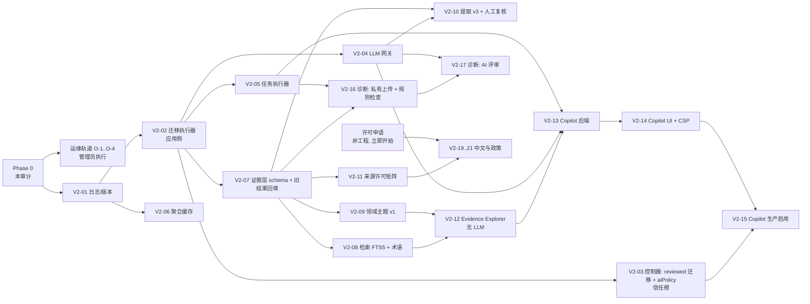

# FanScope V2.0 增量开发路线图

> 依据：[FOUNDATION_AUDIT.md](FOUNDATION_AUDIT.md)（发现编号 P1-x/P2-x）与 [V2_TARGET_ARCHITECTURE.md](V2_TARGET_ARCHITECTURE.md)（设计章节 §x）。
> 编号 `V2-xx` 是计划中的独立 PR，不是 GitHub PR 号。工作量单位为人日，不含审批与管理员操作等待，不确定性标在括号内。
>
> **2026-10-29 评审更新：本路线图已被 [V2_ARCHITECTURE_REVIEW.md](V2_ARCHITECTURE_REVIEW.md) §5–§6 取代。** 原各 PR 的保留、合并、推迟或删除见其中"原 PR 计划的处置"表。本文仅作历史参考。

## 0. 原则

- **先做最便宜、杠杆最高的底座**（日志、迁移、网关、任务），然后尽快交付一个不花 AI 费用的科研工作流（Evidence Explorer），再接入 LLM。
- 每个 PR 只做一件事，可以独立审查和回滚；功能开关默认关闭；不重构既有模块。
- **投入比例**：Phase 1 本质上是稳定性工作，约 2–3 周。此后按约 **75% 科研产品价值 / 25% 稳定性**（测试、监测、运维、技术债）推进。出现生产事故或 P1 回归时，暂停当前阶段的新功能，先修复。
- 遵守 AGENTS.md：独立分支、Draft PR、真实测试结果、不自动合并或部署。

### 通用完成标准（每个 V2 PR 都适用）

1. Linux GitHub Actions `required` 全绿；既有 216 项 API 测试与浏览器验收不删除、不跳过。
2. 涉及数据库的 PR 必须包含"受保护表指纹不变"测试（旧库夹具 → 迁移/操作 → 比对 `articles`/`journals`/`lab_*`/`analysis_*`）。
3. 新代码使用结构化日志（V2-01 合并后），并提供本 PR 的错误码清单；日志测试断言不包含任何密钥模式或正文。
4. 测试中付费 API 一律使用 Mock 或合约夹具；不发起真实付费调用。
5. 新功能有开关且默认关闭；PR 描述写明生产启用步骤与回滚方法。
6. 若在 Windows 本地运行测试，标注与 Linux/Node 22 的差异。

---

## 1. 依赖关系与顺序调整

**相对初始顺序（Foundation → P0/P1 → Evidence → Copilot → Diagnostic → CN & Policy → 集成）的调整与理由**：

1. **Phase 1 拆成"应用侧"与"信任根/运维"两条轨道**。控制器改动（V2-03）需要管理员审查并重装主机，前置时间不可控；应用侧的迁移执行器先以"不随 import 执行"的方式合并（对现有控制器无副作用），开发不必等待主机操作。
2. **在 Copilot 之前插入 Evidence Explorer（V2-12，无 LLM）**。证据层与检索的质量必须先由真实使用来检验；它不产生 AI 费用，又能立即提供"按主题/方法/数据库检索并看证据"的科研价值，也是 Copilot 的检索后端。
3. **诊断的"私有上传 + 规则检查"（V2-16）可在 V2-07 之后与 Copilot 并行**。它只依赖平台和证据层，与 Copilot 代码不交叉，适合交给另一个代理在独立分支上开发。
4. **中文来源许可申请（非工程）现在就开始**。它的周期最长，决定 Phase 5 能做什么；工程实现仍放在最后。
5. **日志（V2-01）排在第一位**。成本最低，后续每个 PR 的调试都受益，也直接回应"错误信息笼统"的历史问题。

---

## 2. Phase 1：P1 最小整改（底座）

### 运维轨道（管理员执行，不是代码 PR；需要用户逐项批准）

| ID | 操作 | 对应发现 | 完成标准 |
| --- | --- | --- | --- |
| O-1 | 异机加密备份（每日）+ 每月隔离恢复演练 | P1-6 | 有 ≤24 h 的异机副本；最近一次演练 integrity 为 ok，结果 JSON 存档；RPO/RTO 写入手册 |
| O-2 | compose 日志轮转（json-file 10 MB × 5） | P2-13 | `docker inspect` 显示 LogConfig；磁盘告警阈值记录在案 |
| O-3 | 生产只读盘点：入口命令、镜像 label、启用期刊、中文 349 条是否在库、主机 RAM/磁盘/其他容器 | 审计 §6 | 脱敏结果写入 `docs/architecture/` 附录（不含密钥与私人数据） |
| O-4 | V2-01 合并后，用**现有控制器**做一次不含结构变化的后端发布演练 | P2-2 | `result.json` 为 success；health 中的 `commit` 等于发布 SHA；备份与演练记录齐全 |

### V2-01 结构化日志、请求关联与版本可见（P1-4）

- **用户价值**：出现故障时，凭一个 request_id 就能定位"哪一步、哪个上游、什么错误码"。
- **范围**：
  - `v2/platform/log.mjs`：JSON Lines、固定字段、`redact()`；
  - HTTP 包装层生成/透传 `X-Request-Id`，记录访问日志（方法、路由模板、状态、耗时）；
  - 错误响应体增加 `request_id`；
  - `server.mjs:182` 改为结构化记录（含 stack，不含请求体）；
  - `/api/health` 增加 `commit/schemaVersion/node/sqlite/flags`；
  - Dockerfile 与 backend-release 注入 `FANSCOPE_COMMIT`；
  - 监测扫描的汇总日志改为结构化。
- **不做**：不改业务逻辑；不替换所有 `console.*`（只改 HTTP、监测和 AI 失败路径）。
- **测试**：日志字段断言；脱敏测试（构造包含 Key/Bearer/邮箱的错误）；响应头测试；health 字段测试；控制器 `health()` 兼容测试（新增字段不影响现有断言）。
- **完成标准**：上述测试通过；本地制造一次 Crossref 失败，日志中能看到 `upstream.status` 与 request/job 关联。
- **工作量**：1–2（低）。

### V2-02 显式迁移执行器：应用侧（P1-1 前半）

- **范围**：
  - `api/migrations/NNNN_*.sql`；
  - `src/v2/platform/migrate.mjs --plan|--apply --db=…`，只在显式调用时执行，记录版本、校验和、commit 和耗时；
  - 首次 apply 时才建立自己的记账表，因此**不改变镜像启动行为**，与现有控制器兼容；
  - 静态测试：`api/src/**` 中除既有位置外不得新增 `CREATE TABLE`/`ALTER TABLE`；
  - CI 中检查 FTS5 与 trigram 可用（Node 22）；
  - 锁定 Dockerfile 的 Node 补丁版本与 CI 的 node-version（P2-9）。
- **测试**：用 `v12-schema.sql` 加当前结构构造旧库夹具 → apply 示例迁移 → 受保护表指纹不变；重复 apply 幂等；校验和不一致时拒绝；旧代码在迁移后的库上能启动并通过 health。
- **完成标准**：示例迁移可规划、可应用、可从冻结快照回滚（用 `sqlite_release.restore`）；镜像启动时数据库零变化（现有 Docker 演练通过）。
- **工作量**：2–3（中）。

### V2-03 发布控制器：reviewed 迁移与 aiPolicy（P1-1 后半，P1-5）

- **信任根变更**：涉及 `scripts/cicd/*`、`deploy/cicd/*` 与 `backend-release.yml`。按 CICD 手册单独严格审查，**合并后需要管理员重装主机控制器**，因此把所有控制器改动合并为这一个 PR，只重装一次。
- **范围**：
  - manifest 增加 `migrationPolicy:'reviewed'`、`migrations:[ids+sha256]`、`aiPolicy:{modules, dailyBudgetCny}`；
  - 控制器在冻结副本上 apply 迁移 → 校验"受保护表指纹不变、只有白名单的新表/列" → 候选镜像无网络启动演练 → 维护窗口内应用到生产 → 失败时恢复冻结快照与旧镜像；
  - health 断言从"AI 必须关闭"改为"AI 配置必须与 `aiPolicy` 一致"；
  - 审批摘要在 GitHub Step Summary 中列出迁移与 AI 策略，供审批人核对。
- **测试**：Python 编排测试新增以下场景：未知迁移、校验和不符、保护表被改、`aiPolicy` 与 Key 不一致、迁移失败后的回滚；CI Docker 演练加入一个示例迁移。
- **完成标准**：上述测试与 CI 演练通过；管理员重装后，O-4 式演练再跑一次成功。
- **工作量**：2–4（高，含审查往返）。

### V2-04 LLM 网关、账本与预算（P1-2，部分 P2-3）

- **范围**：
  - 实现 §5.1：`llm_calls`、`llm_budgets` 迁移；
  - 价格表配置（缺失即拒绝）；
  - 四级预算；幂等键；响应缓存；超时与 abort；错误分类；结构化日志；
  - 全局日预算计入旧 `analysis_usage_log`；
  - 合约夹具（脱敏真实响应 6 类；若暂时没有真实样本，夹具须标注"按官方文档构造，待替换"）。
- **不做**：不迁移旧的 `ai.mjs`/`brief.mjs`/`lab.mjs` 调用（后续单独 PR）；不启用任何真实调用。
- **测试**：预算耗尽时不发请求；并发双提交只产生一次调用；uncertain 不重放；4xx 不计费；缓存命中不计费；未配置价格时拒绝；日志不含 messages。
- **完成标准**：全部测试通过；模块熔断能在测试中触发与恢复。
- **工作量**：3–5（中）。

### V2-05 任务执行器（P2-5，为 Copilot/诊断做准备）

- **范围**：
  - 实现 §5.2：`task_runs` 迁移、领取与续租、阶段持久化、取消、超时、重启恢复规则（含 reserved 调用时转为 blocked）、每模块并发槽与熔断；
  - 进程内 worker 循环（开关 `FANSCOPE_V2_WORKER`）+ 独立入口 `src/v2/worker.mjs`（暂不部署）。
- **测试**：两个 worker 竞争同一任务时只有一个领取成功；进程被杀后恢复（使用子进程测试）；取消发生在阶段之间与 LLM 调用之中；超时；熔断。
- **完成标准**：上述测试通过；任务的全部状态转换都有对应日志事件。
- **工作量**：3–4（中）。

### V2-06 研究聚合缓存（P2-1）

- **范围**：在 `research.mjs`/`stats` 外包一层按（规范化查询, data_version）的 LRU；采集或 AI 写入时递增 `data_version`；给接口记录耗时日志；nginx 限流建议写入文档（不改生产配置）。
- **测试**：缓存命中/失效；数据写入后结果更新；合成 50k 基准作为非阻塞性能测试并记录。
- **完成标准**：缓存命中时 p95 < 50 ms；首页现有浏览器验收通过。
- **工作量**：1–2（低）。

---

## 3. Phase 2：Research Data & Evidence Foundation

### V2-07 证据层 schema 与旧结果回填（P1-3）

- **用户价值**：每个 AI 字段都能看到出处、模型、版本和是否经过人工确认。
- **范围**：迁移 `src_licenses`、`ev_documents`、`ev_chunks`(+fts)、`ev_extractions`、`ev_reviews`、`ev_claims`、`ev_claim_support`；回填迁移把现有摘要写入 `ev_documents(kind='abstract')` 与分块，把 `analysis_json` 写入 `ev_extractions(layer='ai', extractor_version='legacy-v2')`，**不发起任何 AI 调用**；只读 API `/api/v2/papers/:id/profile` 返回值、层级和引用。
- **测试**：回填前后受保护表指纹相等；回填幂等；层级解析顺序；摘要变更后旧提取被标为不再当前；V2 源码不写旧表的静态测试。
- **完成标准**：在合成库与 O-3 授权的生产副本（若管理员提供脱敏副本）上回填成功，计数一致。
- **可延后**：全文文档、政策文档。
- **工作量**：4–6（中）。

### V2-08 检索：FTS5 + 中英术语扩展

- **范围**：英文 unicode61、中文 trigram 两套 FTS；2 字中文词用 `LIKE` 兜底；`config/terms-social-security.v1.json` 中英受控词表；`/api/v2/search`（结构化过滤 + bm25 + 时间加权）；评测集 40–60 条查询，由导师或用户审核标注后入库。
- **测试**：分词与兜底；过滤正确性；recall@20 评测作为 CI 报告（初期不设阈值，只记录基线）。
- **完成标准**：评测基线记录在 PR 中；p95 检索 < 200 ms（合成 50k）。
- **工作量**：3–4（中，评测标注需用户参与）。

### V2-09 领域主题 v1（规则层）

- **范围**：社会保障、老龄化、社会政策主题树（养老保险、医疗保障、长期护理、社会救助、老龄健康、家庭政策、数字养老等），采用最长匹配并加排除词（修正"养老"误命中"养老保险"的问题）；结果写入 `ev_extractions(layer='rule')`。**现有 `articles.topics` 与首页趋势不变。**
- **测试**：误判用例（养老保险、养老金、公共政策泛匹配）；规则版本升级产生新行。
- **完成标准**：抽样 100 篇，由用户或导师确认准确率并记录（不预设通过线，首轮作为基线）。
- **工作量**：2–3（低）。

### V2-10 摘要层提取 v3 与人工复核

- **范围**：schema v3（§4.4），经网关调用并带提示词版本；批次、预算与暂停复用任务执行器；Lab 中提供"接受/更正/驳回"复核页，写入 `ev_reviews`。
- **测试**：合约夹具；引用校验；粒度门禁；复核覆盖解析结果。
- **完成标准**：代码合并时开关关闭；**任何真实付费批次需要用户单独批准数额与范围**。
- **工作量**：4–5（中）。

### V2-11 来源许可矩阵（P2-14）

- **范围**：`src_licenses` 管理，仅 mentor 可操作；检索、展示和发送给 LLM 时按矩阵门禁，未知按最保守处理（只显示题录、不发送给模型）。
- **工作量**：2（低）。

---

## 4. Phase 3：Research Copilot MVP

### V2-12 Evidence Explorer（无 LLM）

- **用户价值**：研究生能按"主题 × 方法 × 数据库 × 年份"检索，看到每篇的证据卡片（层级、引用、粒度），以及确定性的分布统计与缺失比例。**零 AI 费用。**
- **范围**：`/lab/` 新标签页；复用 V2-08 检索与 V2-07 档案；聚合口径沿用 `research.mjs`（有效 n、缺失比例）。
- **测试**：浏览器验收 1440/390（沿用现有 Playwright 框架）；无外部请求；粒度标签显示正确。
- **完成标准**：课题组用户试用后的反馈记录在 PR 或 issue 中。
- **工作量**：3–4。

### V2-13 Copilot 后端

- **范围**：`cp_conversations`/`cp_turns` 迁移；`copilot.turn` 任务（意图 → 检索 → 聚合 → 组织回答 → 校验 → 持久化）；claim 校验器；滚动摘要；会话与用户预算；API `/api/v2/copilot/*`（202 + 轮询）。
- **测试**：
  - 回答 30 条固定问题（模型输出用合约夹具/Mock）：证据 ID 100% 合法；方法类断言 100% 达到 abstract 粒度；不合格条目被降级；
  - 预算耗尽、取消、重启恢复；
  - 每轮都能用 request_id 还原全部阶段。
- **完成标准**：上述测试通过；开关关闭合并。
- **工作量**：5–7（中高）。

### V2-14 Copilot UI 与 CSP（P2-11）

- **范围**：对话界面、证据面板、粒度下限横幅、本轮/会话成本、取消按钮；生产 CSP（`script-src 'self'`，`connect-src` 只允许 API 域名），并确认既有页面在 CSP 下正常。
- **测试**：浏览器验收，包括恶意 Markdown/HTML 输出不执行，以及现有全部浏览器验收。
- **工作量**：3–4。

### V2-15 Copilot 生产启用（依赖 V2-03 已部署）

- **范围**：运行时白名单加入 `/api/v2/copilot/*` 与 `/api/v2/search`；manifest `aiPolicy` 启用 copilot 并设日预算；先对 mentor 单人灰度。
- **完成标准**：管理员发布成功；真实环境一次对话的 request_id 能在日志中完整追踪；预算与熔断在生产配置中可见；**用户批准后**扩大到课题组。
- **MVP 范围**：英文摘要 + 中文题录（标注粒度）；意图为概览、方法分布、数据来源、候选方向。
- **延后**：全文、向量检索、流式输出、分享、导出、跨会话记忆。

---

## 5. Phase 4：Paper Diagnostic MVP

### V2-16 私有上传、同意与规则检查（可与 Phase 3 并行）

- **用户价值**：不调用 AI 也能得到结构化的初步检查（研究问题、假设、样本与数据陈述、因果用语与设计是否一致、局限性章节）。
- **范围**：`dx_submissions`/`dx_findings` 迁移；私有 `ev_documents`；30 天保留与删除；按篇的 `ai_consent`；章节切分；规则引擎（每条规则带 ID 和版本）。
- **测试**：权限（只有本人和 mentor 可见，按需求确认）；删除后文件与行被清除；日志中没有正文；规则用例。
- **工作量**：4–5。

### V2-17 AI 评审与四栏报告

- **范围**：按章节分阶段的评审任务，经网关执行；findings 必须带 `basis`；文献对照复用检索；报告四栏展示，并声明"不构成审稿结论"。
- **测试**：Mock 模型输出中，`material_fact` 缺少引用的会被降级；超出预算时返回部分报告并说明原因；单节失败可单独重试。
- **工作量**：4–6。
- **视情况**：V2-18 worker 拆分为独立容器（§2 触发条件；控制器需要支持双服务，属于信任根变更）。

---

## 6. Phase 5：Chinese Journal & Policy Research Intelligence

- **前置条件**：许可申请有结果（逐刊、逐字段）。若无法取得摘要授权，本阶段只能做题录级的趋势与检索，并在 UI 中明确标注。
- **V2-19**：已授权来源的增量适配器（复用 `chinese-ingestion`），加每日新鲜度告警（P2-10）。
- **V2-20**：政策文档库（公开文件；来源、机关、文号、日期、抓取时间）与论文-政策关联（确定性提及 + 需人工复核的 AI 建议）。
- **V2-21**：热点与空白视图（复用 Copilot 的聚合与 claim 机制）。
- **工作量**：10–20（高，取决于来源数量与许可条件）。

## 7. Phase 6：跨模块集成验收

- 三个模块同时运行时，任一模块熔断或预算耗尽不影响其他模块，也不影响既有监测与 Lab（故障注入测试）。
- 全量回归：既有 API、浏览器验收与 V2 测试全部通过；受保护表指纹在 V2 全部操作前后不变。
- 一次完整的灾备演练：异机备份恢复到隔离环境，V2 数据与旧数据一并核对。
- 成本报告：按模块、用户和日期统计实际费用与预算使用率。

---

## 8. 第一批建议创建的 PR

| 顺序 | PR | 类型 | 可并行 | 需要管理员 |
| --- | --- | --- | --- | --- |
| 1 | V2-01 结构化日志、request_id、版本可见 | 代码 | — | 否 |
| 2 | V2-02 显式迁移执行器（应用侧）+ Node 锁定 + FTS5 CI 检查 | 代码 | 与 V2-06 并行 | 否 |
| 3 | V2-04 LLM 网关、账本与预算 | 代码 | 与 V2-05 并行 | 否 |
| 3 | V2-05 任务执行器 | 代码 | 与 V2-04 并行 | 否 |
| 2 | V2-06 研究聚合缓存 | 代码 | 是 | 否 |
| 4 | V2-03 控制器：reviewed 迁移 + aiPolicy | 信任根 | 与 Phase 2 并行 | **是（重装）** |
| 随时 | O-1 异机备份 · O-2 日志轮转 · O-3 生产只读盘点 · O-4 无结构变化的发布演练 | 运维 | 是 | **是** |

预计 Phase 1 代码约 12–20 人日（不确定性中等），运维轨道取决于管理员可用时间。

## 9. 发现 → PR 映射

| 发现 | 处理位置 |
| --- | --- |
| P1-1 迁移 | V2-02、V2-03 |
| P1-2 AI 成本 | V2-04（旧路径迁移另立 PR） |
| P1-3 结果版本/层级 | V2-07 |
| P1-4 可观测性 | V2-01 |
| P1-5 运行时/控制器 | V2-03、V2-15 |
| P1-6 异机备份 | O-1 |
| P1-7 数据粒度 | V2-07～V2-11 + Copilot 门禁 + 许可申请 |
| P2-1 聚合阻塞 | V2-06 |
| P2-2 后端 CD 首次运行 | O-4 |
| P2-3 合约测试 | V2-04（DeepSeek）；Crossref/Europe PMC 夹具在后续触及时补充 |
| P2-4 meta | V2 一律使用专表；清理任务放入 25% 稳定性预算 |
| P2-5 进程内单例 | V2-05 |
| P2-6 公开诊断接口 | 稳定性预算（S） |
| P2-7 鉴权 | V2-13/V2-16 复用 Lab 会话；管理操作审计放入稳定性预算 |
| P2-8 双副本 | 本 PR 已更新 AGENTS.md；归档由用户决定 |
| P2-9 运行时锁定 | V2-02 |
| P2-10 监测告警 | 稳定性预算（S），V2-19 前必须完成 |
| P2-11 CSP | V2-14 |
| P2-12 邮件幂等 | 启用邮件前 |
| P2-13 日志轮转 | O-2 |
| P2-14 许可边界 | V2-11 |
| P3-* | 触及相关文件时顺手处理，不单独排期 |

## 10. 明确延后的内容

全文获取与解析、向量检索、流式输出、多机部署/PostgreSQL、邮件通知恢复、公开（未登录）AI、Copilot 会话分享与导出、诊断的 OCR 与修订痕迹、自动生成审稿意见信。每一项都需要先有明确的用户需求或触发条件（见架构文档 §2、§8）。
