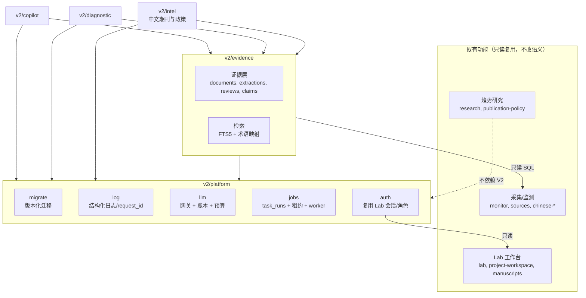

# FanScope V2.0 目标架构：AI Research Decision Support System

> 基线：`main` @ `12310c8`。本文是设计提案，**不代表已实现**；三个模块目前都只是待评审的需求。
> 依据：[FOUNDATION_AUDIT.md](FOUNDATION_AUDIT.md)（文中 P1-x/P2-x 指审计发现）。实施顺序见 [V2_INCREMENTAL_ROADMAP.md](V2_INCREMENTAL_ROADMAP.md)。

## 0. 设计原则

1. **证据优先**：每条科研结论都必须链接到证据条目，并标注证据粒度。"证据不足"是一种正式的回答类型，不算失败。
2. **来源分层、只追加不覆盖**：来源事实 → 规则推导 → AI 提取 → 人工修订，四层分别存储；上层不改写下层。
3. **成本有硬上限**：所有模型调用只经过一个网关，先预留账本，再在调用前做四级预算检查；不确定的请求不重放。
4. **隔离**：三个模块在代码边界、任务队列、预算和功能开关四个层面隔离，既有文献监测与 Lab 只读复用。
5. **低资源优先**：继续使用 SQLite + FTS5，不引入向量库、Redis 或微服务；保留明确的扩容触发条件。
6. **可审查的增量**：新表必须经显式迁移；功能开关默认关闭；先对课题组内少数用户灰度。

---

## 1. 现有模块复用评估

| 现有能力 | 复用方式 | 需要扩展 |
| --- | --- | --- |
| `articles` / `journals` 文献库与日期、缺失字段、来源证据 | 作为论文注册表，V2 **只读** | 不加 AI 列；新信息进入证据层 |
| 采集（Crossref 增量、Europe PMC 补摘要、中文离线导入） | 原样保留，继续供数 | 采集写入后递增 `data_version`，用于缓存失效 |
| `ai.mjs` 账本预留、错误码、引用校验 | 抽取为平台 LLM 网关的核心模式 | 加金额预算、幂等键、提示词版本、统一账本 |
| `automatic-ai.mjs` DB 租约 | 作为 V2 任务领取模式 | 泛化为 `task_runs` 租约 |
| `research.mjs` 聚合口径（有效 n、缺失比例、类型筛选） | 复用口径与告警文案 | 改为基于证据层聚合，并加缓存（P2-1） |
| `brief.mjs` 的"声明必须引用给定 ID"校验 | 推广为 Copilot/诊断的 claim 校验器 | 加 claim 类型与粒度下限 |
| Lab 用户、会话、角色 | Copilot/诊断的身份、配额与审计主体 | 新增 V2 角色权限点 |
| Lab `extractText`（PDF/DOCX/TXT，子进程，有超时） | 诊断上传的文本提取 | 增加章节切分 |
| Lab 建议审批流（原文引用 + 逐条审批 + 事件留痕） | 作为证据层人工复核的交互范式 | — |
| `sqlite_release.py` 指纹/备份，中文导入的受保护表指纹 | 迁移与 V2 回归测试 | 支持"白名单变化" |
| Pages/后端 CD | 继续使用 | `migrationPolicy:'reviewed'`、`aiPolicy`（P1-1、P1-5） |

---

## 2. 执行架构方案比较

| 维度 | **A. 模块化单体，进程内任务执行器** | **B. 同一镜像双进程：API + AI Worker（共享 SQLite WAL）** | C. 微服务 + Redis/PostgreSQL/向量库 |
| --- | --- | --- | --- |
| 复杂度 | 低：一个容器、一个入口 | 中：两个服务，需要跨进程租约（已有模式） | 高：多组件、多套备份与运维 |
| 稳定性 | AI 异常与 API 同进程，需要 try/catch 与并发槽隔离；内存溢出时一起重启 | AI 的崩溃/OOM 不影响 API；SQLite 单写者在此规模下没有问题 | 组件多，故障面大 |
| 维护成本 | 最低 | 低：同一代码与镜像，只是命令不同 | 高，与团队规模不匹配 |
| 服务器资源 | 当前 420 MB 容器内即可；Node 进程约 80–150 MB | 多一个 Node 进程约 +80–120 MB | 需要更大主机 |
| 扩展能力 | 受单进程限制 | 可单独扩 worker 资源或迁到另一台主机（需要换数据库） | 最强，但当前用不上 |
| 发布控制器改动 | 小：入口与 `aiPolicy` | 中：控制器需要管理两个服务的停止/备份/健康 | 大 |
| 失败隔离 | 并发槽 + 每模块熔断开关 | 进程级 | 服务级 |

**结论：代码按 B 组织，部署先用 A，满足触发条件后切到 B。**

- 代码层面就把"任务表 + worker 循环"做成独立模块，提供 `src/v2/worker.mjs` 入口；API 只负责创建任务和查询状态。
- 第一阶段由 `v14` 生产入口在功能开关下启动同一个 worker 循环（进程内），因此**不需要立即改动控制器的多服务逻辑**。
- 切换到 B 的触发条件（任一满足）：
  - 任务执行导致 API p95 延迟连续一周超过 300 ms；
  - Paper Diagnostic 的文档处理上线；
  - API 容器内存峰值超过 350 MB；
  - 需要单独重启或扩容 worker。
- 不选 C：数据量（约 2 万篇、几十 MB）、用户规模（课题组级）和低配服务器都不需要它。

---

## 3. 模块边界与依赖规则



**目录约定**：`api/src/v2/{platform,evidence,copilot,diagnostic,intel}/`，迁移文件放在 `api/migrations/`。既有扁平文件不搬迁。

**依赖规则**（用一个小的静态测试强制执行）：

1. `copilot`、`diagnostic`、`intel` 只能依赖 `evidence` 与 `platform`，彼此之间不得互相 import。
2. V2 模块对 `articles`、`journals` 与全部 `lab_*`、`meta` 表**只允许 SELECT**；测试会扫描 V2 源码中针对这些表的 `INSERT`/`UPDATE`/`DELETE`/`ALTER`。
3. 既有模块不得 import `v2/*`，唯一例外是生产入口在功能开关下挂载 V2 路由与 worker。
4. 外部模型 API 只能由 `v2/platform/llm` 调用；测试会扫描 `api.deepseek.com` 等域名，只允许出现在网关和既有三处旧调用点。
5. 事务内不得 `await` 网络调用（沿用现有正确做法）。

**HTTP**：新路由统一放在 `/api/v2/*`，由独立的路由表挂载，不再扩展 `server.mjs` 的 if 链。全部路由要求 Lab 会话。生产启用时需要显式加入运行时白名单（P1-5）。

---

## 4. 数据与证据模型

### 4.1 四层来源与解析规则

| 层 | 存储 | 示例 | 可否覆盖 |
| --- | --- | --- | --- |
| `source` 来源事实 | 现有 `articles` 列 + `source_evidence_json` | 题名、摘要、日期、DOI | 只由采集更新，V2 不写 |
| `rule` 规则推导 | `ev_extractions(layer='rule')` | 领域主题 v1、因果用语与设计不一致的标记 | 新版本规则产生新行，旧行标为 superseded |
| `ai` AI 提取 | `ev_extractions(layer='ai')` | 研究设计、数据库名、识别策略 | 同上，每行带模型/提示词版本 |
| `human` 人工修订 | `ev_reviews` | 接受、更正、驳回 | 只追加 |

当前值的解析顺序：人工更正 > AI（引用已核验，且输入指纹与当前摘要一致）> 规则 > 未知。API 与 UI 必须同时返回值和所属层，前端显示为"来源事实 / 规则判断 / AI 提取（已核对原文）/ 人工确认"。

旧数据：`articles.analysis_json` 经一次迁移复制为 `ev_extractions(layer='ai', extractor_version='legacy-v2')`，不发起新调用；`articles` 原列保留不动，供旧页面读取。

### 4.2 证据粒度门禁

| 粒度 | 可以支持的结论 | 不能支持的结论 |
| --- | --- | --- |
| `metadata`（题名/作者/期刊/日期） | 数量、期刊与时间分布、规则主题初筛（需标注） | 方法、样本、数据来源、识别策略、结论 |
| `abstract` | 摘要中**明确陈述**的设计/方法/样本/数据库，必须附引用并标注"摘要层面" | 变量与模型细节、稳健性、未在摘要中出现的内容 |
| `full_text`（仅限已授权或用户本人上传） | 变量、模型、识别策略细节，附章节与引用 | 超出文本的推断 |

每个回答或报告都要计算"粒度下限"和覆盖数 n，并在顶部显示。例如："本回答基于 128 篇英文摘要与 41 篇中文题录；中文部分不含方法信息"。

### 4.3 表结构草图（示意，最终 DDL 在迁移 PR 中评审）

```sql
-- v2/platform
CREATE TABLE task_runs(
  id TEXT PRIMARY KEY, module TEXT NOT NULL, kind TEXT NOT NULL,
  status TEXT NOT NULL CHECK(status IN ('queued','running','succeeded','failed','cancelled','blocked','uncertain')),
  idempotency_key TEXT UNIQUE, user_id TEXT, payload_json TEXT NOT NULL, result_json TEXT,
  stage TEXT, attempts INTEGER NOT NULL DEFAULT 0, max_attempts INTEGER NOT NULL DEFAULT 2,
  lease_owner TEXT, lease_expires_at TEXT, cancel_requested INTEGER NOT NULL DEFAULT 0,
  budget_cap_cny REAL NOT NULL, cost_reserved_cny REAL NOT NULL DEFAULT 0, cost_actual_cny REAL NOT NULL DEFAULT 0,
  error_code TEXT, error_detail TEXT, request_id TEXT, app_commit TEXT,
  created_at TEXT NOT NULL, started_at TEXT, finished_at TEXT);
CREATE TABLE llm_calls(
  id TEXT PRIMARY KEY, task_id TEXT, module TEXT NOT NULL, purpose TEXT NOT NULL, user_id TEXT,
  provider TEXT NOT NULL, model TEXT NOT NULL, prompt_version TEXT NOT NULL, input_sha256 TEXT NOT NULL,
  idempotency_key TEXT NOT NULL UNIQUE,
  status TEXT NOT NULL CHECK(status IN ('reserved','completed','failed','uncertain')),
  reserved_cny REAL NOT NULL, price_version TEXT NOT NULL, input_tokens INTEGER, output_tokens INTEGER, cost_cny REAL,
  finish_reason TEXT, error_code TEXT, upstream_request_id TEXT, latency_ms INTEGER, request_id TEXT,
  created_at TEXT NOT NULL, completed_at TEXT);
CREATE TABLE llm_budgets(
  scope TEXT NOT NULL CHECK(scope IN ('global','module','user','task')), scope_id TEXT NOT NULL DEFAULT '*',
  period TEXT NOT NULL CHECK(period IN ('day','month','once')), limit_cny REAL NOT NULL,
  updated_by TEXT NOT NULL, updated_at TEXT NOT NULL, PRIMARY KEY(scope, scope_id, period));

-- v2/evidence
CREATE TABLE src_licenses(
  id TEXT PRIMARY KEY, source TEXT NOT NULL,
  scope_json TEXT NOT NULL,  -- {metadata|abstract|full_text: {store, display_public, display_lab, send_to_llm, retain_days}}
  evidence_url TEXT, reviewed_by TEXT, reviewed_at TEXT, expires_at TEXT);
CREATE TABLE ev_documents(
  id TEXT PRIMARY KEY, paper_id TEXT REFERENCES articles(id),
  kind TEXT NOT NULL CHECK(kind IN ('abstract','full_text','policy_text','manuscript')),
  granularity TEXT NOT NULL CHECK(granularity IN ('metadata','abstract','full_text')),
  source TEXT NOT NULL, license_id TEXT REFERENCES src_licenses(id), content_sha256 TEXT NOT NULL,
  text TEXT, file_path TEXT, language TEXT,
  visibility TEXT NOT NULL CHECK(visibility IN ('public','lab','private')), owner_user_id TEXT,
  retention_until TEXT, created_at TEXT NOT NULL, superseded_by TEXT);
CREATE TABLE ev_chunks(
  id INTEGER PRIMARY KEY, document_id TEXT NOT NULL REFERENCES ev_documents(id),
  ordinal INTEGER NOT NULL, section TEXT, char_start INTEGER, char_end INTEGER, text TEXT NOT NULL);
CREATE VIRTUAL TABLE ev_chunks_fts USING fts5(text, content='ev_chunks', content_rowid='id', tokenize='trigram');
CREATE TABLE ev_extractions(
  id TEXT PRIMARY KEY, paper_id TEXT REFERENCES articles(id), document_id TEXT REFERENCES ev_documents(id),
  schema_name TEXT NOT NULL, field TEXT NOT NULL, value_json TEXT NOT NULL,
  layer TEXT NOT NULL CHECK(layer IN ('rule','ai')),
  quote TEXT, quote_start INTEGER, quote_verified INTEGER NOT NULL DEFAULT 0,
  extractor TEXT NOT NULL, extractor_version TEXT NOT NULL, llm_call_id TEXT REFERENCES llm_calls(id),
  input_sha256 TEXT, status TEXT NOT NULL DEFAULT 'active' CHECK(status IN ('active','superseded','rejected')),
  superseded_by TEXT, created_at TEXT NOT NULL);
CREATE TABLE ev_reviews(
  id TEXT PRIMARY KEY, extraction_id TEXT NOT NULL REFERENCES ev_extractions(id),
  reviewer_id TEXT NOT NULL REFERENCES lab_users(id),
  decision TEXT NOT NULL CHECK(decision IN ('accept','correct','reject')),
  corrected_value_json TEXT, note TEXT, created_at TEXT NOT NULL);
CREATE TABLE ev_claims(
  id TEXT PRIMARY KEY, owner_type TEXT NOT NULL CHECK(owner_type IN ('copilot_turn','diagnostic_report')),
  owner_id TEXT NOT NULL, ordinal INTEGER NOT NULL, text TEXT NOT NULL,
  claim_type TEXT NOT NULL CHECK(claim_type IN ('source_fact','rule_finding','ai_judgment','insufficient_evidence')),
  granularity_floor TEXT NOT NULL, coverage_n INTEGER, limitations TEXT NOT NULL DEFAULT '', created_at TEXT NOT NULL);
CREATE TABLE ev_claim_support(
  id INTEGER PRIMARY KEY, claim_id TEXT NOT NULL REFERENCES ev_claims(id),
  paper_id TEXT, extraction_id TEXT, chunk_id INTEGER,
  relation TEXT NOT NULL CHECK(relation IN ('supports','contradicts','context')));

-- v2/copilot
CREATE TABLE cp_conversations(
  id TEXT PRIMARY KEY, user_id TEXT NOT NULL REFERENCES lab_users(id), title TEXT NOT NULL,
  status TEXT NOT NULL DEFAULT 'active', summary TEXT NOT NULL DEFAULT '', summary_upto INTEGER NOT NULL DEFAULT 0,
  pinned_papers_json TEXT NOT NULL DEFAULT '[]', budget_cap_cny REAL NOT NULL, created_at TEXT NOT NULL, updated_at TEXT NOT NULL);
CREATE TABLE cp_turns(
  id TEXT PRIMARY KEY, conversation_id TEXT NOT NULL REFERENCES cp_conversations(id), ordinal INTEGER NOT NULL,
  role TEXT NOT NULL CHECK(role IN ('user','assistant')), content TEXT NOT NULL, task_id TEXT REFERENCES task_runs(id),
  intent TEXT, retrieval_json TEXT, aggregates_json TEXT, prompt_version TEXT, created_at TEXT NOT NULL,
  UNIQUE(conversation_id, ordinal));

-- v2/diagnostic
CREATE TABLE dx_submissions(
  id TEXT PRIMARY KEY, user_id TEXT NOT NULL REFERENCES lab_users(id), document_id TEXT NOT NULL REFERENCES ev_documents(id),
  title TEXT NOT NULL, ai_consent INTEGER NOT NULL DEFAULT 0, status TEXT NOT NULL,
  retention_until TEXT NOT NULL, created_at TEXT NOT NULL);
CREATE TABLE dx_findings(
  id TEXT PRIMARY KEY, submission_id TEXT NOT NULL REFERENCES dx_submissions(id), task_id TEXT,
  category TEXT NOT NULL CHECK(category IN ('question','hypothesis','theory_fit','method_data','variables_model','overclaim','contribution','other')),
  basis TEXT NOT NULL CHECK(basis IN ('material_fact','rule_flag','ai_judgment','cannot_assess')),
  severity TEXT CHECK(severity IN ('info','minor','major')), text TEXT NOT NULL, quote TEXT, location TEXT,
  rule_id TEXT, llm_call_id TEXT, created_at TEXT NOT NULL);
```

### 4.4 研究设计提取 schema v3（摘要层，每项必须附引用）

在现有 v2 字段（研究问题、设计、方法、数据类型、样本量/单位、波次、国家、时期）的基础上增加：

- `datasets[]`：受控名称表（CHARLS、CFPS、CHFS、CGSS、CLHLS、CHNS、CSS 以及其他名称），未命中时记为 `other:原文`；
- `identification[]`：DID/RDD/IV/PSM/FE/event-study/none-stated；
- `causal_language`：因果、关联或未说明；
- `qualitative{interviewees, n, analysis}`；
- `policy_refs[]`：摘要中提到的政策名称。

字段缺失一律记为"未陈述"，不能写成"没有使用"。

---

## 5. AI 执行：网关、任务、预算与隔离

### 5.1 LLM 网关（`v2/platform/llm`）

```text
callModel({module, purpose, promptVersion, messages, maxOutputTokens, taskId, userId, idempotencyKey, signal})
  1. 校验：模块开关已开；价格表 price_version 已配置（缺失时拒绝，P1-2）
  2. 估算保守成本 = 输入 token 上界 + maxOutputTokens
  3. BEGIN IMMEDIATE：检查 global/module/user/task 四级剩余预算 → 插入 llm_calls(status='reserved')；
     若 idempotency_key 已存在则直接返回原记录或结果；COMMIT
  4. fetch（AbortSignal = 超时 ∪ 任务取消）
  5. 成功：更新 token/cost/finish_reason → completed；
     HTTP 4xx（400/401/402/403/404/429）：failed（未计费）；
     超时/中断/5xx/网络错误：uncertain（按预留额计费，阻断任务，不自动重放）
  6. 结构化日志：llm_call_id、task_id、request_id、model、prompt_version、status、tokens、latency、upstream_request_id
     （不记录 messages 正文）
```

- 预算口径：`llm_calls` 中 completed 的实际成本 + reserved/uncertain 的预留成本；全局日预算再加上旧表 `analysis_usage_log` 的当日成本，保证新旧路径共用一个上限。
- 响应缓存：按 `(model, prompt_version, input_sha256)` 缓存 24 h，相同请求（双击、重试）直接复用，不再付费。
- 模型选择：通过配置映射 `purpose → model`；把便宜模型用于改写和摘要，主模型用于作答。供应商切换只改网关。
- 合约夹具：至少包含"正常 / length 截断 / 无效 JSON / 429 / 5xx / 超时"六类脱敏真实响应（P2-3）。

### 5.2 任务队列（`v2/platform/jobs`）

- 一张 `task_runs` 表，用 `module` 列区分队列；每个模块有独立的并发槽（初始 copilot=2、diagnostic=1、evidence=1）和熔断开关（环境变量 + DB 覆盖）。
- **领取**：`BEGIN IMMEDIATE` 后用条件 UPDATE 写入 `lease_owner`/`lease_expires_at`（60 s），执行期间续租；沿用 `automatic-ai.mjs` 的模式。
- **阶段化**：每个任务由若干幂等阶段组成（例如 `retrieve → aggregate → compose → validate → persist`），每进入一个阶段就持久化 `stage`。不含付费调用的阶段可以安全重跑。
- **取消**：用户请求时设置 `cancel_requested=1`；worker 在阶段之间检查，并对进行中的 LLM 调用发出 abort。被中断的调用记为 uncertain，计入预留成本。
- **恢复**：重启后，租约过期的 `running` 任务会被检查：如果存在 `reserved` 状态的 llm_call，则该调用改为 uncertain、任务改为 `blocked`，需要人工处理；否则从当前阶段继续。
- **超时**：每个任务有总时限（Copilot 120 s、诊断单节 180 s），超时按取消处理。
- **防重复付费**：三层保护，分别是任务幂等键（客户端为每条消息生成 UUID）、LLM 调用幂等键 `hash(task_id, stage, attempt)`，以及响应缓存。
- **失败隔离**：单个任务的异常只写入该任务的 `error_code`；同一模块连续 3 次 `uncertain` 或 provider 401/402/403 时，熔断该模块（沿用 `automatic-ai.mjs` 的 blocked 语义），不影响其他模块和既有功能。

### 5.3 预算（数额待用户决定，以下仅为示例量级）

| 范围 | 示例 | 行为 |
| --- | --- | --- |
| 全局/日 | ¥30 | 达到上限后所有 V2 AI 调用返回 `budget_exhausted`，非 AI 功能照常 |
| 模块/日 | Copilot ¥20、诊断 ¥10 | 只影响该模块 |
| 用户/日 | ¥5 | 返回提示，次日恢复 |
| 任务 | Copilot 单轮 ¥0.3；诊断单篇 ¥2 | 超出则阶段失败，返回部分结果并说明原因 |

---

## 6. 可观测性设计（低成本）

- **日志**：stdout JSON Lines，由 Docker json-file 轮转（10 MB × 5）。固定字段：`ts, level, event, request_id, task_id, llm_call_id, module, stage, user_hash, error_code, error_class, upstream{provider,status,code,request_id}, duration_ms, attempt, commit`。
- **脱敏**：统一的 `redact()`。键名匹配 `key|token|secret|password|authorization` 时整值替换；邮箱、Bearer 串和 URL 查询参数做掩码；**禁止记录** messages、上传全文、稿件、对话正文（只记录长度和哈希）。
- **事件名**：`http.request`、`task.created|claimed|stage|succeeded|failed|blocked|cancelled`、`llm.reserved|completed|failed|uncertain`、`budget.exhausted`、`monitor.scan`、`migration.applied`。
- **健康**：`/api/health` 增加 `commit`、`schemaVersion`、`node`、`sqlite`、`flags`、`workers{module: running/blocked}`，不暴露数量以外的内部细节。
- **诊断入口**：需鉴权的 `/api/v2/admin/tasks/:id` 返回任务、阶段、llm_calls 摘要和最近错误；另提供 CLI `node src/v2/platform/diag.mjs --request-id=…`，可从容器日志中过滤同一 request_id 的全部事件。这样 Claude Code/Codex 拿到一个 request_id 就能定位问题。
- **外部探测**：免费 uptime 服务每 5 分钟访问 `/api/health` 和新鲜度端点（是否有监测期刊超过 48 h 未成功）。

---

## 7. 三个产品模块

### 7.1 Research Copilot

**用户与入口**：课题组成员登录 `/lab/` 后使用，**不对匿名用户开放 AI**。

**单轮流程**（一个 `copilot.turn` 任务）：

1. **意图识别**：先用规则，失败时再调用便宜模型。意图分为：领域概览、方法分布、数据来源、研究空白、选题建议、单篇查询。
2. **检索**：FTS5 + 中英术语扩展 + 结构化过滤（市场、期刊、年份、类型、设计），取前 40 篇；同时读取它们的"当前值 + 层级"。
3. **确定性聚合**：设计、方法、数据库、年份分布与覆盖 n 由 SQL/JS 计算，**数字不由模型生成**。
4. **组织回答**：主模型输入"问题 + 聚合表 + 证据卡片（ID、题名、粒度、已核验引用）"，输出结构化 JSON `claims[]`，每条包含 `text`、`claim_type`、`evidence_ids`、`limitations`。
5. **校验**：`evidence_ids` 必须是提供集合的子集；引用必须是原文子串；方法类断言的证据粒度必须达到 `abstract`。不合格的条目被丢弃或降级为 `insufficient_evidence`。若丢弃比例超过 30%，回答顶部给出提示。
6. **持久化与返回**：写入 `cp_turns` 与 `ev_claims`/`ev_claim_support`；前端展示回答、证据面板、粒度下限和本轮成本。

**多轮上下文与成本**：

- 每轮的上下文 = 滚动摘要 + 最近 4 轮原文 + 用户固定的论文集 + 本轮新检索，**每轮都重新检索**，不把历史证据整体带入。
- 滚动摘要只在历史超过约 6k token 时用便宜模型生成，成本计入会话预算。
- 单轮输入上限约 12k token、输出约 1.5k token；会话和用户各有预算上限。

**选题建议的约束**：

- 只给出"候选方向"，每个方向至少引用 3 篇证据；
- 数据可行性只能依据已提取的 `datasets`，不得编造数据库；
- 研究空白只能表述为"在本库 n 篇中未检索到"，不得说"该领域无人研究"；
- 明确提示需要导师判断。

**MVP 之外，延后**：全文、向量检索、流式输出、会话分享、导出。

### 7.2 Paper Diagnostic

1. **上传**：复用 `extractText`，存为 `ev_documents(kind='manuscript', visibility='private')`，`owner_user_id` 为本人，默认保留 30 天，提供删除接口。稿件全文**永不写日志**。
2. **AI 同意**：每篇稿件单独勾选 `ai_consent`。不同意时只运行规则检查。模型供应商与数据驻留由用户决定（见 §12）。
3. **章节切分（规则）**：摘要、引言、理论/假设、数据与方法、结果、讨论。
4. **规则检查（确定性，记为 `rule_flag`）**：是否有可识别的研究问题/假设句；样本量与数据来源是否陈述；横截面设计却使用强因果用语；讨论中出现"证明/导致"而方法是相关分析；缺少稳健性/局限性章节等。
5. **AI 评审（经网关，按章节拆成阶段，可单独重试）**：输出 `findings[]`，每条必须包含 `basis`（`material_fact` 需要稿件内引用；`ai_judgment` 需要理由；`cannot_assess` 需要说明缺少什么材料）。
6. **文献对照**：通过检索找出相近研究，贡献表述为"相对于本库检索到的 n 篇（摘要层面）"。
7. **报告**：按"材料已证实 / 规则发现 / AI 判断与建议 / 无法判断"四栏展示，顶部声明"不构成审稿结论"。

### 7.3 Chinese Journal & Policy Research Intelligence

- **前置条件（非工程）**：按 [chinese-source-strategy](../chinese-source-strategy/README.md) 取得逐刊、逐字段的许可，写入 `src_licenses`。许可决定能否存储/展示/发送给模型。
- **增量监测**：复用 `chinese-ingestion` 引擎，每个已授权来源配一个适配器；接入每日新鲜度告警（P2-10）。
- **统一检索**：中英文同一 FTS 索引，加受控的社会保障术语对照表（例如 养老保险↔pension insurance、长期护理保险↔long-term care insurance、城乡居民医保↔URRBMI、低保↔Dibao/minimum living guarantee），按版本放在配置中。
- **政策文本**：公开政策文件（来源 URL、发布机关、文号、发布日期、抓取时间）存为 `ev_documents(kind='policy_text')`。论文与政策的关联分两种：确定性的"文中提及政策名称"，以及需要人工复核的 AI 建议。
- **热点与空白**：使用与 Copilot 相同的聚合与 claim 机制，按粒度下限声明结论边界。

---

## 8. 检索与技术选型

### 8.1 检索

| 方案 | 结论 |
| --- | --- |
| 现有 `LIKE '%q%'` | 全表扫描，没有排序；仅作为 2 字中文词的兜底 |
| **SQLite FTS5（英文 unicode61 + 中文 trigram）+ 受控术语扩展** | **采用**。本轮已验证 trigram 可用（Node 24/SQLite 3.53.4），2 字词需用 `LIKE` 兜底；生产 Node 22 需要在 CI 中验证（P2-9）。索引约为文本体积的数倍，以当前规模计约百 MB 以内 |
| 向量/语义检索（sqlite-vec 或进程内暴力余弦） | **延后**。触发条件：在 40–60 条人工标注查询上，术语扩展后的 recall@20 仍低于 0.7；或证据层出现 20 万个以上全文分块。届时优先选择小维度（≤512）、int8 量化、进程内检索，避免额外服务 |
| 外部向量库/搜索引擎 | 不采用 |

### 8.2 SQLite 与 PostgreSQL

**继续使用 SQLite。** 理由：数据量小（合成 12.5k 篇约 21 MB，100k 篇约 216 MB）；单主机；备份、恢复、指纹和发布控制器都围绕 SQLite 构建；团队规模小。

**需要重新评估的触发条件**：

- 日志中频繁出现 `SQLITE_BUSY`/锁等待超过 1 s；
- 需要多主机写入；
- 数据库超过 5–10 GB；
- 并发活跃用户超过约 50；
- 需要大规模向量检索。

迁移成本主要在发布控制器与备份工具，而不在应用 SQL。

### 8.3 其他

- **Node**：锁定 Node 22 补丁版本与镜像 digest；`node:sqlite` 的实验状态由测试和 health 中的版本号兜底（P2-9）。
- **前端**：继续使用原生 JS + ECharts，不引入框架。LLM 文本只经转义或安全的 Markdown 子集渲染，并配合 CSP（P2-11）。

---

## 9. 低资源部署与扩容路径

| 阶段 | 拓扑 | 资源预估 |
| --- | --- | --- |
| 现在到 Copilot MVP | 单容器（API + 进程内 worker，开关控制） | 现有 420 MB 上限内；FTS 索引在磁盘 |
| 诊断上线或触发 §2 条件 | 同一镜像双容器（`api`、`worker`），共享卷 | 约 +120 MB；控制器支持双服务停止与备份 |
| 用户或数据显著增长 | 更大的云主机，或 worker 迁到另一台主机（同时评估 PostgreSQL） | 按测量结果决定 |

主机实际的内存、磁盘和其他容器负载尚未核实（审计 §6），需要在 Phase 1 由管理员提供只读数据。

---

## 10. 如何不影响既有文献监测与 Lab

1. 只新增表；V2 对旧表只读，由静态测试强制（§3）。
2. 每个迁移 PR 都包含"受保护表指纹不变"测试（沿用 `chinese-production-import` 的模式）。发布控制器在冻结副本上同样执行该校验。
3. 功能开关默认关闭：`FANSCOPE_V2_COPILOT`、`FANSCOPE_V2_DIAGNOSTIC`、`FANSCOPE_V2_INTEL`、`FANSCOPE_V2_WORKER`。
4. 独立预算与熔断：V2 预算耗尽或模块熔断时，既有监测和 Lab 不受影响。
5. 既有测试套件（216 项 API 测试 + 浏览器验收）在每个 V2 PR 中保持全绿；不删除、不跳过。
6. 聚合缓存（P2-1）先于 Copilot 上线，避免同进程的检索与聚合拖慢首页。
7. 生产启用分三步：mentor 单人 → 课题组 → 扩大范围。每一步都对应一个独立的 release 和审批。

---

## 11. 关键设计决策（ADR 摘要）

| # | 决策 | 主要理由 | 放弃的选项 |
| --- | --- | --- | --- |
| D1 | 继续 SQLite + FTS5，MVP 不用向量库 | 规模小、资源低、工具链完备 | PostgreSQL + pgvector |
| D2 | 证据层用独立表，四层来源只追加 | 可追溯，不破坏旧数据 | 在 `articles` 上加列 |
| D3 | 单一 LLM 网关 + 预留账本 + 四级硬预算 | 成本可控，防重复付费 | 各模块自行调用 |
| D4 | 任务表 + worker 循环；先进程内，后可拆分 | 先简单部署，保留扩展 | 立即拆服务或微服务 |
| D5 | V2 只对登录的课题组成员开放 | 成本与隐私 | 匿名公开 AI |
| D6 | 显式版本化迁移 + 控制器 `migrationPolicy:'reviewed'` | 可审查、可回滚 | import 时隐式迁移 |
| D7 | 结构化日志 + request/task/llm_call 关联 ID | 代理能凭日志定位问题 | 引入 ELK/APM |
| D8 | claim 分类型并校验，数字由确定性代码计算 | 不把模型建议包装成事实 | 自由文本回答 |

## 12. 需要用户决定的问题

1. 预算数额（全局/模块/用户/任务，§5.3）。
2. Copilot 与诊断使用的模型供应商；未发表稿件能否发送给境内/境外供应商；是否需要"仅规则"模式。
3. 对话与稿件的保留期（建议 30 天默认，可手动删除）。
4. V2 是否始终只对课题组成员开放。
5. `FanScope-Dev` 是否归档为只读（审计 P2-8）。
6. 运维 runbook 是否继续留在公开仓库（审计 P3-7）。
