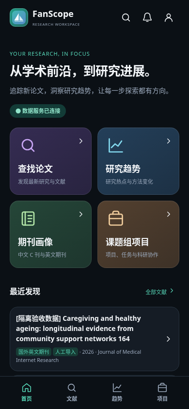

# FanScope 三屏暗色参考图实现与验收

本轮以用户提供的 Dashboard / Research Trends / Literature Discovery 三屏参考图为视觉目标，继续在 PR #7 的原分支修改。三个视图是独立路由，不是三栏页面。保留原有 Lab、桌面端、DeepSeek 修复和论文证据验证。

## 九张指定截图及逐项对比

截图均由 Playwright 从可运行的页面生成；样本明确标记为「隔离验收数据」。不使用参考图中的 1,248、+62%、28.4% 等示意值。

| 截图 | 与参考图对照结果 |
| --- | --- |
| [1. 390px 暗色首页](reference/01-home-390-dark.png) | 深黑海军蓝底、薄荷绿连接状态、左对齐 Hero、紫/蓝/绿/琥珀色 2×2 卡片、搜索/通知/个人入口、最近发现与项目底栏均已实现。保留当前 FanScope SVG Logo，使用默认用户 SVG。 |
| [2. 390px 趋势：主题](reference/02-trends-topics-390-dark.png) | 四类切换中默认选中主题；多色折线与图例颜色对应，环形图使用相同主题配色。数量来自接口；完整页面含增长排行，见 [长图](reference/02-trends-topics-full.png)。 |
| [3. 390px 趋势：方法](reference/03-trends-methods-390-dark.png) | 切换后真实替换为方法分布、方法年度变化和方法排名，不复用主题图冒充。见 [长图](reference/03-trends-methods-full.png)。 |
| [4. 390px 文献发现](reference/04-literature-390-dark.png) | 深色大搜索框、可横向滚动 Chips、薄荷绿选中态、独立圆角文献卡片和真实 DOI 入口。无无效收藏按钮、无未经核验的 SCI/CSSCI 标签。 |
| [5. 390px 论文详情](reference/05-article-390-dark.png) | 独立详情页沿用同一配色；摘要、研究问题、设计、方法、来源、样本与证据均保留，缺失项明确显示证据不足。 |
| [6. 390px 课题组项目](reference/06-projects-390-dark.png) | 项目 Tab 进入现有 Lab；未登录先进入真实登录流程，登录后显示已有业务项目卡片、阶段、负责人和进度。 |
| [7. 320px 暗色首页](reference/07-home-320-dark.png) | 仍为双列双行卡片，标题与副标题自动换行，三个 Header 入口和四个 Tab 保持可触控。 |
| [8. 430px 暗色首页](reference/08-home-430-dark.png) | 保持约 20px 外边距、12px 网格间距、18px 卡片圆角；随宽度增长，卡片自然展开。 |
| [9. 1440px 桌面首页](reference/09-home-1440-dark.png) | 桌面侧栏、总览模块、监测与管理入口保留；未把手机布局套成桌面三栏。 |



## 还原与必要调整

**按图实现的结构与视觉：** `#0B1015` 背景、`#151C25` 表面、`#55D2B4` 强调色，四种功能卡片底色，醒目的中文 Hero，卡片图标与右箭头，顶部导航，固定安全区域底栏，以及主题 / 研究方法 / 样本特征 / 数据来源四个独立内容集合。浅色主题继续可用。

**因真实功能调整的细节：**

- 使用现有品牌 SVG，未制作参考图里的示意头像，也不伪造手机的 9:41、信号和电量栏。
- 搜索实际支持标题、摘要与关键词，所以 placeholder 明确写这些字段；期刊通过真实期刊筛选器查询，不假称支持作者检索。
- 接口没有可靠的统一开放获取标识，也没有收藏存储接口，故不显示假开放获取、SCI/CSSCI 或无效收藏按钮。文献来源展示实际 Crossref / RSS / 人工导入等来源。
- 论文标题、期刊名与证据说明长度不固定；卡片高度随真实内容变化，不截断长标题来强行匹配参考图的示例内容。
- 每张图保留统计范围、有效样本、缺失比例与 AI 证据覆盖，趋势卡片因此比纯示意图略高。增长排行在下方垂直滚动查看。
- 曲线形状、环形图分段、百分比、排行都由当前接口数据决定，不复制参考图的数值或曲线。
- 使用已有 API 支持的观察期，而不提供名为「近5年」但无法准确查询的假选项。选择全部期刊表示合并描述收录主题，不合并或比较中文/英文评级体系；可分别筛选两种期刊。

## 数据与聚合口径

新增纯函数模块 `web/research-visuals.mjs`，不依赖模型或第三方框架，不更改 API / 数据库或既有证据验证。

- **主题趋势 / 分布：** 使用 `/api/research` 的 topic × month 聚合。折线为每个主题的收录次数；一篇可命中多主题。环形图分母是有效年月内的主题标签命中总次数，明确不是互斥论文占比。
- **收录变化：** 最近 12 个完整月份分为前后两个等长六个月窗口，排除当前未结束月份。每期该主题至少 5 条记录，才计算 `(后期−前期)/前期`；月份不完整、零基线或样本不足则显示原因。只描述系统收录变化，不宣称领域真实增长。
- **方法：** 只使用现有接口通过证据验证的方法字段。年度变化按观测月份汇总，不填造未观测年份；多方法占比按方法记录数计算。没有访谈等明确分类时不自行推断。
- **样本：** person、household、institution 等单位独立选择、独立分区间；已知/未知展示论文数量，不把人数与家庭数混加。接口没有按年份关联的样本量，所以年度变化显示明确空状态。
- **来源：** 保留五类已知来源及未知来源；已知但缺日期的记录单列，不错误归入未知。未知记录不生成已知来源时间曲线。

## 自动化与视觉验收

- Node 22 / Node 24 完整测试：各 **133 项通过**，包含 DeepSeek 原修复、既有权限/文档/业务回归，以及主题/方法独立聚合、同窗口增长、零基线与小样本、年度汇总、样本单位和未知来源测试。
- Chromium + WebKit：**99 个流程场景通过**，覆盖 320 / 375 / 390 / 430 / 768 / 1440px、浅深色、导航/历史、实际搜索和筛选、四类图表切换、分页、Lab 权限、上传、人工审核和失败重试；页面错误与意外管理员写请求均为 0。见 [流程结果](screenshots/results.json)。
- 指定九视图额外 **35 项检查通过**，包括双列几何关系、卡片触控与留白、背景色、折线/图例颜色一致、空数据、样本单位、真实登录与横向溢出。见 [视觉检查结果](reference/visual-checks.json)。实际打开并查看了九张浏览器截图，已迭代卡片图标色、图例映射、文献筛选位置、标题/元数据间距。
- Safe Area、软键盘、字体缩放和 reduced motion 为浏览器模拟；未连接实体 iPhone / Android 手机。

CI 运行同样的浏览器验收与九视图截图检查，并上传结果。复现：

```bash
# 新建 work/ 下的隔离库；必须尚不存在，禁止使用业务库。
DATABASE_PATH="$PWD/work/reference-check.sqlite" node --experimental-sqlite api/test/mobile-browser-server.mjs
```

另一个终端（先安装 Playwright 1.62.0 与 Chromium/WebKit）：

```bash
python scripts/mobile-browser-acceptance.py --webkit --output work/reference-browser-results
python scripts/dark-reference-acceptance.py --output work/reference-nine-views
```

所有验收只操作隔离库；外部付费 AI 请求被测试服务拦截。本轮没有更改 `api/src/ai.mjs` 或论文证据规则，没有合并 main、部署生产、恢复暂停批次或重新处理生产的 20 篇论文。
