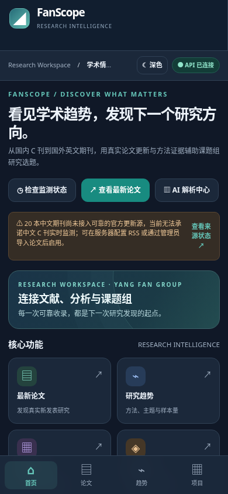
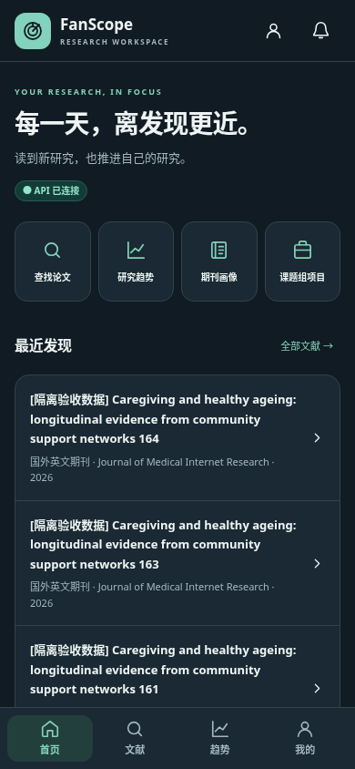
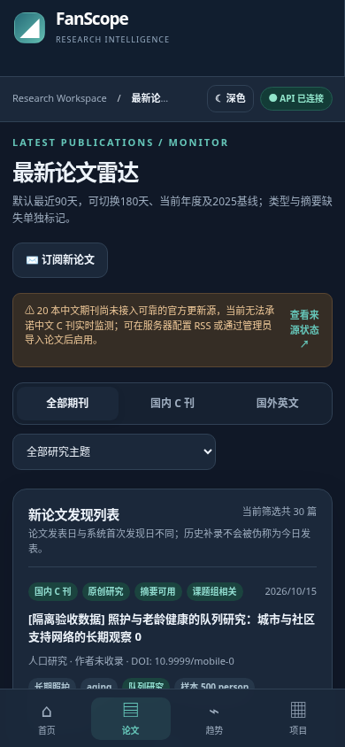
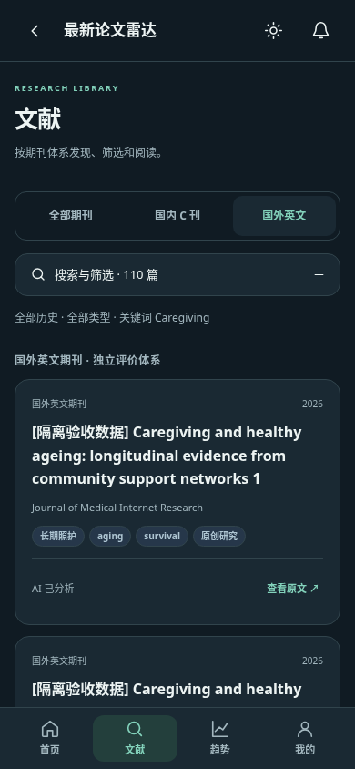
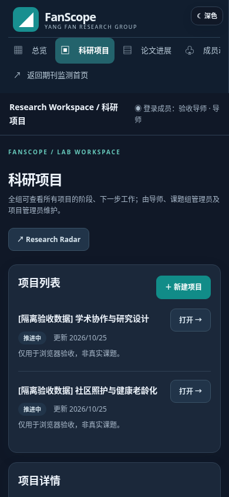
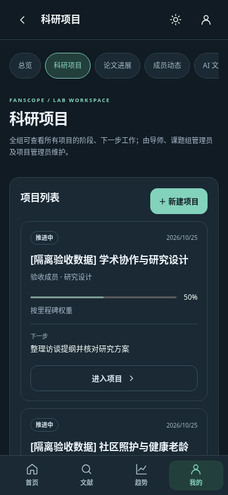

# FanScope Mobile App Experience Redesign

本页记录上一轮 App 化改造。当前三屏暗色参考图实现与最新截图、口径及验收见 [新版视觉报告](../dark-ui-reference/README.md)。

本次移动端改造与 DeepSeek 修复分别提交，继续使用现有 HTML / CSS / JavaScript。移动端改造没有修改业务 API、数据库结构、论文证据规则或 Lab 权限策略。所有截图来自明确标记的隔离验收数据，不是生产论文、项目或成员资料。

## 加载与架构审查

| 审查项 | 改造前实际状态 | 改造后 |
| --- | --- | --- |
| Research 页面入口 | `index.html` 加载 `style.css`、`stage2.css`；未导入 `mobile-ui.js`、未加载 `mobile.css` | 导入共享移动组件并实际加载 `mobile.css` |
| Research 底栏 | `app.js` 与 `stage2.css` 实现一套字符图标导航；未使用文件中另有一套 SVG 导航 | 只保留 `mobile-ui.js` 的 SVG Tab Bar：首页、文献、趋势、我的 |
| Lab 页面入口 | 未加载 `lab-mobile.css`；沿用顶部横向菜单；缺少 `viewport-fit=cover` | 加载共享 tokens / shell 与 Lab 适配样式，启用安全区域 |
| 路由 | Research 只改内存状态；Lab 列表路由已有 history，选中详情未编码到 URL | 页面、筛选、论文详情、Lab 记录详情进入 URL；前进后退与选中状态一致，并恢复列表滚动位置 |
| 样式职责 | 基础 CSS、Stage 2 和未接入的移动文件中存在重复移动实现 | 从旧样式中移除过时移动布局与底栏；移动布局集中在 `mobile.css`，Lab 专有列表、表单适配放在 `lab-mobile.css` |

`mobile-ui.js` 统一 SVG、导航、Header、原生 dialog 和 visualViewport 处理。`mobile.css` 统一背景、表面、文字、边框、强调色、圆角、触控尺寸和安全区域。常规移动断点为 820px；触屏手机的横屏也保留 App 导航。字体使用 rem，支持文字缩放，动效遵循 `prefers-reduced-motion`。

## 关键变化

| 页面 | 改造前 | 改造后 |
| --- | --- | --- |
| 首页 | 桌面标题、模块、KPI、图表纵向堆叠 | 独立移动 Dashboard：欢迎、四个快捷动作、最近收录、研究观察、期刊动态、组会入口 |
| 文献 | 长摘要与证据直接铺在列表，筛选器在列表后 | 独立论文卡片；中英文期刊分组；触屏筛选面板；进入详情阅读摘要、设计、数据与原文证据 |
| 趋势 | 七张复杂图表连续展示 | 单张图表、七个可切换维度、可展开视图；保留有效样本、缺失比例、覆盖率、出处和限制 |
| 项目 | 桌面列表与详情纵向堆叠 | 卡片优先显示负责人、阶段、里程碑进度、最近更新、下一步；详情单独进入与返回 |
| 论文进度 | 横向宽表 | 移动卡片，保留目标与实际投稿期刊、负责人、阶段、下一步；支持继续加载 |
| 组会文档 | 长表单和列表、审核并排逻辑直接缩窄 | 分组导入与文件列表；单独建议详情；明确的确认 / 驳回 / 暂不处理；错误重试保留草稿 |
| 编辑 | 自制遮罩弹窗 | 原生 dialog：焦点限制、Escape、关闭后焦点恢复、键盘高度与安全区域适配 |

文献分页使用已有 API 的 `offset`，避免原先仅增加 `limit`、超过 100 条后无法继续加载的问题。筛选状态和浏览器历史保持同步。私人资料缓存与表单草稿在退出或登录失效后清除，延迟返回的旧账号请求不会填充新账号页面。

## 前后对比（390px）

同一隔离测试 API / 数据集，改造前使用修改前保存的真实前端资产。

| 页面 | 改造前 | 改造后 |
| --- | --- | --- |
| 首页 |  |  |
| 文献 |  |  |
| 项目 |  |  |

## 手机关键页面截图

每个链接均为独立原尺寸截图。

| 页面 | 浅色 | 深色 |
| --- | --- | --- |
| 首页 | [查看](screenshots/390-light-home.png) | [查看](screenshots/390-dark-home.png) |
| 文献 | [查看](screenshots/390-light-literature.png) | [查看](screenshots/390-dark-literature.png) |
| 论文详情与证据 | [查看](screenshots/390-light-article.png) | [查看](screenshots/390-dark-article.png) |
| 研究趋势与覆盖说明 | [查看](screenshots/390-light-trends.png) | [查看](screenshots/390-dark-trends.png) |
| 图表近景 | [查看](screenshots/390-light-trend-chart.png) | [查看](screenshots/390-dark-trend-chart.png) |
| 期刊画像 | [查看](screenshots/390-light-journals.png) | [查看](screenshots/390-dark-journals.png) |
| 登录 | [查看](screenshots/390-light-login.png) | [查看](screenshots/390-dark-login.png) |
| 科研项目 | [查看](screenshots/390-light-projects.png) | [查看](screenshots/390-dark-projects.png) |
| 项目详情 | [查看](screenshots/390-light-project-detail.png) | [查看](screenshots/390-dark-project-detail.png) |
| 项目编辑 | [查看](screenshots/390-light-project-edit.png) | [查看](screenshots/390-dark-project-edit.png) |
| 组会文档 | [查看](screenshots/390-light-documents.png) | [查看](screenshots/390-dark-documents.png) |
| 建议修改与人工审核 | [查看](screenshots/390-light-review.png) | [查看](screenshots/390-dark-review.png) |

补充：[320px 首页](screenshots/320-light-home.png) · [Safe Area / 字体缩放](screenshots/390-light-safe-area.png) · [WebKit 项目详情](screenshots/390-webkit-project.png) · [权限拒绝](screenshots/390-permission-denied.png) · [1440px 桌面](screenshots/1440-light-home.png)。

## 验证与复现

完整 API / 回归测试在 Node 22 与 Node 24 上各通过 128 项，包含此前 DeepSeek 修复测试。最终浏览器全量 99 个场景通过（包括直链返回 / 实时主题切换），均无页面脚本错误或意外管理员写请求。结果逐项记录在 [results.json](screenshots/results.json) 和 [edge-results.json](screenshots/edge-results.json)。

浏览器矩阵覆盖 Chromium 的 320、375、390、430、768、1440px 与浅 / 深色主题，以及 WebKit 的上述六种宽度。检查首页、文献、趋势、期刊、登录、项目、论文进度、组会文档、导航 / 筛选 / 详情 / 返回、图表、原生编辑弹窗、输入和文件草稿、跨 100 条分页、请求失败重试、角色权限及横向溢出。额外验证模拟 iPhone 底部安全区域、字体放大、横屏、visualViewport 软键盘和 reduced motion；隔离样本跨 18 个月，检查密集月份标签的布局。

审核流程通过真实本地 API 验证：人工修改建议 → 模拟一次 503 → 保留修改 → 重试 → 一条批准、一条驳回；同时验证手机文件上传与原始文件权限。导师、组管、成员、文档上传者分别校验实际 API 权限，检查同会话换角色不会残留私人近况。测试禁止意外的管理员写请求，外部 DeepSeek / Crossref 被隔离测试服务拦截。

WebKit / Chromium 是浏览器引擎自动化验证；安全区域和软键盘使用模拟参数，未连接实体 iPhone / Android 手机。

```bash
cd api
npm ci --ignore-scripts
npm test
```

在仓库根目录安装浏览器测试依赖，并使用一个**尚不存在**的 `work/` 下数据库启动本地服务：

```bash
python -m pip install playwright==1.62.0
python -m playwright install --with-deps chromium webkit
mkdir -p work
DATABASE_PATH="$PWD/work/mobile-check.sqlite" node --experimental-sqlite api/test/mobile-browser-server.mjs
```

另一个终端运行：

```bash
python scripts/mobile-browser-acceptance.py --webkit --output work/mobile-browser-results
node scripts/check-sensitive.mjs
git diff --check
```

CI 的独立 `mobile` job 自动执行同一套浏览器验收并上传截图 / 报告。测试服务拒绝已存在的数据库和 `work/` 外的路径；测试资料不会进入实际应用或生产数据库。本次交付不合并 main、不直接部署生产环境、不恢复暂停批次、不重新处理生产环境的 20 篇论文。
